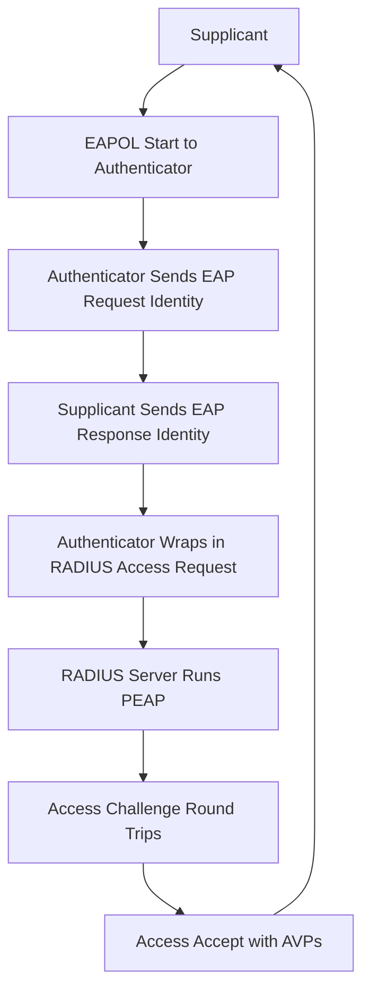

# RADIUS Message Flow in Slow Motion: What Happens Between the Supplicant and the Server

## English

Most explanations of RADIUS describe the three parties (supplicant, authenticator, authentication server) but skip the actual packet-by-packet choreography. Let's walk through a single 802.1X login to a Wi-Fi network using EAP-PEAP, which is the most common enterprise setup. The supplicant (your laptop) sends an EAPOL-Start frame to the authenticator (the wireless access point or switch). The authenticator replies with an EAP-Request/Identity, and the supplicant answers with an EAP-Response/Identity containing a username like alice@example.org. At this point the authenticator has no idea whether alice is legitimate, so it wraps that EAP-Response/Identity inside a RADIUS Access-Request packet and forwards it to the RADIUS server over UDP port 1812.

The RADIUS server sees the username, looks up the realm (example.org), and decides to run PEAP. It sends back an Access-Challenge containing an EAP-Request/PEAP/Start. The authenticator strips the RADIUS encapsulation and forwards the raw EAP payload to the supplicant. The supplicant responds with EAP-Response/PEAP, which the authenticator wraps in another Access-Request. This ping-pong continues for several round trips: the server sends its TLS certificate, the supplicant validates it, they negotiate keys, and finally the supplicant sends its credentials inside the encrypted TLS tunnel. Each round trip is one Access-Request → Access-Challenge pair, and the authenticator is essentially a dumb relay that never sees the plaintext credentials.

When the inner authentication succeeds, the server sends an Access-Accept. This packet is not just a yes/no — it contains AVPs (attribute-value pairs) that instruct the authenticator. A typical Access-Accept for a Wi-Fi login includes Tunnel-Type=VLAN, Tunnel-Medium-Type=IEEE-802, and Tunnel-Private-Group-Id=120, which tells the AP to place the user on VLAN 120. It might also include Session-Timeout=28800 (8 hours) and an EAP-Message attribute carrying the final EAP-Success. The authenticator applies the VLAN, opens the port, and sends EAP-Success to the supplicant. The whole exchange usually takes under a second.

If the credentials are wrong, the server sends Access-Reject instead, and the authenticator refuses to open the port. Note that Access-Reject can also carry AVPs — for example, Reply-Message with a human-readable reason, or a Filter-Id that pushes the user into a captive portal quarantine. If the server is unreachable, the authenticator may fall back to a configured behaviour (reject, or accept into a guest VLAN), which is why failover design matters.

Finally, after the session starts, the authenticator may send Accounting-Request (Start) packets to UDP port 1813, and periodically Interim-Update packets so the server knows the session is still alive. When the user disconnects, an Accounting-Request (Stop) closes the session. This whole choreography — Challenge loops, Accept with AVPs, Accounting — is what people mean when they say RADIUS is a stateful conversation, not a single request/response.

## 中文

大部分 RADIUS 的解釋都會提到三方（supplicant、authenticator、authentication server），但往往略過真正逐個封包的流程。讓我們用最常見的企業設定 —— EAP-PEAP 連接 Wi-Fi —— 走一次完整的 802.1X 登入。Supplicant（你的手提電腦）先向 authenticator（無線 AP 或交換機）送出 EAPOL-Start。Authenticator 回一個 EAP-Request/Identity，supplicant 再以 EAP-Response/Identity 回覆，內含像 alice@example.org 這樣的用戶名。此時 authenticator 完全不知道 alice 是否合法，於是把這個 EAP-Response/Identity 包進 RADIUS Access-Request，經 UDP 1812 端口轉發給 RADIUS 伺服器。

RADIUS 伺服器看到用戶名，查出 realm（example.org），決定採用 PEAP，於是回一個 Access-Challenge，內含 EAP-Request/PEAP/Start。Authenticator 剝掉 RADIUS 外殼，把原始 EAP payload 轉給 supplicant。Supplicant 回 EAP-Response/PEAP，authenticator 再包成另一個 Access-Request。這樣的來回會持續好幾次：伺服器送出 TLS 憑證、supplicant 驗證、雙方協商金鑰，最後 supplicant 在加密的 TLS 隧道內送出帳密。每一輪就是一個 Access-Request → Access-Challenge 配對，而 authenticator 基本上只是個不會看到明文帳密的轉發器。

內層認證成功後，伺服器送出 Access-Accept。這個封包不只是「是／否」——它內含 AVP（attribute-value pairs，屬性值對），用來指示 authenticator。典型的 Wi-Fi 登入 Access-Accept 會帶 Tunnel-Type=VLAN、Tunnel-Medium-Type=IEEE-802、Tunnel-Private-Group-Id=120，告訴 AP 把用戶放到 VLAN 120。也可能帶 Session-Timeout=28800（8 小時），以及一個攜帶最終 EAP-Success 的 EAP-Message 屬性。Authenticator 套用 VLAN、開啟端口、向 supplicant 送出 EAP-Success。整個過程通常不到一秒。

如果帳密錯誤，伺服器改送 Access-Reject，authenticator 就不開端口。要注意 Access-Reject 一樣可以帶 AVP —— 例如 Reply-Message 提供人類可讀的原因，或 Filter-Id 把用戶推進 captive portal 隔離區。如果伺服器連不上，authenticator 會依預先設定的行為處理（拒絕，或放行到 guest VLAN），這就是為什麼容錯設計很重要。

最後，連線開始後 authenticator 會向 UDP 1813 送出 Accounting-Request（Start），並定期送 Interim-Update 讓伺服器知道連線仍然存活。用戶斷線時，再送 Accounting-Request（Stop）結束 session。這一整套流程 —— Challenge 迴圈、帶 AVP 的 Accept、Accounting —— 就是人們說 RADIUS 是有狀態對話、而非單次請求和回應的意思。

## Key Takeaway

A RADIUS login is a multi-round-trip conversation where the authenticator relays EAP messages blindly and the server decides policy through AVPs in Access-Accept or Access-Reject.

## Related Concepts
- EAP-PEAP tunneled authentication
- RADIUS Access-Accept AVPs for VLAN assignment

## Diagram

