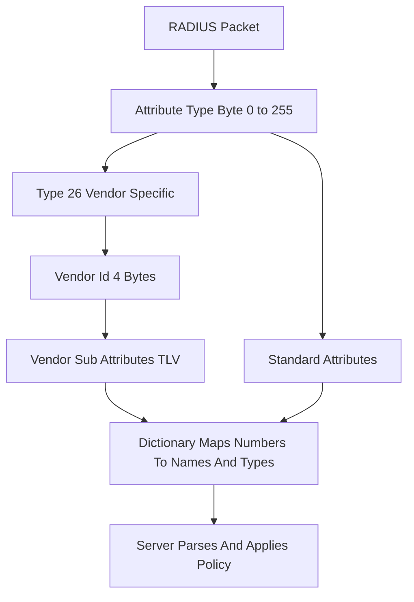

# The RADIUS Dictionary: How Vendors Extend a 1990s Protocol Without Breaking It

## English

RADIUS packets have a rigid structure: a code, an identifier, a length, an authenticator, and then a list of attributes. Each attribute is a Type-Length-Value triple, where the Type is a single byte (0–255). That gives you at most 256 attribute types — and the original RFC 2865 and RFC 2866 already burned through dozens. How do you add vendor-specific features like Cisco's AV-Pair, Juniper's firewall filters, or Aruba's user roles without running out of numbers? The answer is the Vendor-Specific Attribute (VSA), type 26, defined in RFC 2865. A VSA's value contains a 4-byte Vendor-Id (assigned by IANA), followed by one or more vendor-defined sub-attributes that themselves use the Type-Length-Value pattern. So a single attribute type (26) becomes an escape hatch for an unlimited number of vendor extensions.

Every RADIUS implementation ships with a dictionary file — in FreeRADIUS it's a set of files under share/dictionary, in Cisco ISE it's internal — that maps numbers to names. When you write Tunnel-Type = VLAN in a config, the server translates VLAN into the correct integer (13) before putting it on the wire. When a packet arrives with attribute 26 and Vendor-Id 9 (Cisco), the dictionary tells the server how to parse the sub-attributes inside. Without the dictionary, the server would just see opaque bytes. This is why a mismatched or outdated dictionary causes bizarre bugs: your Cisco switch sends Cisco-AVPair but the server's dictionary doesn't know that sub-attribute, so it silently drops or misparses it.

The dictionary also encodes data types. RADIUS attributes can be string, integer, IP address, date, or octets. If the dictionary says Session-Timeout is an integer but your policy writes it as a string, the packet may be malformed or ignored. FreeRADIUS's dictionary syntax allows flags like encrypt=1 (for Tunnel-Password), has_tag=1, and array=1 for attributes that can appear multiple times. These flags control how the server serialises and validates the attribute, and getting them wrong produces errors that are hard to trace because the packet looks fine on the wire.

Standards bodies have also extended the namespace. RFC 6929 introduced the Extended-Type-Length-Value (extended attributes), which use type 241 as a prefix followed by a one-byte extended type, effectively adding another 256 slots (and more via long-extended forms). This was needed because the original 8-bit type field was genuinely exhausted. Modern FreeRADIUS supports RFC 6929, but many older NAS devices do not, so in practice most deployments still rely on VSAs and the classic 1–255 range.

For an operator, the practical lesson is that the dictionary is not a static file you can ignore. When you add a new switch vendor, you must install their dictionary, verify the VSA numbering, and test that attributes round-trip correctly. A common failure mode is a NAS sending an attribute the server doesn't recognise, the server silently discarding it, and the resulting policy applying the wrong VLAN or missing a bandwidth cap. Treat the dictionary as part of your configuration and version-control it alongside your policy.

## 中文

RADIUS 封包結構很固定：code、identifier、length、authenticator，然後是一串屬性。每個屬性是 Type-Length-Value 三元組，Type 只佔一個 byte（0–255），所以最多只有 256 種屬性類型 —— 而最初的 RFC 2865 和 RFC 2866 已經用掉幾十個。那要怎麼加入 Cisco 的 AV-Pair、Juniper 的 firewall filter、Aruba 的 user role 這類廠商專屬功能，而不把編號用光？答案是 RFC 2865 定義的 Vendor-Specific Attribute（VSA，類型 26）。VSA 的值包含一個由 IANA 分配的 4 byte Vendor-Id，後面接一或多個廠商自訂的子屬性，子屬性本身也用 Type-Length-Value 格式。於是單一屬性類型（26）就變成一個逃生門，可容納無限多種廠商擴充。

每個 RADIUS 實作都會附帶 dictionary 檔案 —— FreeRADIUS 是 share/dictionary 下的一組檔案，Cisco ISE 則是內建 —— 把數字對應到名稱。當你在設定裡寫 Tunnel-Type = VLAN，伺服器會先把 VLAN 翻成正確的整數（13）才放上網路。當封包帶著屬性 26 和 Vendor-Id 9（Cisco）進來，dictionary 告訴伺服器怎麼解析裡面的子屬性。沒有 dictionary，伺服器只會看到一堆不透明的 bytes。這就是為什麼 dictionary 版本不對或過舊會造成莫名其妙的 bug：你的 Cisco 交換機送 Cisco-AVPair，但伺服器的 dictionary 不認識那個子屬性，於是靜靜地丟棄或誤解。

Dictionary 也記錄資料型別。RADIUS 屬性可以是 string、integer、IP address、date 或 octets。如果 dictionary 說 Session-Timeout 是 integer，但你的政策寫成字串，封包可能變成畸形或被忽略。FreeRADIUS 的 dictionary 語法支援 encrypt=1（用於 Tunnel-Password）、has_tag=1、array=1 等旗標，讓同一屬性可重複出現。這些旗標控制伺服器如何序列化和驗證屬性，弄錯會產生難以追查的錯誤，因為封包在網路上看起來完全正常。

標準組織也擴充了命名空間。RFC 6929 引入 Extended-Type-Length-Value（擴充屬性），用類型 241 當前綴，後接一個 byte 的 extended type，等於再加 256 個位置（long-extended 形式還能更多）。這是因為原本 8-bit 的 type 欄位真的用完了。現代 FreeRADIUS 支援 RFC 6929，但許多舊 NAS 不支援，所以實務上大部分部署仍靠 VSA 和傳統的 1–255 範圍。

對維運人員來說，實際的教訓是：dictionary 不是可以忽略的靜態檔案。當你新增一家交換機廠商，必須安裝他們的 dictionary、確認 VSA 編號、測試屬性來回是否正確。常見的失敗模式是 NAS 送出伺服器不認識的屬性，伺服器默默丟棄，結果政策套用了錯的 VLAN 或漏掉頻寬上限。請把 dictionary 當成設定的一部分，和你的政策一起做版本控制。

## Key Takeaway

The RADIUS dictionary is the translation layer between human-readable attribute names and the 8-bit on-wire types, and vendor extensions survive only because type 26 (VSA) and RFC 6929 extended types provide escape hatches.

## Related Concepts
- Vendor-Specific Attribute (VSA)
- RFC 6929 extended attributes

## Diagram

