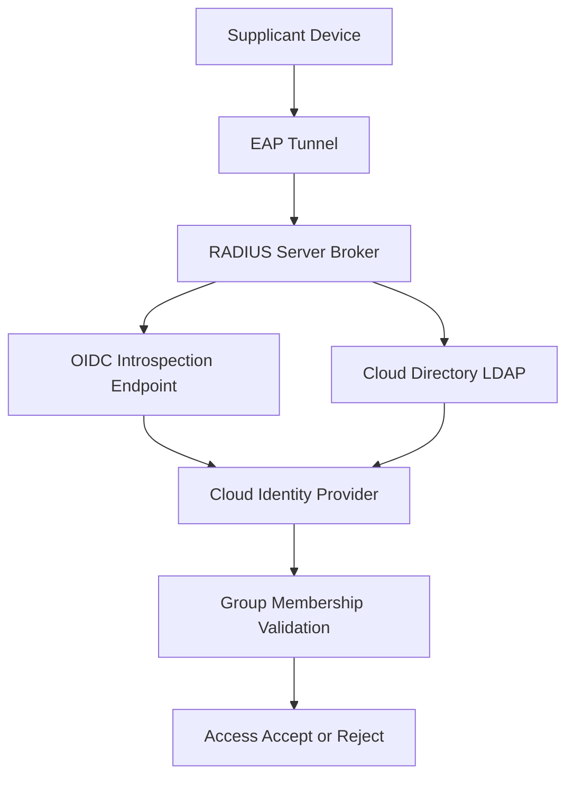

# RADIUS in the Cloud Era: Cloud-Native NAC, Identity Federation, and the Shift to SAML/OIDC

## English

RADIUS was designed in an era of on-premises switches and local user databases. Today, many organisations run their identity in a cloud IdP (Okta, Entra ID, Google Workspace), their network in a cloud or hybrid environment, and their users on devices that never touch a corporate LAN. This creates a tension: RADIUS speaks username/password or EAP, while modern identity speaks SAML assertions and OIDC tokens. How do you bridge them? The common pattern is a RADIUS server that acts as a SAML/OIDC relying party — it terminates the EAP tunnel locally, then calls the IdP's API to validate credentials or fetch group membership. This is sometimes called 'RADIUS to IdP brokering'. FreeRADIUS can do it with the rlm_rest module calling an OIDC introspection endpoint, or with rlm_ldap against a cloud directory that syncs from the IdP.

A second pattern is certificate-based EAP-TLS with cloud-managed certificates. Instead of a password, the supplicant presents a client certificate issued by a cloud PKI (e.g., a SCEP or EST service tied to the IdP). The RADIUS server validates the certificate chain and maps the certificate's SAN or subject to a user identity. This eliminates password sprawl and works well for managed devices, but requires the device to be enrolled before it can join the network — a chicken-and-egg problem solved by onboarding SSIDs or cloud MDM enrolment flows.

A third pattern is the 'cloud NAC' or 'network access broker' — a SaaS service that receives RADIUS requests over RadSec (RADIUS over TLS, port 2083) from on-premises or cloud network gear, evaluates policy in the cloud, and returns Access-Accept/Reject. Vendors like Cisco, Aruba, and Juniper offer cloud management planes that integrate with this. The advantage is centralised policy across sites and clouds; the disadvantage is that every login now depends on internet connectivity to the cloud provider, so you need local caching or a fallback path. This is why many deployments keep a local RADIUS server as a secondary and use the cloud as primary, with the NAS configured to fail over.

A fourth shift is the rise of 802.1X for IoT and headless devices. These devices often can't do EAP-TLS with a user certificate, so they use MAB (MAC Authentication Bypass) — the switch sends the MAC address as both username and password to RADIUS. That's weak on its own, so modern designs pair MAB with profiling (the RADIUS server or a companion system fingerprints the device via DHCP, LLDP, or TCP behaviour) and then apply a restrictive VLAN until the device is identified. Cloud NAC platforms excel here because they can correlate telemetry across many sites.

Finally, there's a quiet but important shift: some cloud-first organisations are skipping RADIUS entirely for user Wi-Fi and using captive portals backed by OIDC, reserving RADIUS for 802.1X on wired ports and IoT. This isn't because RADIUS is obsolete — it's because the operational model of a cloud IdP favours browser-based flows for humans. The lesson is that RADIUS remains the lingua franca of network access control at layer 2, but it increasingly sits behind an abstraction layer that translates between the packet-level world and the token-level world of modern identity.

## 中文

RADIUS 誕生於一個以在地交換機和本機使用者資料庫為主的年代。今天，許多組織把身分放在雲端 IdP（Okta、Entra ID、Google Workspace），網路在雲或混合環境，使用者的裝置根本不會接觸企業 LAN。這就產生張力：RADIUS 講的是帳密或 EAP，現代身分講的是 SAML assertion 和 OIDC token。要怎麼接起來？常見模式是讓 RADIUS 伺服器扮演 SAML/OIDC 的 relying party —— 它在本機終結 EAP 隧道，再呼叫 IdP 的 API 驗證帳密或取得群組成員資格。這有時叫「RADIUS 到 IdP 的仲介」。FreeRADIUS 可以用 rlm_rest 模組呼叫 OIDC introspection endpoint，或用 rlm_ldap 對接一個從 IdP 同步過來的雲端目錄。

第二種模式是以憑證為基礎的 EAP-TLS，配合雲端管理的憑證。Supplicant 不用密碼，而是出示由雲端 PKI（例如繫結 IdP 的 SCEP 或 EST 服務）簽發的使用者端憑證。RADIUS 伺服器驗證憑證鏈，並把憑證的 SAN 或 subject 對應到使用者身分。這消除了密碼散落問題，對受管裝置很有效，但要求裝置先完成註冊才能連網 —— 這是雞生蛋、生蛋的問題的問題，通常用 onboarding SSID 或雲端 MDM 註冊流程解決。

第三種模式是「雲端 NAC」或「網路存取仲介」—— 一個 SaaS 服務，透過 RadSec（RADIUS over TLS，埠 2083）接收來自地端或雲端網路裝置的 RADIUS 請求，在雲端評估政策，回傳 Access-Accept/Reject。Cisco、Aruba、Juniper 等廠商都提供與此整合的雲端管理平面。優點是跨站點、跨雲集中政策；缺點是每次登入都依賴到雲端供應商的網際網路連線，因此需要本機快取或備援路徑。這就是為什麼許多部署保留一臺地端 RADIUS 當次要，雲端當主要，並在 NAS 設定 failover。

第四個轉變是 802.1X 用在 IoT 和無頭裝置上。這些裝置通常無法用使用者憑證做 EAP-TLS，於是採用 MAB（MAC Authentication Bypass）—— 交換機把 MAC 位址同時當帳號和密碼送給 RADIUS。這本身很弱，所以現代設計把 MAB 搭配 profiling（RADIUS 伺服器或配套系統透過 DHCP、LLDP 或 TCP 行為辨識裝置指紋），先放進限制性 VLAN，等裝置被識別後再調整。雲端 NAC 平臺在這方面特別擅長，因為它們能跨多站點關聯 telemetry。

最後，有一個安靜但重要的轉變：一些雲端優先的組織在使用者 Wi-Fi 上乾脆跳過 RADIUS，改用由 OIDC 支撐的 captive portal，只把 RADIUS 留給有線埠的 802.1X 和 IoT。這不是因為 RADIUS 過時，而是因為雲端 IdP 的營運模式對人類偏好瀏覽器流程。教訓是：RADIUS 仍然是 layer 2 網路存取控制的通用語言，但它越來越常位於一層抽象之後，該抽象負責在封包層世界與現代身分的 token 層世界之間翻譯。

## Key Takeaway

RADIUS still anchors layer-2 access control, but in cloud-first environments it increasingly acts as a broker between EAP and SAML/OIDC identity, with RadSec and cloud NAC platforms bridging the packet world and the token world.

## Related Concepts
- RadSec to cloud NAC
- SAML/OIDC identity brokering

## Diagram

