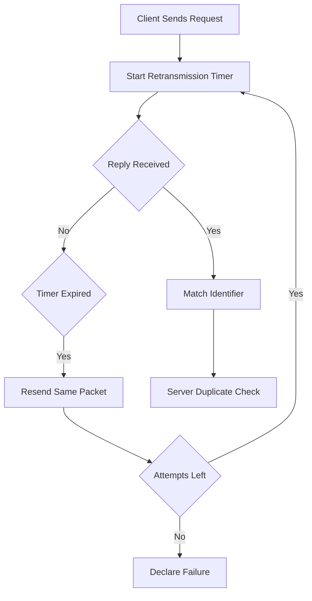

# Retransmission, Timeouts, and Duplicate Detection: RADIUS Reliability on Top of UDP

## English

RADIUS runs over UDP, which means the protocol itself has to supply the reliability that TCP would normally provide. Every RADIUS client — a switch, a wireless controller, a VPN concentrator — keeps a retransmission timer per request. If no reply arrives before the timer fires, the client resends the identical packet, byte for byte, including the same Identifier field. The timer typically doubles on each retry (an exponential backoff), and after a configured number of attempts the request is declared failed and the user is denied or the session is dropped. This is why a client that gives up too quickly produces mysterious "authentication failed" errors even though the server is healthy — it was simply slow, or a firewall silently dropped the reply.

The Identifier is a single byte (0-255) that the client assigns to each outstanding request. Because the client may have many requests in flight, it must avoid reusing an Identifier while a request bearing that Identifier is still unanswered. A server echoes the Identifier back in its response so the client can match reply to request. If the client has more than 256 simultaneous in-flight requests to one server, it must queue or throttle — a real constraint that shows up in high-density Wi-Fi deployments during a morning rush when thousands of supplicants associate at once.

Because UDP can duplicate packets (a retransmission may arrive after the original was already processed), the server must detect and suppress duplicates. The classic approach is a duplicate-detection cache keyed on the combination of source address, source port, Identifier, and the request authenticator. If an identical request arrives while the original is still being processed, the server can either drop it or, better, hold it briefly and replay the cached response once available. Without this, a slow backend (say, an LDAP lookup that takes three seconds) plus an impatient client retransmitting every second would trigger three or four parallel authentications for the same user — hammering the directory and potentially tripping account lockout counters.

The practical lesson is that timeout values are a tuning problem, not a fixed truth. The client's retransmit interval must be long enough to cover the server's worst-case processing time (including backend latency) but short enough that a genuinely dead server is detected before the user gives up. A common operational mistake is setting the client timeout to one or two seconds while the backend occasionally takes five; the fix is usually to speed up the backend or add caching, not to shorten the timer further. Monitoring retransmission rates per client is one of the most useful health signals in a RADIUS deployment, because rising retransmits predict user-visible failures before they happen.

Finally, note that these mechanics are invisible in a lab with a fast local server and a single client, which is exactly why they bite in production. A useful mental model: RADIUS over UDP is like sending postcards with a return address and a serial number, and keeping a photocopy so you can mail it again if no reply comes. The protocol's simplicity is what made it ubiquitous, but that simplicity pushes reliability, ordering, and duplicate suppression up into the application layer — where you, the operator, are responsible for getting them right.

## 中文

RADIUS 行在 UDP 之上，即係話 TCP 本來會提供嘅可靠性，要由協定自己補返。每一個 RADIUS 客戶端——交換機、無線控制器、VPN 閘道——都會為每個請求維護一個重傳計時器。如果計時器到期都未收到回覆，客戶端就會將同一個封包原封不動再送一次，連 Identifier 欄位都一模一樣。計時器通常每次重試就倍增（即指數式退避），重試到某個次數之後就判定失敗，用戶被拒或者連線被中斷。所以有時客戶端設得太心急，就會出現莫名其妙的「認證失敗」，其實伺服器好健康，只係慢咗，或者防火牆靜靜雞丟咗個回覆。

Identifier 係一個 byte（0 至 255），由客戶端為每個未完成嘅請求指派。因為客戶端可能同時有好多請求在途，佢必須避免在一個請求未回覆之前重複使用同一個 Identifier。伺服器回應時會照抄返個 Identifier，客戶端就靠佢配對請求和回覆。如果客戶端對同一部伺服器同時有超過 256 個在途請求，就要排隊或者限流——呢個係真實限制，朝早返工返學嗰陣幾千部裝置同時連 Wi-Fi，就會撞正呢個問題。

因為 UDP 會重複送包（重傳嘅包可能喺原本嗰個已經處理完之後才到），伺服器必須偵測同抑制重複。經典做法係用一個重複偵測快取，以來源位址、來源埠、Identifier 同請求 authenticator 嘅組合做 key。如果同一個請求喺原本仲處理緊嘅時候又到，伺服器可以選擇丟棄，或者更好嘅做法係短暫保留，等結果出咗就重播快取嘅回應。冇呢層保護嘅話，一個慢後端（例如 LDAP 查詢要三秒）加上每秒重傳一次嘅心急客戶端，就會為同一個用戶觸發三、四個並行認證——狂打目錄服務，甚至觸發帳戶鎖定計數器。

實務上嘅教訓係：timeout 數值係調校問題，唔係永恆真理。客戶端嘅重傳間隔要長過伺服器最壞情況嘅處理時間（包括後端延遲），但又要短到真係死機嗰陣可以在用戶放棄之前偵測到。常見嘅操作錯誤係客戶端 timeout 設一、兩秒，但後端偶爾要五秒；正確嘅修法通常係加快後端或者加快取，而唔係再縮短計時器。監察每個客戶端嘅重傳率，係 RADIUS 部署入面最有用嘅健康指標之一，因為重傳率上升通常預示住用戶可見嘅故障即將出現。

最後要留意，呢啲機制喺實驗室（本機快伺服器、單一客戶端）係完全睇唔到嘅，所以先會喺生產環境咬你一口。一個好用嘅心智模型：RADIUS over UDP 就好似發明信片，上面寫住回郵地址同序號，自己留返張影印本，冇回音就再寄一次。協定嘅簡單正正係它無處不在嘅原因，但呢份簡單就將可靠性、次序同去重推咗上應用層——即係話，呢啲嘢要你，作為營運者，自己搞掂。

## Key Takeaway

RADIUS pushes retransmission, timeout tuning, and duplicate suppression onto the application layer, so operators must treat client timers and server-side deduplication as first-class reliability concerns.

## Related Concepts
- UDP retransmission and exponential backoff
- Duplicate request detection cache

## Diagram

