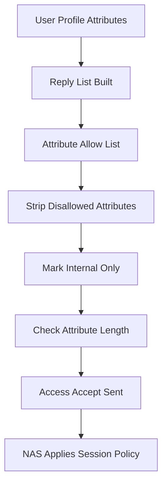

# Attribute Filtering and Reply Sanitisation: Why the Server Must Prune What It Sends Back

## English

A RADIUS server does not just say yes or no — it returns a bundle of attributes that the network access device (NAS) uses to shape the session: a VLAN tag, a tunnel type, a session timeout, a bandwidth policy, an IP pool name, a filter identifier. This makes the reply a kind of configuration payload, and like any configuration payload it can be dangerous if it carries more than the NAS can safely interpret. Consider a NAS that receives a vendor-specific attribute it does not recognise, or a Tunnel-Type value it supports only for a different tunnel medium. Well-behaved devices ignore unknown attributes, but not all do, and some have historically mis-parsed malformed or unexpected values in ways that affected the whole device rather than one session.

The defensive posture is attribute filtering on the server: an explicit allow-list of which attributes may appear in an Access-Accept for a given client, realm, or user class, with everything else stripped before transmission. FreeRADIUS, for example, supports per-client and per-realm policy that can delete attributes from the reply list, and it ships with ways to mark attributes as internal-only so they never leave the server. The principle is the same as output encoding in web security: never emit data you did not intend to emit, even if the downstream consumer is supposed to ignore it. A misconfigured user profile that accidentally includes an administrative attribute should fail closed, not leak a privilege hint to a device that might honour it.

There is a second, subtler reason to prune replies: attribute length and packet size. A RADIUS attribute's length field is a single byte, so an individual attribute's value is limited to 255 octets minus the two-byte header. Long values — a big certificate blob, a long filter list, a verbose group membership string — must be split across multiple attributes of the same type, and the receiver has to reassemble them in order. If the total reply exceeds the link MTU, the server must either fragment at the IP layer (which some NASes handle poorly) or rely on EAP fragmentation at a higher layer. Sending a lean reply reduces the chance of hitting these edges. Some deployments also run into the historic 4096-byte practical ceiling for a single RADIUS packet, which is one reason EAP methods that carry large certificates need fragmentation support.

Filtering also matters for accounting and for logging hygiene. Accounting requests can contain calling-station identifiers (MAC addresses), framed IP addresses, and sometimes user-identifying strings. A server that forwards accounting to a billing system or a SIEM should scrub fields that the downstream system has no business seeing, both for privacy and to avoid schema surprises. Similarly, when a reply is proxied across an organisational boundary, the proxy should apply its own filter rather than trusting the upstream realm to have been careful. Trust boundaries in RADIUS are per-hop, not end-to-end, so each hop owns its own output policy.

A practical way to build this discipline is to treat the reply attribute list as a schema with a contract: for each class of client (wired switch, wireless controller, VPN gateway, legacy NAS), document exactly which attributes are expected, and configure the server to strip anything outside that set. Then test with a deliberately over-permissive user profile to confirm the filter actually fires. This turns an invisible risk — a stray attribute that happens to be honoured by one device model — into a visible, testable rule. It is unglamorous work, but it is the difference between a RADIUS deployment that fails predictably and one that fails in ways nobody can reproduce.

## 中文

RADIUS 伺服器唔止係答「得」或者「唔得」——佢會回傳一大堆屬性，網路接入裝置（NAS）就用呢啲屬性去塑造條 session：VLAN 標籤、隧道型別、session 逾時、頻寬政策、IP pool 名稱、filter 識別碼。即係話，個回覆本身就係一種設定負載，而同任何設定負載一樣，如果佢帶住啲 NAS 唔能夠安全解讀嘅嘢，就會有危險。想像一部 NAS 收到一個佢唔認識嘅廠商專用屬性，或者一個佢只喺另一種隧道媒介先支援嘅 Tunnel-Type 值。行為良好嘅裝置會忽略未知屬性，但唔係所有裝置都咁乖，歷史上亦有一些裝置會錯誤解析畸形或者預期之外嘅值，影響到整部機而唔止一條 session。

防禦性嘅做法係喺伺服器做屬性過濾：為每個客戶端、realm 或者使用者類別，訂立一份明確嘅允許清單，講明 Access-Accept 入面可以出現邊啲屬性，其餘一律喺送出之前剝走。以 FreeRADIUS 為例，佢支援 per-client 同 per-realm 政策，可以喺回覆清單度刪除屬性，亦有機制將屬性標記為只供內部使用，確保佢哋永遠唔會離開伺服器。呢個原則同網頁安全嘅輸出編碼一樣：唔應該送出嘅資料就唔好送，即使下游消費者理論上應該忽略佢。一個設定錯誤嘅使用者 profile 唔小心包咗個管理屬性，應該要 fail closed，而唔係漏個許可權提示畀一部可能真係會照做嘅裝置。

修剪回覆仲有第二個更微妙嘅原因：屬性長度同封包大小。RADIUS 屬性嘅長度欄位只有一個 byte，所以單一屬性嘅值上限係 255 octets 減兩個 byte 標頭。長值——一大嚿證書、一長串 filter、一抽好長嘅 group 成員字串——必須拆散喺多個同型別屬性度，接收方要按次序重組。如果整個回覆超過 link MTU，伺服器就要喺 IP 層分片（部分 NAS 處理得好差），或者倚賴更高層嘅 EAP 分片。送出精簡嘅回覆可以減少撞到呢啲邊界嘅機會。有啲部署亦會撞到單一 RADIUS 封包歷史上約 4096 bytes 嘅實際上限，呢個亦係為何攜帶大型證書嘅 EAP 方法需要分片支援嘅原因之一。

過濾對 accounting 同日誌衛生亦同樣重要。Accounting 請求可能包含 calling-station identifier（MAC 位址）、framed IP 位址，有時仲有使用者識別字串。如果伺服器要將 accounting 轉發去計費系統或者 SIEM，就應該洗走下游系統無權見到嘅欄位，既為私隱，亦避免 schema 意外。同樣道理，當回覆要經代理跨越組織邊界，個代理應該套用自己嘅過濾，而唔係信任上游 realm 一定好小心。RADIUS 嘅信任邊界係逐跳計，唔係端到端，所以每一跳都要為自己嘅輸出政策負責。

建立呢種紀律嘅實用方法，係將回覆屬性清單當成一種有合約嘅 schema：為每一類客戶端（有線交換機、無線控制器、VPN 閘道、舊式 NAS）記錄清楚預期會出現邊啲屬性，並設定伺服器剝走集合以外嘅一切。然後用一個刻意過度寬鬆嘅使用者 profile 去測試，確認過濾器真係會觸發。咁樣就可以將一個隱形風險——一個咁啱得某款裝置會照做嘅多餘屬性——變成可見、可測試嘅規則。呢啲工作唔起眼，但正正係「可預期地失敗」同「無人重現到點失敗」之間嘅分別。

## Key Takeaway

Treat the RADIUS reply attribute list as a per-client allow-list schema and strip everything else, because an over-permissive reply is a configuration injection into the NAS.

## Related Concepts
- Attribute-Value Pair length limits and fragmentation
- Per-client reply policy in FreeRADIUS

## Diagram

