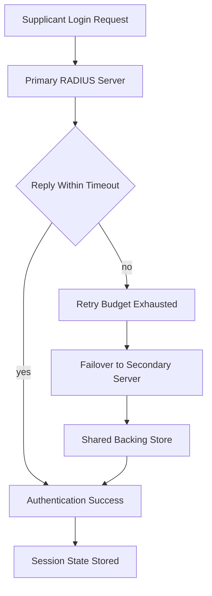

# High Availability and Load Balancing: Making the AAA Tier Survive Failure

## English

A RADIUS server is a single point of failure for every network login in its scope: if it is down, new supplicants cannot associate, VPN users cannot connect, and 802.1X reauthentications fail. That makes availability engineering a core part of running RADIUS, not an afterthought. The basic pattern is to configure each NAS with more than one RADIUS server and to rely on the client's own failover logic: send to the primary, and if no reply arrives within the timeout and retry budget, switch to the secondary. This is simple and works, but it has a subtlety — the client only fails over after it has exhausted its retries, so the failover latency is the timeout multiplied by the retry count. Tuning those values is a direct trade-off between fast failover and spurious failover caused by transient slowness.

The server side is harder than the client side. Two servers that both hold user data must agree on that data, or authentications will succeed on one and fail on the other. Historically this meant replicating a backing store — an LDAP directory, an SQL database — and pointing both RADIUS servers at it, so the RADIUS tier itself stays stateless and any server can answer any request. Statelessness is the property you want: it lets you add servers, remove servers, and restart them without coordinating sessions. Where state is unavoidable — for example, EAP-TLS session resumption caches, or the tracking of in-progress Access-Challenge conversations — you need either sticky routing (so the same client reaches the same server for the duration of a conversation) or a shared state store.

Load balancing RADIUS is trickier than load balancing HTTP because the transport is UDP and the request carries no session cookie. A simple UDP load balancer that hashes on source IP will pin a whole NAS to one server, which is fine for spreading many NASes but useless for spreading one very busy NAS. Hashing on the RADIUS Identifier is worse, because identifiers repeat. Some deployments use a dedicated RADIUS proxy tier in front of the servers precisely because the proxy understands the protocol: it can inspect the User-Name realm, apply per-realm routing, retry against an alternate home server, and maintain its own duplicate-detection and failover state. That is a heavier architecture, but it centralises the hard parts in one place instead of pushing them into every NAS configuration.

Health checking deserves its own thought. A TCP connect check is meaningless for a UDP service. A better check is to send a synthetic Access-Request with a known test account and require a valid Access-Accept (or a deliberate Access-Reject) within a tight deadline; anything else marks the server unhealthy. Be careful that the health check itself does not pollute accounting or trigger lockout counters for the test account. Also consider what "healthy" means when the backend is degraded: a server that answers in 50 milliseconds when the directory is fine and 8 seconds when it is not is technically alive but functionally useless, and a latency-aware health check catches that where a simple liveness probe does not.

Finally, plan for the failure modes that HA does not fix. Split-brain in a shared database, a certificate expiry that takes out EAP-TLS on all servers simultaneously, a configuration push that changes a shared secret on the servers before the NASes — these are correlated failures that redundancy cannot mask. The mitigation is operational: stage configuration changes, monitor certificate expiry well ahead of time, and keep a documented break-glass path so that a wired port with a static fallback VLAN or a local credential exists when the AAA tier is unreachable. High availability is not just two boxes; it is the combination of redundant servers, stateless design, honest health checks, and a human plan for the day the redundancy itself fails.

## 中文

RADIUS 伺服器係範圍內每一次網絡登入嘅單點故障：佢一死，新 supplicant 連唔到，VPN 用戶連唔到，802.1X 重新認證亦會失敗。所以可用性工程係營運 RADIUS 嘅核心部分，唔係後補嘅事。基本模式係為每部 NAS 設定多過一部 RADIUS 伺服器，倚賴客戶端自己嘅故障轉移邏輯：送去主要伺服器，如果喺 timeout 同重試預算之內都冇回覆，就轉去次要伺服器。呢個做法簡單又行得通，但有個微妙位——客戶端要耗盡重試次數先會轉移，所以轉移延遲等於 timeout 乘重試次數。調校呢啲數值，就係喺「快速轉移」同「因為短暫變慢而誤轉移」之間直接取捨。

伺服器嗰邊比客戶端難。兩部都持有用戶資料嘅伺服器必須對資料有共識，否則認證會喺一部成功、喺另一部失敗。歷史上嘅做法係複製一個後端儲存——LDAP 目錄、SQL 資料庫——兩部 RADIUS 伺服器都指向佢，令 RADIUS 層本身保持無狀態，任何一部都可以答任何請求。無狀態正正係你想要嘅性質：可以加機、減機、重啟，都唔需要協調 session。喺避唔開狀態嘅地方——例如 EAP-TLS session resumption 快取，或者追蹤進行中嘅 Access-Challenge 對話——你就要麼用 sticky routing（令同一個客戶端喺整段對話期間都去同一部伺服器），要麼用共享狀態儲存。

負載平衡 RADIUS 比負載平衡 HTTP 棘手，因為傳輸係 UDP，而請求冇 session cookie。一個簡單嘅 UDP 負載平衡器如果按來源 IP 做 hash，就會將整部 NAS 釘死喺一部伺服器——對於分散好多部 NAS 冇問題，但對於分散一部超級繁忙嘅 NAS 就完全冇用。按 RADIUS Identifier 做 hash 更差，因為 identifier 會重複。有啲部署喺伺服器前面加一層專用 RADIUS 代理，正正因為代理明白協定：佢可以檢查 User-Name 嘅 realm、按 realm 路由、向備用 home server 重試，並維護自己嘅去重同故障轉移狀態。呢個架構重啲，但就將難嘅部分集中喺一個地方，而唔係推去每部 NAS 嘅設定度。

健康檢查值得獨立思考。對 UDP 服務嚟講，TCP connect 檢查毫無意義。更好嘅檢查係送一個合成 Access-Request，用一個已知嘅測試帳戶，要求喺緊迫嘅期限內收到有效嘅 Access-Accept（或者刻意嘅 Access-Reject）；其他情況一律標記為不健康。要小心健康檢查本身唔好汙染 accounting，或者觸發測試帳戶嘅鎖定計數器。亦要思考後端退化時「健康」係咩意思：一部伺服器喺目錄正常時 50 毫秒回應、目錄唔正常時 8 秒回應，技術上仲活住，但功能上已經冇用；延遲感知嘅健康檢查捉得到呢種情況，簡單嘅存活探測就捉唔到。

最後，要為 HA 解決唔到嘅故障模式做準備。共享資料庫嘅腦裂、一張證書到期令所有伺服器嘅 EAP-TLS 同時死、一次設定推送喺 NAS 之前就先改咗伺服器上嘅共享密鑰——呢啲都係相關性故障，冗餘遮蓋唔到。緩解方法係營運層面：分階段推送設定、提早好多監察證書到期、並保留一份有文件記錄嘅 break-glass 路徑，確保 AAA 層不可達嗰陣，仍然有一個有靜態 fallback VLAN 嘅有線埠或者本機憑證可以用。高可用唔止係兩部機；佢係冗餘伺服器、無狀態設計、誠實嘅健康檢查，同埋一個為「冗餘本身都死埋」嗰日而設嘅人手計劃，四樣嘢加埋。

## Key Takeaway

RADIUS high availability is achieved by keeping the server tier stateless against a shared backend, tuning client failover timers deliberately, and pairing redundancy with protocol-aware health checks and a break-glass plan.

## Related Concepts
- Stateless server design and shared backend stores
- Protocol-aware RADIUS proxy load balancing

## Diagram

