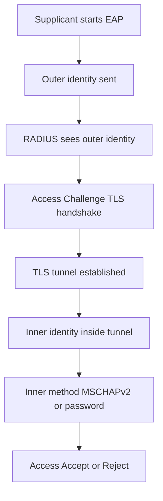

# Tunneling EAP: PEAP and TTLS Hide the Inner Identity Inside TLS

## English

EAP on its own is just a framework: it defines a container for authentication methods but says little about protecting the conversation. In 802.1X Wi-Fi and wired deployments, the two workhorses are PEAP (Protected EAP) and EAP-TTLS. Both solve the same problem: the outer EAP exchange is visible to anyone listening on the wireless medium, so the supplicant first establishes a TLS tunnel to the RADIUS server, then runs the real authentication (usually MS-CHAPv2 or a password check) inside that tunnel. The outer identity is a throwaway string like anonymous@example.edu, while the real username travels encrypted inside the TLS session.

The critical teaching point is the two-phase identity. When the supplicant begins, the RADIUS server sees only the outer identity. It can use that to pick a virtual server or a realm (for example, route anonymous@example.edu to the staff realm), but it cannot decide whether to grant access until the inner identity arrives. This is why the Access-Challenge response matters: the server sends an EAP-Request asking for the next TLS handshake fragment or the inner credentials, and the supplicant replies. From the NAS perspective this looks like a multi-round conversation, not a single Access-Request/Access-Accept pair.

PEAP and TTLS differ in packaging. PEAP wraps EAP inside the TLS tunnel, so the inner method is itself an EAP method (commonly EAP-MSCHAPv2). TTLS tunnels legacy authentication protocols such as PAP, CHAP, or MS-CHAPv2 as length-prefixed AVPs inside TLS, which lets it carry older credential stores without changing them. TTLS is more flexible; PEAP is more tightly specified and tends to be the default on Windows and many supplicants.

One subtlety: the server certificate is the only thing protecting the client from a rogue access point. If the supplicant does not validate the RADIUS server's certificate against a trusted CA and check the expected server name, an attacker can stand up a fake AP and harvest the inner credentials. Most enterprise deployments therefore push a CA certificate and a server-name match rule to clients via MDM or Group Policy. The RADIUS server side also needs a server certificate whose subject or SAN matches what clients expect.

Operationally, PEAP/TTLS move a lot of work to the RADIUS server: TLS handshakes, session caching, and per-connection state. A busy Wi-Fi controller can open thousands of EAP sessions per minute during a shift change, so the AAA tier needs enough CPU and memory, and TLS session resumption (session IDs or tickets) matters for latency. Also remember that the outer identity is what appears in logs unless you enable inner-identity logging, which is why accounting and troubleshooting often look anonymous until you dig in.

## 中文

EAP 本身只是一個框架：它定義了認證方法的容器，但對「如何保護這段對話」著墨不多。在 802.1X 的 Wi-Fi 與有線部署中，兩大主力是 PEAP（Protected EAP）與 EAP-TTLS。兩者解決同一個問題：外層 EAP 交換在無線媒介上人人可見，所以 supplicant 先與 RADIUS 伺服器建立 TLS 隧道，再把真正的認證（通常是 MS-CHAPv2 或密碼檢查）放進隧道內執行。外層身分只是一個拋棄式字串，例如 anonymous@example.edu，真正的使用者名稱在 TLS 工作階段內加密傳送。

關鍵教學重點是「兩階段身分」。supplicant 一開始時，RADIUS 伺服器只看到外層身分，可以用它來選擇 virtual server 或 realm（例如把 anonymous@example.edu 導向 staff realm），但在內層身分抵達之前，無法決定是否放行。這就是 Access-Challenge 回應重要的原因：伺服器送出 EAP-Request，要求下一個 TLS handshake 片段或內層憑證，supplicant 再回覆。從 NAS 的角度看，這是一段多回合對話，而不是單一的 Access-Request/Access-Accept 配對。

PEAP 與 TTLS 的差異在於封裝方式。PEAP 把 EAP 包在 TLS 隧道裡，所以內層方法本身也是 EAP 方法（常見是 EAP-MSCHAPv2）。TTLS 則把 PAP、CHAP、MS-CHAPv2 等傳統認證協定以帶長度前綴的 AVP 形式塞進 TLS，讓它可以沿用舊有憑證庫而不必改動。TTLS 較有彈性，PEAP 規格較嚴謹，也往往是 Windows 與許多 supplicant 的預設。

有個微妙之處：伺服器憑證是保護用戶端免於流氓 AP 的唯一屏障。若 supplicant 不驗證 RADIUS 伺服器憑證是否由受信任 CA 簽發、且伺服器名稱符合預期，攻擊者就能架設假 AP 收割內層憑證。因此多數企業部署會透過 MDM 或群組原則，把 CA 憑證與伺服器名稱比對規則推送到用戶端。RADIUS 伺服器端也需要一張 subject 或 SAN 符合用戶端期望的伺服器憑證。

在維運上，PEAP/TTLS 把大量工作移到 RADIUS 伺服器：TLS handshake、session 快取、每條連線的狀態。忙碌的 Wi-Fi 控制器在換班時每分鐘可能開啟數千個 EAP session，所以 AAA 層需要足夠的 CPU 與記憶體，而 TLS session resumption（session ID 或 ticket）對延遲影響很大。另外要記得：除非開啟內層身分記錄，否則日誌裡只會看到外層身分，這也是為什麼會計與疑難排解常常看起來一片匿名，得再往下挖。

## Key Takeaway

PEAP and TTLS protect credentials by running the real authentication inside a TLS tunnel, but that protection only works if the supplicant validates the RADIUS server's certificate.

## Related Concepts
- EAP methods
- TLS certificate validation

## Diagram

