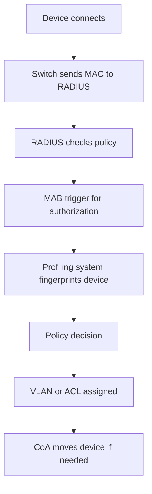

# Authorizing the Device Itself: MAC Authentication Bypass and Profiling

## English

Not every device on a network has a human behind it. Printers, IP cameras, badge readers, HVAC controllers, and medical devices often cannot run an 802.1X supplicant at all. The pragmatic answer is MAC Authentication Bypass (MAB): the switch or wireless controller sends the device's MAC address to the RADIUS server as both the username and the password (often formatted in a vendor-specific way such as aa-bb-cc-dd-ee-ff or aabb.ccdd.eeff). The RADIUS server checks its policy and either accepts, rejects, or challenges the device.

MAB is weak on its own: MAC addresses are broadcast on the wire and trivially spoofed. Treating MAB as authentication is a mistake. The better framing is that MAB is a trigger for authorization: the MAC tells the RADIUS server "a device with this identity wants on the network," and the server then applies policy based on what it knows about that device. That knowledge comes from a profiling system that fingerprints the device by DHCP options, HTTP User-Agent, LLDP/CDP neighbor data, TCP stack quirks, and OUI lookup.

A realistic policy might be: unknown MACs land in a quarantine VLAN with limited access; known printers get a printer VLAN; known cameras get a camera VLAN; and a MAC that suddenly appears in a different building triggers a CoA to move it to quarantine. The RADIUS server returns tunnel attributes (Tunnel-Type, Tunnel-Medium-Type, Tunnel-Private-Group-ID) so the switch can place the port in the right VLAN, or it returns a Filter-Id pointing to an ACL.

There are practical gotchas. MAB has no challenge-response, so it cannot detect a spoofed MAC. Devices that sleep or power-cycle may re-authenticate frequently, creating load. Some devices send traffic before the port is authorized, so the switch needs a pre-auth ACL. And MAB and 802.1X can run on the same port: the switch tries 802.1X first, falls back to MAB after a timeout, and if the device later starts speaking EAP, the session can be re-evaluated.

The deeper lesson is that RADIUS is not just a yes/no gate. It is a policy engine that can combine identity, device profile, location, time, and posture into a decision, and then enforce that decision through VLAN assignment, ACLs, or CoA. MAB is the entry point for the un-authenticatable, and profiling is what makes that entry point defensible.

## 中文

網路上並非每台裝置背後都有人。印表機、IP 攝影機、讀卡機、HVAC 控制器、醫療設備往往根本跑不了 802.1X supplicant。務實的答案是 MAC Authentication Bypass（MAB）：交換器或無線控制器把裝置的 MAC 位址當成使用者名稱與密碼送給 RADIUS 伺服器（格式常因廠商而異，例如 aa-bb-cc-dd-ee-ff 或 aabb.ccdd.eeff）。RADIUS 伺服器查詢政策後，決定接受、拒絕或對裝置發出 challenge。

MAB 本身很弱：MAC 位址在線路上廣播，偽造輕而易舉。把 MAB 當成「認證」是錯誤的。比較好的框架是：MAB 是「授權的觸發器」——MAC 告訴 RADIUS 伺服器「有這樣一台裝置想上網」，伺服器再依它對這台裝置的了解套用政策。這些了解來自 profiling 系統，透過 DHCP 選項、HTTP User-Agent、LLDP/CDP 鄰居資訊、TCP stack 特徵與 OUI 查表來指紋辨識裝置。

實際政策可能是：未知 MAC 丟進隔離 VLAN，只能有限存取；已知印表機進印表機 VLAN；已知攝影機進攝影機 VLAN；某個 MAC 突然出現在不同樓層就觸發 CoA 把它移到隔離區。RADIUS 伺服器回傳 tunnel 屬性（Tunnel-Type、Tunnel-Medium-Type、Tunnel-Private-Group-ID）讓交換器把埠放進正確 VLAN，或回傳指向 ACL 的 Filter-Id。

實務上有幾個坑。MAB 沒有 challenge-response，無法偵測偽造 MAC。會休眠或斷電重啟的裝置可能頻繁重新認證，造成負載。有些裝置在埠尚未授權前就送出流量，所以交換器需要 pre-auth ACL。而且 MAB 與 802.1X 可以並存在同一個埠：交換器先試 802.1X，逾時後退回 MAB；若裝置後來開始講 EAP，工作階段還能重新評估。

更深的啟示是：RADIUS 不只是「是/否」的閘門，而是一個政策引擎，能把身分、裝置描述檔、位置、時間、posture 結合成一個決定，再透過 VLAN 指派、ACL 或 CoA 落實。MAB 是無法認證裝置的入口，而 profiling 讓這個入口站得住腳。

## Key Takeaway

MAB lets devices without supplicants onto the network, but it is only defensible when paired with profiling and policy that treat the MAC as a hint rather than proof of identity.

## Related Concepts
- Device profiling
- VLAN assignment via tunnel attributes

## Diagram

