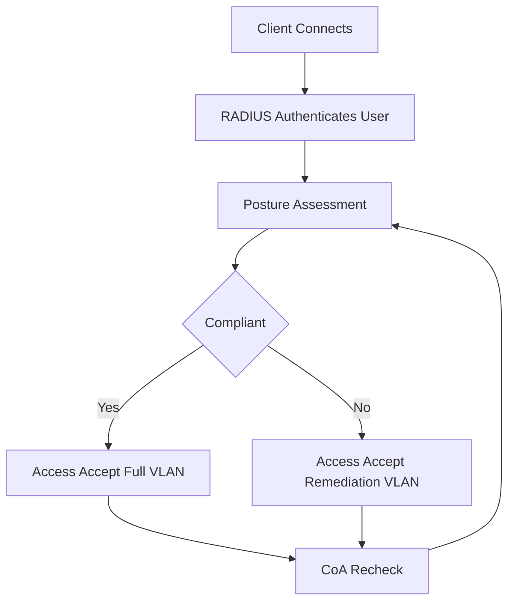

# Posture and Authorization: When Accept Is Not the End of the Story

## English

Classic RADIUS returns one of three answers: Access-Accept, Access-Reject, or Access-Challenge. But real enterprise policy often needs a fourth state: "you are authenticated, but you are not yet compliant." That is the job of posture assessment and the authorization phase that follows authentication. The RADIUS server authenticates the user, then checks whether the endpoint meets policy: OS patch level, disk encryption, antivirus running, firewall enabled, or a managed-device certificate present. If not, the server can return an Access-Accept that places the device in a remediation VLAN with limited access to update servers, rather than rejecting outright.

This is where RADIUS stops being a simple bouncer and becomes a policy decision point. The server may consult external sources: an MDM (mobile device management) API, an endpoint detection platform, or an identity provider. It then maps the result to a role, and the role maps to attributes. A common pattern is to return Filter-Id or a vendor-specific AVP that the NAS interprets as an ACL name, plus tunnel attributes for VLAN placement. The NAS enforces; the RADIUS server decides.

Posture is not static. A device that was compliant at 9 a.m. may fall out of compliance at noon when its antivirus definitions expire. This is why CoA (Change of Authorization) pairs with posture: the RADIUS server or an external orchestrator sends a CoA-Request to the NAS to re-evaluate the session, and the NAS may then issue a new Access-Request or apply a new policy. Without CoA, posture would only be checked at connect time and would drift.

There are real trade-offs. Posture checks add latency to the connect flow and can fail open or fail closed depending on configuration; failing open is convenient but defeats the purpose. Remediation VLANs need their own DHCP, DNS, and update-server reachability. And posture data is sensitive: it can reveal patch levels and installed software, so it should be transported carefully (RadSec or an encrypted management channel) and retained according to policy.

The bigger idea is that authorization in RADIUS is attribute-driven and composable. Authentication answers "who are you?" Authorization answers "what may you do, right now, from here, on this device?" Posture is the input that makes the second question dynamic, and CoA is the mechanism that keeps the answer current.

## 中文

傳統 RADIUS 只回三種答案：Access-Accept、Access-Reject、Access-Challenge。但現實企業政策往往需要第四種狀態：「你通過認證了，但還沒合規。」這就是 posture 評估與認證後授權階段的工作。RADIUS 伺服器先認證使用者，再檢查端點是否符合政策：作業系統修補等級、磁碟加密、防毒是否執行、防火牆是否開啟、是否有受管裝置憑證。若不符合，伺服器可以回傳 Access-Accept，把裝置放進修復 VLAN，只能存取更新伺服器，而不是直接拒絕。

這裡 RADIUS 從單純的守門人變成政策決策點。伺服器可能查詢外部來源：MDM（行動裝置管理）API、端點偵測平台或身分提供者，再把結果對應到角色，角色再對應到屬性。常見做法是回傳 Filter-Id 或廠商自訂 AVP，讓 NAS 解讀成 ACL 名稱，再加上 tunnel 屬性決定 VLAN。NAS 負責執行，RADIUS 伺服器負責決定。

Posture 不是靜態的。早上九點合規的裝置，中午防毒定義過期就可能變得不合規。這就是 CoA（Change of Authorization）與 posture 搭配的原因：RADIUS 伺服器或外部編排器送出 CoA-Request 給 NAS 要求重新評估工作階段，NAS 可能再發新的 Access-Request 或套用新政策。沒有 CoA，posture 只在連線時檢查一次，之後就會漂移。

實務上有取捨。Posture 檢查會增加連線延遲，且依設定可能 fail open 或 fail closed；fail open 方便，但失去意義。修復 VLAN 需要自己的 DHCP、DNS 與更新伺服器可達性。而且 posture 資料很敏感：可能洩漏修補等級與安裝的軟體，所以傳輸要小心（RadSec 或加密管理通道），保存也要依政策。

更大的觀念是：RADIUS 的授權是屬性驅動且可組合的。認證回答「你是誰？」，授權回答「你現在、從這裡、在這台裝置上，可以做什麼？」Posture 是讓第二個問題動態化的輸入，CoA 則是讓答案保持最新的機制。

## Key Takeaway

Posture turns RADIUS authorization from a one-time yes/no into a continuous, attribute-driven decision, with CoA keeping the decision current as devices drift in and out of compliance.

## Related Concepts
- Posture assessment
- Policy decision point

## Diagram

