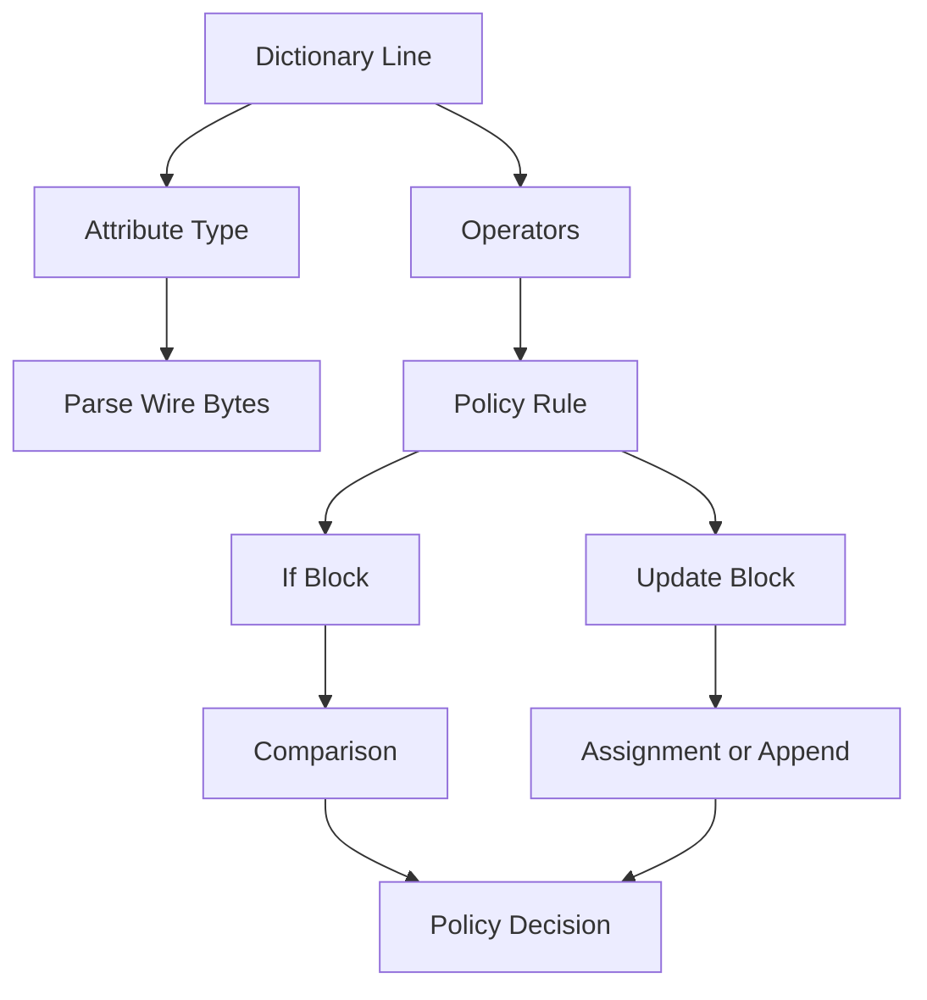

# RADIUS Attribute Operators: How Policies Are Actually Expressed in the Dictionary

## English

Every RADIUS attribute in a dictionary line has a type and, crucially, a set of comparison operators attached to it. When you write `User-Password` or `Framed-IP-Address` in `dictionary` files, the format string after the type (like `octets`, `ipaddr`, `string`) tells the server how to parse the wire bytes and how to compare values in policy rules. But the operators are what make policies expressive: `:=` assigns a value unconditionally, `=` checks equality (and assigns if the attribute is absent on reply), `==` checks equality only, `+=` appends to a list, and `!=`, `>`, `<`, `>=`, `<=` do the obvious comparisons. In FreeRADIUS's unlang, these operators appear constantly in `if` blocks and in the `update` sections of virtual servers, and getting them right is the difference between a working policy and a silent misconfiguration.

The subtlety is that the same symbol can mean different things depending on context. In an `if` condition, `=` is a comparison that also assigns when the left side is unset — surprising but documented. In an `update reply { ... }` block, `:=` forcibly overwrites while `=` only sets when the attribute is not already present. A common bug is writing `Framed-IP-Address = 10.0.0.1` in a reply and wondering why the user keeps getting a different address: the attribute was already populated upstream, so `=` did nothing. Using `:=` fixes it. Similarly, `+=` on a `string` attribute concatenates, which is handy for building `Reply-Message` strings but dangerous on attributes like `Filter-Id` where you actually wanted to replace.

Operators also interact with attribute types. On an `ipaddr` attribute, `>` and `<` compare numerically, not lexically — so `10.0.0.9 < 10.0.0.10` is true even though the strings would sort the other way. On an `octets` attribute, comparisons are byte-wise. On a `date` attribute, comparisons are against Unix timestamps. This is why the dictionary type matters: it is not cosmetic, it drives the semantics of every operator you apply. If you declare a vendor attribute as `string` when it is really an integer, `>` will compare lexically and produce nonsense.

A second layer is the `virtual` and `concat` flags in dictionaries, and the `has_tag`/`&` tag syntax for tagging attribute instances. Tags let you distinguish multiple instances of the same attribute — for example, several `Tunnel-Type` attributes for different VLANs — and operators like `==` can be combined with tag matching to select a specific instance. This is how a server can say 'only the tag-1 Tunnel-Type should be a VLAN' without collapsing all instances into one.

Practically, the way to get fluent is to read the `man unlang` page and the dictionary format documentation, and then to test policies with `radclient` against a running server rather than trusting your mental model. The operators look trivial but they encode the entire policy language's behaviour, and a single `=` versus `:=` can silently break authentication for thousands of users.

## 中文

RADIUS 字典檔中每一行屬性都有一個型別，而更關鍵的是它附帶了一組比較運算子。當你在 dictionary 檔中寫 `User-Password` 或 `Framed-IP-Address` 時，型別後面那個格式字串（例如 `octets`、`ipaddr`、`string`）會告訴伺服器如何解析線路上的位元組，以及如何在政策規則中比較數值。但真正讓政策有表達力的是運算子：`:=` 無條件指派、`=` 檢查相等（若屬性不存在則順便指派）、`==` 只檢查相等、`+=` 附加到清單，而 `!=`、`>`、`<`、`>=`、`<=` 則做一般比較。在 FreeRADIUS 的 unlang 中，這些運算子不斷出現在 `if` 區塊與虛擬伺服器的 `update` 區段，寫對與寫錯往往就是政策生效與默默失效的差別。

微妙之處在於同一個符號在不同情境下意思可能不同。在 `if` 條件中，`=` 是比較，但左邊未設定時也會指派——這點令人意外，但文件有記載。在 `update reply { ... }` 區塊中，`:=` 會強制覆寫，而 `=` 只在屬性尚未存在時才設定。常見的錯誤是：在 reply 中寫 `Framed-IP-Address = 10.0.0.1`，卻納悶為何使用者一直拿到別的位址——因為該屬性在上游已被填入，`=` 就什麼都沒做。改用 `:=` 就解決了。同樣地，對 `string` 屬性使用 `+=` 會串接字串，這在組 `Reply-Message` 時很方便，但對 `Filter-Id` 這類屬性卻很危險，因為你其實想取代而非附加。

運算子也會與屬性型別互動。對 `ipaddr` 屬性，`>` 與 `<` 是數值比較而非字典序——所以 `10.0.0.9 < 10.0.0.10` 為真，儘管字串排序會相反。對 `octets` 屬性，比較是逐位元組的。對 `date` 屬性，比較是對 Unix 時間戳。這就是為什麼字典型別不是裝飾：它決定了你套用的每個運算子的語意。若你把某個其實是整數的廠商屬性宣告成 `string`，`>` 就會做字典序比較而產生荒謬結果。

第二層是字典中的 `virtual` 與 `concat` 旗標，以及用於標記屬性實例的 `has_tag`／`&` 標籤語法。標籤讓你區分同一屬性的多個實例——例如針對不同 VLAN 的多個 `Tunnel-Type` 屬性——而 `==` 之類的運算子可結合標籤比對來選定特定實例。這讓伺服器能表達「只有 tag-1 的 Tunnel-Type 該是 VLAN」，而不會把所有實例混為一談。

實務上，要熟悉這些，最好的方式是讀 `man unlang` 與字典格式文件，然後用 `radclient` 對執行中的伺服器測試政策，而不是相信自己的心智模型。運算子看似簡單，卻編碼了整個政策語言的行為，一個 `=` 與 `:=` 的差別就可能默默弄壞數千名使用者的認證。

## Key Takeaway

RADIUS dictionary operators (`:=`, `=`, `==`, `+=`, comparisons) are the real policy language, and their meaning depends on context and attribute type.

## Related Concepts
- FreeRADIUS unlang
- RADIUS dictionary types

## Diagram

