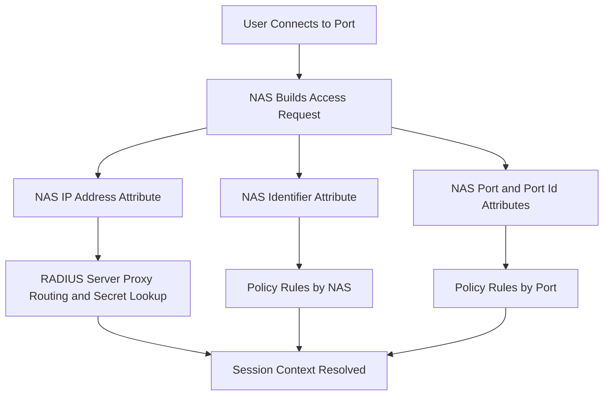

# The NAS-Identifier, NAS-Port, and Session Identity: How RADIUS Knows Which Door You Came Through

## English

A RADIUS server rarely sees a user in isolation; it sees a request that claims to come from a specific network access server (NAS) on a specific port. The attributes `NAS-Identifier`, `NAS-IP-Address`, `NAS-Port`, and `NAS-Port-Id` carry that context. `NAS-IP-Address` is the source IP of the NAS as seen by the server, and is often used as the proxy routing key and as the shared-secret lookup key. `NAS-Identifier` is a human-readable string the NAS chooses (often its hostname), useful when the NAS sits behind NAT and its IP is not stable. `NAS-Port` is a numeric identifier of the physical or logical port the user connected to, and `NAS-Port-Id` is a textual description of that port (for example `GigabitEthernet1/0/7` or `wireless-ssid-corp`). Together these attributes let the server answer the question: which door did this person come through?

Why does that matter? Because authorization is rarely uniform across a network. A policy might say: users on the lobby Wi-Fi get an internet-only VLAN, users on the wired port in the finance office get the finance VLAN, and users on the VPN concentrator get a restricted segment. All three can be expressed as rules keyed on `NAS-Identifier` or `NAS-Port-Id`. This is also how per-port billing, per-building accounting, and troubleshooting ('which switch port was this session on?') work. Without these attributes, every NAS would look identical and every port would be anonymous.

The tricky part is that NASes are inconsistent. Some send `NAS-Port` as a small integer (1, 2, 3...), some send it as a large ifIndex value, and some send `0` or omit it entirely. `NAS-Port-Id` is optional and its format is vendor-specific. `NAS-Identifier` may collide between two devices with the same hostname. `NAS-IP-Address` may be a management IP that differs from the data-plane IP, or may be rewritten by NAT. A robust server therefore does not trust any single attribute; it treats them as hints and cross-checks them against a NAS inventory table maintained in configuration, often keyed by source IP plus shared secret.

The accounting side leans on these attributes even more heavily. `Acct-Session-Id` is a NAS-generated string that must be unique per session, and together with `Acct-Session-Time`, `Acct-Input-Octets`, and `Acct-Output-Octets` it lets the server reconstruct usage. The `Acct-Unique-Session-Id` is often computed by the server by hashing `Acct-Session-Id`, `NAS-IP-Address`, and `NAS-Port` so that two NASes that happen to generate the same session ID do not collide in the accounting database. This is a small but important detail: without it, stop records can be applied to the wrong session.

Operationally, the lesson is to inventory your NASes. Keep a table mapping each NAS to its expected `NAS-Identifier`, its IP range, and its shared secret, and reject requests from unknown sources. Log `NAS-Identifier` and `NAS-Port-Id` in every auth and accounting record so that incident response can answer 'where was this user?' without guesswork. Treat these attributes as identity for the network side of the conversation, not just as metadata.

## 中文

RADIUS 伺服器很少孤立地看一個使用者；它看到的是一個宣稱來自某台特定網路存取伺服器（NAS）、某個特定埠的要求。`NAS-Identifier`、`NAS-IP-Address`、`NAS-Port` 與 `NAS-Port-Id` 這些屬性就承載了這個脈絡。`NAS-IP-Address` 是伺服器眼中 NAS 的來源 IP，常被用作代理路由鍵與共享密鑰查詢鍵。`NAS-Identifier` 是 NAS 自選的人類可讀字串（通常是主機名），在 NAS 位於 NAT 之後、IP 不穩定時很有用。`NAS-Port` 是使用者所連實體或邏輯埠的數字識別碼，`NAS-Port-Id` 則是該埠的文字描述（例如 `GigabitEthernet1/0/7` 或 `wireless-ssid-corp`）。這些屬性合起來讓伺服器能回答：這個人是從哪扇門進來的？

為什麼重要？因為授權很少在整個網路上一致。政策可能規定：大廳 Wi-Fi 的使用者拿到只能上網的 VLAN，財務辦公室有線埠的使用者拿到財務 VLAN，VPN 集中器的使用者拿到受限網段。這三者都能寫成以 `NAS-Identifier` 或 `NAS-Port-Id` 為鍵的規則。逐埠計費、逐棟建築的會計，以及疑難排解（「這個 session 是在哪個交換器埠上？」）也都靠這些屬性。少了它們，每台 NAS 看起來都一樣，每個埠都匿名。

麻煩在於 NAS 各行其是。有些把 `NAS-Port` 送成小整數（1、2、3……），有些送成很大的 ifIndex 值，有些送 `0` 或乾脆省略。`NAS-Port-Id` 是選用的，格式依廠商而異。`NAS-Identifier` 可能在兩台同名主機之間碰撞。`NAS-IP-Address` 可能是與資料平面不同的管理 IP，或被 NAT 改寫。因此穩健的伺服器不會信任單一屬性；它把它們當作提示，並與設定中維護的 NAS 清冊交叉比對，通常以來源 IP 加共享密鑰為鍵。

會計面更依賴這些屬性。`Acct-Session-Id` 是 NAS 產生的字串，每個 session 必須唯一，配合 `Acct-Session-Time`、`Acct-Input-Octets`、`Acct-Output-Octets` 就能讓伺服器重建用量。`Acct-Unique-Session-Id` 常由伺服器對 `Acct-Session-Id`、`NAS-IP-Address`、`NAS-Port` 做雜湊計算，以免兩台 NAS 碰巧產生相同 session ID 時在會計資料庫中碰撞。這是個小卻重要的細節：少了它，停止記錄可能套用到錯誤的 session。

實務上的教訓是：為你的 NAS 建立清冊。維護一張表，把每台 NAS 對應到預期的 `NAS-Identifier`、IP 範圍與共享密鑰，並拒絕來自未知來源的要求。在每筆認證與會計記錄中記錄 `NAS-Identifier` 與 `NAS-Port-Id`，讓事件應變能不必猜測就回答「這個使用者當時在哪裡？」。把這些屬性當作對話中網路端的身份，而不只是後設資料。

## Key Takeaway

NAS-Identifier, NAS-Port, and NAS-Port-Id are how RADIUS attributes a session to a specific door, and robust deployments inventory them rather than trusting them blindly.

## Related Concepts
- Acct-Session-Id
- NAS inventory and shared secrets

## Diagram

