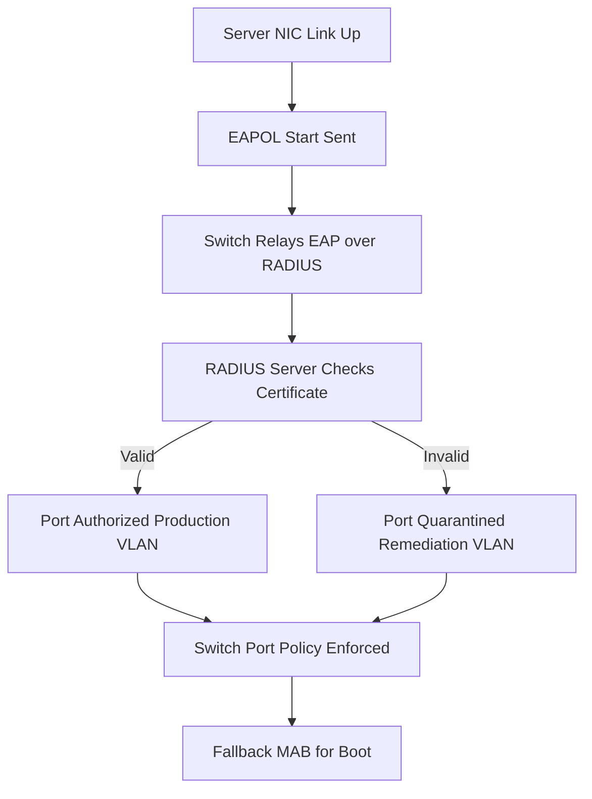

# RADIUS in the Data Center: 802.1X for Servers, Switches, and Storage Fabrics

## English

Most RADIUS discussions focus on users and Wi-Fi, but a large and growing use case is authenticating the infrastructure itself. Data center switches, hypervisor hosts, and even storage array ports can be 802.1X supplicants. A server NIC that supports 802.1X will, on link-up, send an EAPOL-Start, the switch will relay it to the RADIUS server via EAP over RADIUS, and the server will decide whether the port should be authorized for production VLANs or quarantined. This is the same three-party dance as Wi-Fi, just on copper instead of radio.

Why do this? Because a data center port that is physically patched but not yet configured is a liability: anyone who plugs in a laptop gets a trunk. 802.1X on server ports closes that gap. The server authenticates with EAP-TLS using a certificate, the switch learns the identity, and the RADIUS server returns a `Tunnel-Type`/`Tunnel-Medium-Type`/`Tunnel-Private-Group-Id` triple that puts the port into the right VLAN. If the certificate is missing or expired, the port stays in a quarantine VLAN that can only reach a remediation server. This is a real, deployed pattern in many enterprises, and it turns the switch port into a policy enforcement point.

The challenges are different from Wi-Fi. Servers reboot, and during PXE boot or early boot stages there is no supplicant running yet, so the port must be configured with a fallback (often MAC Authentication Bypass, or a pre-authorized VLAN for known MACs). Hypervisors complicate things because a single physical NIC may carry traffic for many virtual machines, and 802.1X authenticates the physical link, not the VMs. Some environments therefore use 802.1X for the host and a separate overlay (VXLAN with micro-segmentation) for the VMs. Storage networks are even trickier: Fibre Channel and iSCSI fabrics have their own authentication models, and RADIUS is not typically used there, though some vendors expose RADIUS for management-plane access.

The RADIUS server's role in this scenario is mostly authorization and accounting. Authentication is certificate-based (EAP-TLS), so the server's job is to validate the certificate chain, check revocation, map the certificate subject to a device role, and return the right VLAN and ACL attributes. Accounting matters because you want to know when a server port came up, went down, and how much traffic it carried. CoA matters because when a certificate is revoked or a server is decommissioned, you want to kick the port immediately rather than wait for reauthentication.

Operationally, treat server 802.1X as a change-management problem as much as a security one. Stage it on non-production racks first, document the fallback path for PXE and rescue boots, and make sure the RADIUS server's certificate validation is strict enough to reject self-signed certs from random devices. The payoff is that the data center stops being a place where any cable equals any access.

## 中文

大多數 RADIUS 討論聚焦於使用者與 Wi-Fi，但一個龐大且成長中的用例是認證基礎設施本身。資料中心交換器、hypervisor 主機，甚至儲存陣列的埠，都可以是 802.1X 的 supplicant。支援 802.1X 的伺服器網卡會在鏈路建立時送出 EAPOL-Start，交換器透過 EAP over RADIUS 轉給 RADIUS 伺服器，伺服器再決定該埠應授權到生產 VLAN 還是隔離。這與 Wi-Fi 是同樣的三方共舞，只是從無線換成銅線。

為什麼要這樣做？因為一個實體已接線但尚未設定的資料中心埠是負擔：任何人插上筆電就能拿到 trunk。伺服器埠上的 802.1X 補上了這個缺口。伺服器用憑證做 EAP-TLS 認證，交換器得知身分，RADIUS 伺服器回傳 `Tunnel-Type`／`Tunnel-Medium-Type`／`Tunnel-Private-Group-Id` 三元組，把埠放進正確的 VLAN。若憑證缺失或過期，埠就留在隔離 VLAN，只能連到修復伺服器。這是許多企業真實部署的模式，把交換器埠變成政策執行點。

挑戰與 Wi-Fi 不同。伺服器會重開機，而在 PXE 開機或早期開機階段還沒有 supplicant 在跑，所以埠必須設定備援（通常是 MAC Authentication Bypass，或對已知 MAC 預先授權的 VLAN）。Hypervisor 讓事情更複雜，因為單一實體網卡可能承載多台虛擬機的流量，而 802.1X 認證的是實體鏈路，不是 VM。因此有些環境對主機做 802.1X，對 VM 另用覆蓋網路（VXLAN 加微切分）。儲存網路更棘手：Fibre Channel 與 iSCSI fabric 有自己的認證模型，RADIUS 通常不用在那裡，雖然有些廠商在管理平面暴露 RADIUS。

RADIUS 伺服器在此情境的角色主要是授權與會計。認證是憑證式的（EAP-TLS），所以伺服器的工作是驗證憑證鏈、檢查撤銷、把憑證主體對應到裝置角色，並回傳正確的 VLAN 與 ACL 屬性。會計重要，因為你想知道伺服器埠何時起來、何時下去、承載多少流量。CoA 重要，因為當憑證被撤銷或伺服器退役時，你想立刻踢掉該埠，而不是等重新認證。

實務上，把伺服器 802.1X 當成變更管理問題，而不只是安全問題。先在非生產機櫃試行，記錄 PXE 與救援開機的備援路徑，並確保 RADIUS 伺服器的憑證驗證夠嚴格，能拒絕來路不明的自簽憑證。回報是：資料中心不再是「任何線纜等於任何存取」的地方。

## Key Takeaway

802.1X on server and switch ports turns the data center into a policy-enforced environment, with certificate-based EAP-TLS and careful fallback planning for boot-time gaps.

## Related Concepts
- EAP-TLS
- MAC Authentication Bypass

## Diagram

