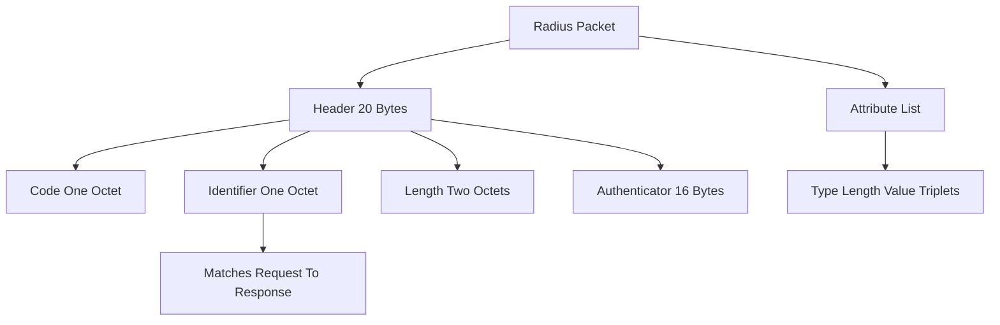

# RADIUS Packet Anatomy: Code, Identifier, Length, Authenticator

## English

Every RADIUS packet, whether an Access-Request, Access-Accept, Accounting-Request, or CoA-Request, begins with the same 20-byte header. The first field is the Code, one octet that names the packet type (1 for Access-Request, 2 for Access-Accept, 3 for Access-Reject, 4 for Accounting-Request, 5 for Accounting-Response, 11 for Access-Challenge, and so on). The second field is the Identifier, one octet that lets a client match a response to the request it sent. Because RADIUS rides on UDP, which has no notion of a connection, this Identifier is the only thing tying a reply back to its question. The third field is Length, two octets, which says how many bytes the whole packet occupies including the header, so the receiver knows where the attribute list ends.

The fourth field is the most interesting: the 16-byte Authenticator. Its meaning changes with the packet type. In an Access-Request it is a random nonce, freshly generated for each request, which makes every request unique even if the attributes are identical. In responses (Access-Accept, Access-Reject, Access-Challenge) the Authenticator is a cryptographic hash computed over the response packet plus the original request's Authenticator plus the shared secret. That construction is why a client can trust that a packet claiming to be from its server really came from something that knows the shared secret, and why an attacker cannot simply replay or forge a response.

After the header comes the attribute list: a sequence of Type-Length-Value triplets. Each attribute is one octet of Type (which the dictionary maps to a name like User-Name or NAS-IP-Address), one octet of Length (including the type and length octets themselves), and then the value. Because Length is a single octet, a single attribute value can be at most 253 bytes. That limit is why large EAP payloads must be fragmented across multiple EAP-Message attributes, and why a long certificate chain in EAP-TLS gets split into several chunks that the server reassembles.

A concrete example helps. Suppose a switch sends an Access-Request for user alice. The packet has Code=1, some Identifier like 0x2A, a Length of maybe 90 bytes, and a random 16-byte Authenticator. The attributes might include User-Name="alice", NAS-IP-Address, NAS-Port, and a Message-Authenticator (an HMAC-MD5 over the packet, defined in RFC 3579, used to protect against spoofed requests, especially important for EAP). The server replies with Code=2, the same Identifier 0x2A, and an Authenticator computed as MD5(Code+Identifier+Length+RequestAuth+Attributes+Secret). The switch checks the Identifier matches, recomputes the hash, and only then trusts the reply.

Understanding this layout explains many operational quirks. Duplicate detection uses the source IP, source port, and Identifier together, because two different requests can reuse the same Identifier over time. Message-Authenticator is mandatory in practice for any packet carrying EAP, since without it an attacker could inject EAP packets and manipulate the tunnel negotiation. And the 4096-byte maximum packet size (from the two-octet Length field) is why RADIUS over UDP can never carry a single enormous attribute; the protocol was designed for small, chatty messages, not bulk data.

## 中文

每一個 RADIUS 封包，無論是 Access-Request、Access-Accept、Accounting-Request 還是 CoA-Request，開頭都是同樣的 20 位元組標頭。第一個欄位是 Code，一個位元組，用來標明封包類型（1 代表 Access-Request，2 代表 Access-Accept，3 代表 Access-Reject，4 代表 Accounting-Request，5 代表 Accounting-Response，11 代表 Access-Challenge，如此類推）。第二個欄位是 Identifier，一個位元組，讓客戶端把回應對應回它送出的請求。因為 RADIUS 跑在 UDP 之上，而 UDP 根本沒有連線的概念，這個 Identifier 就是唯一把回應綁回問題的東西。第三個欄位是 Length，兩個位元組，說明整個封包（包括標頭）佔多少位元組，接收方因此知道屬性列表在哪裡結束。

第四個欄位最有趣：16 位元組的 Authenticator。它的意義隨封包類型而變。在 Access-Request 裡，它是一個隨機 nonce，每個請求都重新產生，令每個請求獨一無二，即使屬性完全相同。在回應（Access-Accept、Access-Reject、Access-Challenge）裡，Authenticator 是一個密碼學雜湊，計算是把回應封包、原本請求的 Authenticator、以及共享密鑰一起算進去。這個構造正是客戶端可以信任「聲稱來自伺服器的封包」真的來自知道共享密鑰的一方的原因，也是攻擊者不能簡單重播或偽造回應的原因。

標頭之後是屬性列表：一連串 Type-Length-Value 三元組。每個屬性是一個位元組的 Type（字典會把它映射成 User-Name 或 NAS-IP-Address 之類的名字）、一個位元組的 Length（包含 type 和 length 位元組本身）、然後是值。因為 Length 只有一個位元組，單一屬性的值最多 253 位元組。這個限制正是大型 EAP 負載必須分散到多個 EAP-Message 屬性的原因，也是 EAP-TLS 裡長憑證鏈要被切成幾段、由伺服器重新組合的原因。

舉個具體例子。假設交換器為用戶 alice 送出 Access-Request。封包有 Code=1、某個 Identifier 例如 0x2A、Length 大約 90 位元組、以及一個隨機的 16 位元組 Authenticator。屬性可能包括 User-Name="alice"、NAS-IP-Address、NAS-Port，以及一個 Message-Authenticator（對整個封包做 HMAC-MD5，定義於 RFC 3579，用來防止偽造請求，對 EAP 尤其重要）。伺服器回覆 Code=2、同一個 Identifier 0x2A、以及一個按 MD5(Code+Identifier+Length+RequestAuth+Attributes+Secret) 算出的 Authenticator。交換器核對 Identifier 吻合、重算雜湊，然後才信任這個回覆。

理解這個佈局可以解釋很多營運上的怪現象。重複偵測是把來源 IP、來源埠、Identifier 三者合起來看的，因為兩個不同的請求可以隨時間重用同一個 Identifier。實務上，任何攜帶 EAP 的封包都強制要有 Message-Authenticator，否則攻擊者可以注入 EAP 封包、操縱隧道協商。而 4096 位元組的最大封包大小（來自兩個位元組的 Length 欄位）正是 RADIUS over UDP 永遠不能攜帶單一巨大屬性的原因；這個協議是為細小、頻繁的訊息設計的，不是為大量資料。

## Key Takeaway

The fixed 20-byte RADIUS header and its per-packet Authenticator are what let a connectionless UDP protocol authenticate both directions and detect forgeries.

## Related Concepts
- Message-Authenticator (RFC 3579)
- Type-Length-Value attributes

## Diagram

