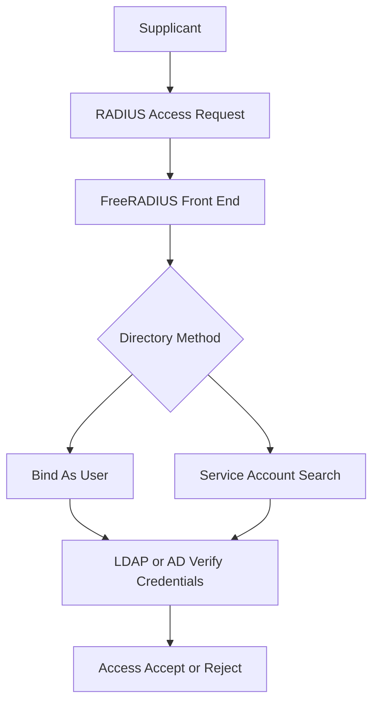

# Where RADIUS Meets the Directory: LDAP and AD as the Identity Backend

## English

RADIUS itself does not store users. It is a protocol for asking and answering access questions, and in real deployments the actual credentials live somewhere else, most often a directory. The classic pattern is FreeRADIUS acting as a front end that receives the Access-Request, then talks to an LDAP server (OpenLDAP, or Active Directory via LDAP) to verify the password or fetch group membership. This split matters because the directory is the system of record for identity, shared with email, VPN, file shares, and single sign-on, while RADIUS is only the network's gatekeeper. Keeping one source of truth avoids the nightmare of stale duplicate accounts.

There are two fundamentally different ways FreeRADIUS uses a directory, and confusing them is a common source of pain. The first is bind-as-user authentication: the server takes the User-Name and User-Password from the request, opens a fresh LDAP connection, and attempts to bind as that distinguished name with that password. If the bind succeeds, the credentials are valid. This is simple and works with any LDAP server, but it means the RADIUS server must be able to construct the user's DN (for example by searching for the entry first, or by using a template like uid=%{User-Name},ou=people,dc=example,dc=com), and it generates a bind for every authentication attempt, which is chatty under load.

The second is search-then-bind with a service account: the server binds once with a privileged account (or uses an anonymous bind if permitted), searches for the user entry, reads attributes such as memberOf or a custom radius attribute, and then either verifies the password separately or trusts the bind as the check. Many deployments also use this path purely for authorization: the password is checked against a local or other store, and the directory is consulted only to fetch group membership that maps to a VLAN or filter. This is where the RADIUS dictionary and the LDAP schema meet, and where a mismatch between what the directory returns and what the policy expects causes silent authorization failures.

Active Directory adds its own wrinkles. AD supports LDAP simple bind over TLS (LDAPS on port 636) and, in modern versions, LDAP signing and channel binding requirements that reject plaintext binds. It also supports Kerberos, which FreeRADIUS can use via the krb5 module for password-free authentication, and it exposes group membership through memberOf or tokenGroups. A frequent trap is that memberOf is a computed, back-link attribute that may not appear on every entry or may be filtered by the search base, so a policy that says 'if memberOf contains CN=NetAdmins' can fail for users whose group is outside the search scope. Careful testing with real directory data, not just a test user, is essential.

Performance and resilience are the other half of the story. Each LDAP operation is a round trip, and under a burst of authentications (say, a thousand laptops reconnecting after a power cut) the directory can become the bottleneck. Common mitigations are connection pooling (FreeRADIUS keeps a pool of persistent LDAP connections rather than reconnecting each time), caching of group lookups with a short TTL, and a local fallback such as a flat file of emergency accounts for when the directory is unreachable. The overall lesson: RADIUS is the protocol, the directory is the database, and a healthy deployment treats the link between them as a first-class dependency with its own monitoring, timeouts, and failure modes.

## 中文

RADIUS 本身不儲存使用者。它是一個用來提問和回答存取問題的協議，而在真實部署裡，真正的憑證住在別的地方，最常見是一個目錄服務。經典模式是 FreeRADIUS 當前端，收到 Access-Request 之後，去跟 LDAP 伺服器（OpenLDAP，或透過 LDAP 存取的 Active Directory）對話，驗證密碼或抓取群組成員資格。這個分工很重要，因為目錄是身分的權威紀錄，跟電郵、VPN、檔案分享、單一登入共用，而 RADIUS 只是網絡的守門人。保持單一真相來源，可以避免過時重複帳號的噩夢。

FreeRADIUS 使用目錄有兩種根本不同的方式，把它們混淆是常見的痛苦來源。第一種是「以使用者身分 bind」的認證：伺服器從請求取出 User-Name 和 User-Password，開一條新的 LDAP 連線，嘗試用那個 distinguished name 和那個密碼去 bind。如果 bind 成功，憑證就有效。這很簡單，適用於任何 LDAP 伺服器，但意味著 RADIUS 伺服器必須能構造出使用者的 DN（例如先搜尋該條目，或用 uid=%{User-Name},ou=people,dc=example,dc=com 之類的模板），而且每次認證嘗試都產生一次 bind，在高負載下相當頻繁。

第二種是「先搜尋再 bind」，配一個服務帳號：伺服器先用特權帳號 bind 一次（或在允許時用匿名 bind），搜尋使用者條目，讀取 memberOf 或自訂 radius 屬性之類的屬性，然後要麼另外驗證密碼，要麼把那次 bind 當作檢查。很多部署也用這條路徑純粹做授權：密碼拿去跟本地或其他儲存比對，目錄只用來抓群組成員資格，再映射到 VLAN 或過濾器。這裡正是 RADIUS 字典與 LDAP schema 相遇的地方，也是目錄回傳的東西與政策期望不符時，造成無聲授權失敗的地方。

Active Directory 有它自己的麻煩。AD 支援透過 TLS 的 LDAP simple bind（LDAPS，埠 636），而現代版本有 LDAP signing 和 channel binding 的要求，會拒絕明文 bind。它也支援 Kerberos，FreeRADIUS 可以透過 krb5 模組使用，做到免密碼認證，並透過 memberOf 或 tokenGroups 暴露群組成員資格。一個常見陷阱是 memberOf 是計算出來的 back-link 屬性，未必在每個條目出現，或者會被搜尋基準過濾掉，所以一條「若 memberOf 含 CN=NetAdmins」的政策，對群組在搜尋範圍之外的使用者就可能失效。用真實目錄資料（而不只是測試用戶）仔細測試，是必須的。

效能與韌性是故事的另一半。每個 LDAP 操作都是一次來回，在一陣認證爆發時（比如停電後一千部手提電腦同時重連），目錄可能變成瓶頸。常見的緩解方法包括連線池（FreeRADIUS 維持一個持久的 LDAP 連線池，而不是每次都重連）、對群組查詢做短 TTL 的快取、以及本地後備，例如一組緊急帳號的平面檔案，以備目錄不可達時使用。整體教訓是：RADIUS 是協議，目錄是資料庫，健康的部署會把兩者之間的連線當作一等公民的依賴，有它自己的監控、逾時和故障模式。

## Key Takeaway

RADIUS rarely owns the credentials; treating the directory link as a monitored, pooled, fallback-protected dependency is what separates a toy setup from a production one.

## Related Concepts
- LDAP bind authentication
- Group-to-VLAN authorization

## Diagram

