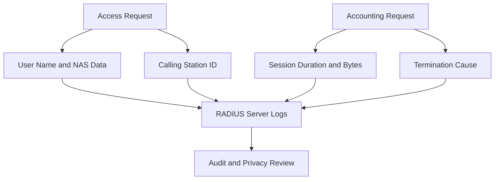

# Logging, Auditing, and Privacy: What RADIUS Records and What It Must Not

## English

RADIUS is a goldmine of security telemetry and a minefield of privacy risk at the same time. Every Access-Request carries a User-Name, a NAS-IP-Address, a NAS-Port, often a Calling-Station-Id (the MAC address of the supplicant), and timestamps. Every Accounting-Request adds session duration, bytes in and out, and a termination cause. Together these records answer questions like who connected, from which switch port, when, for how long, and how much data moved. For incident response, that is invaluable: you can reconstruct which device was on which port at the time of an alert. For a privacy regulator, the same records are personal data about identifiable individuals and their movements.

The first principle is that the RADIUS server should never log secrets. User-Password in an Access-Request is not sent in cleartext; it is XORed with an MD5 stream derived from the shared secret and the Request Authenticator, so it is protected on the wire but trivially recoverable by anyone who knows the shared secret and captures the packet. That means the server's own logs must not contain the raw User-Password attribute, and shared secrets must never appear in debug output that gets shipped to a central log store. A common mistake is running FreeRADIUS in debug mode in production, which prints attribute values including passwords and Message-Authenticator details, then forgetting to turn it off. Debug output belongs on a console during troubleshooting, not in a log pipeline.

The second principle is separation of duties between accounting and authentication logs. Accounting records are long-lived by nature (billing, capacity planning, forensics) and are often retained for months or years, while authentication failure logs are high-volume and short-lived. Mixing them in one index makes both expensive to query and hard to apply different retention rules. A practical pattern is to send accounting to a dedicated database or time-series store with a defined retention policy, and to send authentication events (especially Access-Reject and Access-Challenge) to a SIEM where they can be correlated with other security signals. Alerting on spikes of Access-Reject from a single NAS or a single User-Name is one of the cheapest intrusion-detection wins available.

Privacy engineering enters here. The Calling-Station-Id reveals a device's MAC address, which on many networks is a stable identifier and can be linked to a person. Under regimes such as GDPR, that is personal data, and storing it indefinitely without a lawful basis is a problem. Techniques that help: hashing MAC addresses before long-term storage where the raw value is not needed, minimizing the set of attributes retained, defining retention periods per data type, and restricting access to the accounting store to those with a genuine need. None of this requires breaking the protocol; it is a matter of what the server writes down and for how long.

Finally, integrity matters as much as content. Logs should be shipped over an authenticated, encrypted channel (syslog over TLS, or a log shipper with mutual TLS) and stored where they cannot be silently edited, because an attacker who gains access to the RADIUS server will try to erase the evidence of their session. Time synchronization across NAS devices and the RADIUS server is also essential: if switch clocks drift, correlating a RADIUS record with a firewall or IDS event becomes guesswork. A well-run RADIUS deployment treats its logs as a security product in their own right, with owners, retention rules, access controls, and alerting, rather than as a byproduct to be deleted when disk fills up.

## 中文

RADIUS 同時是安全遙測的寶庫，也是私隱風險的雷區。每個 Access-Request 都帶著 User-Name、NAS-IP-Address、NAS-Port，通常還有 Calling-Station-Id（supplicant 的 MAC 位址）和時間戳。每個 Accounting-Request 再加上工作階段時長、進出位元組數、以及終止原因。這些紀錄合起來能回答：誰連上了、從哪個交換器埠、幾時、多久、移動了多少資料。對事故應變來說，這是無價的：你可以重建警報發生時哪部裝置在哪個埠。對私隱監管機構來說，同樣的紀錄是可識別個人及其行蹤的個人資料。

第一原則是：RADIUS 伺服器絕不應記錄機密。Access-Request 裡的 User-Password 並非以明文送出；它是跟一條由共享密鑰和 Request Authenticator 衍生的 MD5 串流做 XOR，所以在網線上受保護，但任何知道共享密鑰並截取封包的人都可以輕易還原。這意味著伺服器自己的日誌不能含原始的 User-Password 屬性，共享密鑰也絕不能出現在被送往中央日誌儲存的除錯輸出裡。一個常見錯誤是在生產環境以除錯模式跑 FreeRADIUS，它會印出屬性值包括密碼和 Message-Authenticator 細節，然後忘了關掉。除錯輸出應該在排錯時留在主控台，而不是進入日誌管道。

第二原則是 accounting 日誌與 authentication 日誌的職責分離。Accounting 紀錄本質上是長壽的（計費、容量規劃、鑑證），通常保留數月甚至數年，而認證失敗日誌是大量而短壽的。把它們混在一個索引裡，會令兩者查詢都昂貴，也難以套用不同的保留規則。一個實用模式是把 accounting 送到專用資料庫或時序儲存，有明確的保留政策；把認證事件（尤其 Access-Reject 和 Access-Challenge）送到 SIEM，與其他安全訊號關聯。對單一 NAS 或單一 User-Name 的 Access-Reject 尖峰發出警報，是現今最便宜的入侵偵測成果之一。

私隱工程就在這裡進場。Calling-Station-Id 洩露裝置的 MAC 位址，在許多網絡上這是穩定識別碼，可以連繫到一個人。在 GDPR 之類的法規下，那是個人資料，無法律依據而無限期儲存是個問題。有幫助的技術包括：在不需要原始值時，長期儲存前先對 MAC 位址做雜湊；把保留的屬性集合減到最少；按資料類型定義保留期；限制只有真正需要的人才能存取 accounting 儲存。這些都不需要破壞協議；關鍵是伺服器寫下什麼、寫多久。

最後，完整性與內容同樣重要。日誌應經認證和加密的通道傳送（syslog over TLS，或雙向 TLS 的日誌轉發器），並存放在不能被悄悄編輯的地方，因為取得 RADIUS 伺服器存取權的攻擊者會試圖抹去自己工作階段的證據。NAS 裝置與 RADIUS 伺服器之間的時間同步也至關重要：如果交換器時鐘漂移，把 RADIUS 紀錄與防火牆或 IDS 事件關聯起來就變成猜謎。一個管理良好的 RADIUS 部署，會把日誌當作本身就是一個安全產品，有負責人、保留規則、存取控制和警報，而不是磁碟滿了就刪掉的副產品。

## Key Takeaway

RADIUS logs are both forensic gold and privacy liability, so the discipline is to log what you need, never log secrets, and apply explicit retention and access rules.

## Related Concepts
- Accounting records and retention
- Calling-Station-Id and privacy

## Diagram

