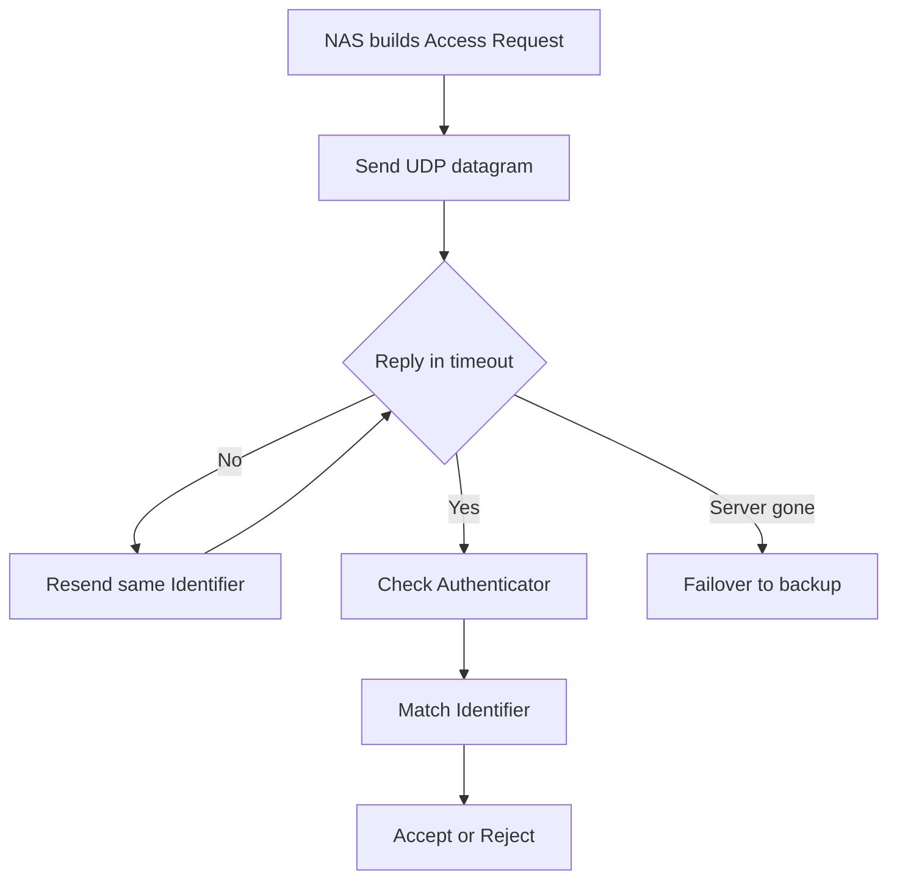

# Why RADIUS Uses UDP and Why That Choice Still Matters

## English

RADIUS was designed in the early 1990s, when a single server might handle a few dozen dial-in modems and a lost packet was cheaper than a stalled connection. Its authors chose UDP (User Datagram Protocol, a connectionless transport that sends each datagram independently with no handshake, no ordering, and no built-in retransmission) rather than TCP, and that decision shapes almost everything about how the protocol behaves today. The reasoning is mostly about failure semantics: if a RADIUS server disappears mid-request, the network access server (NAS — the switch, wireless controller, or VPN gateway asking for a decision) should find out quickly and move on to a backup server, not sit in a TCP retransmission backoff that can take minutes to give up. A short timeout plus an explicit retry is a decision the NAS can make itself, and that keeps the login experience predictable.

The protocol compensates for UDP's unreliability with a small, well-understood toolkit. Every request carries an Identifier byte that the server copies into its reply, so a NAS with several requests in flight can match answers to questions. Every packet also carries a 16-byte Authenticator field; for Access-Request packets it is a random value, and the reply's authenticator is computed as an MD5 hash over the response plus the request authenticator plus the shared secret. That binding means a NAS can detect a reply that does not belong to its request, and it makes blind packet injection hard without the shared secret. Retransmission is handled by the NAS: if no reply arrives within a configured timeout, it resends the same packet with the same Identifier, and the server is expected to recognise duplicates and answer idempotently rather than start a second authentication.

There is a real cost to this design. UDP datagrams are bounded — RFC 2865 caps a RADIUS packet at 4096 bytes, and in practice most deployments keep well under that to avoid IP fragmentation (the 16-bit Length field could in principle encode more, but the 4096-byte ceiling is the protocol's own limit). EAP (Extensible Authentication Protocol) conversations, especially with TLS-based methods like PEAP or EAP-TLS, routinely need more room than one datagram allows, so the protocol gained fragmentation rules and the NAS and server must cooperate to reassemble. Fragmented UDP is also fragile across NAT and stateful firewalls, which is one reason operators sometimes prefer RadSec (RADIUS over TLS, which runs on TCP) for links that cross the public internet.

A second consequence is that RADIUS has no notion of a connection, so there is nothing to keep alive, nothing to drain, and no head-of-line blocking. A server can restart and the next request simply arrives on a fresh socket. Load balancers in front of a RADIUS tier therefore work at the datagram level, hashing on the Identifier or on NAS address, and must understand the protocol enough to keep a conversation sticky: if request 1 goes to server A and its retransmission goes to server B, B may not have the EAP state to answer. That stickiness requirement is a direct inheritance from the connectionless design.

Finally, the shared secret is the only thing standing between a UDP port and anyone on the path. Because there is no TLS handshake or certificate, integrity and authenticity rest entirely on the MD5-based checks and on the secret. MD5 is cryptographically broken for collision resistance, but RADIUS uses it in a keyed construction rather than as a bare hash, and the practical guidance is unchanged: use long random secrets, restrict the source addresses that may reach the server, and treat any network where the secret could be sniffed as hostile — which is exactly the gap RadSec was invented to close.

## 中文

RADIUS 誕生於 1990 年代初，當時一部伺服器可能只服務幾十個撥號數據機，而遺失一個封包的代價遠低於一條卡住的連線。設計者選擇了 UDP（User Datagram Protocol，用戶資料包協定：一種無連線的傳輸方式，每個資料包獨立送出，沒有握手、沒有排序、也沒有內建重傳），而非 TCP，這個決定塑造了今日協定的幾乎所有行為。理由主要在失敗語意：若 RADIUS 伺服器在請求途中消失，網路存取伺服器（NAS，即向伺服器索取決定的交換機、無線控制器或 VPN 閘道）應該很快得知並轉向備援伺服器，而不是卡在 TCP 的重傳退避裡，可能要幾分鐘才放棄。短逾時加上明確重試是 NAS 自己能做的判斷，這讓登入體驗可預期。

協定用一套小而清晰的工具來補償 UDP 的不可靠。每個請求都帶一個 Identifier 位元組，伺服器會把它複製到回覆中，於是同時有多個請求在飛的 NAS 可以配對答案與問題。每個封包還帶 16 位元組的 Authenticator 欄位；Access-Request 裡它是隨機值，而回覆的 authenticator 是對「回應內容＋請求 authenticator＋共享密鑰」做 MD5 雜湊算出來的。這種綁定讓 NAS 能偵測不屬於自己請求的回覆，也讓沒有共享密鑰的盲目封包注入變得困難。重傳由 NAS 負責：若在設定的逾時內沒有回覆，它會用同一個 Identifier 重送同一個封包，而伺服器理應辨識重複並以冪等方式回答，而不是重新啟動一次認證。

這個設計有實際代價。UDP 資料包有大小上限——RFC 2865 將 RADIUS 封包限制在 4096 位元組，實務上多數部署遠低於此以避免 IP 分片（16 位元的 Length 欄位理論上可以編碼更多，但 4096 位元組的上限是協定自身的限制）。EAP（Extensible Authentication Protocol，可延伸認證協定）對話，尤其是 PEAP 或 EAP-TLS 這類基於 TLS 的方法，經常需要超過一個資料包的空間，於是協定加入了分片規則，NAS 與伺服器必須合作重組。分片的 UDP 在 NAT 與有狀態防火牆之間也很脆弱，這也是營運者有時候偏好 RadSec（RADIUS over TLS，跑在 TCP 上）來跨越公網鏈路的原因之一。

第二個後果是 RADIUS 沒有連線概念，因此沒有東西需要保活、沒有東西需要排空、也沒有隊頭阻塞。伺服器可以重啟，下一個請求就從全新 socket 進來。因此 RADIUS 層前面的負載平衡器是在資料包層級運作，按 Identifier 或 NAS 位址做雜湊，而且必須懂協定到足以讓對話保持黏著：若請求 1 送到伺服器 A，而它的重傳送到伺服器 B，B 可能沒有 EAP 狀態可回答。這種黏著要求正是無連線設計的直接遺產。

最後，共享密鑰是 UDP 埠與路徑上任何人之前唯一的屏障。因為沒有 TLS 握手或憑證，完整性與真實性完全依賴 MD5 為基礎的檢查與密鑰。MD5 在抗碰撞性上已被攻破，但 RADIUS 把它用在帶密鑰的構造中而非單純雜湊，實務指引並未改變：使用長而隨機的密鑰、限制可觸及伺服器的來源位址，並把任何密鑰可能被竊聽的網路視為敵對環境——這正是 RadSec 要補上的缺口。

## Key Takeaway

RADIUS runs on UDP so that a dead server fails fast rather than stalling a login, and every reliability feature — identifiers, authenticators, NAS-driven retransmission — exists to make that trade-off safe.

## Related Concepts
- UDP vs TCP transport trade-offs
- RADIUS Authenticator and shared secret integrity

## Diagram

