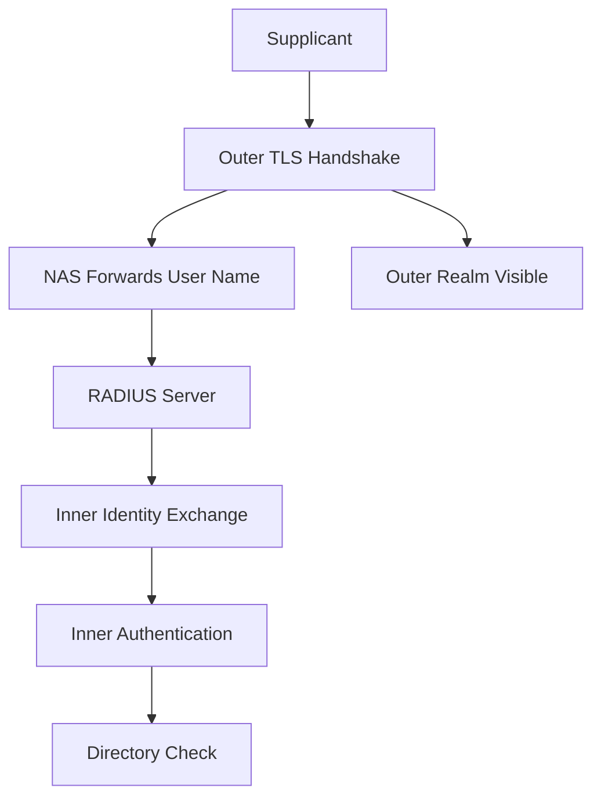

# Tunneled EAP, the Inner Identity, and What the Outer Realm Leaks

## English

When a supplicant uses a TLS-tunneled EAP method such as PEAP (Protected EAP) or EAP-TTLS (Tunneled TLS), the authentication happens in two layers. The outer layer is an unauthenticated TLS handshake between the supplicant and the RADIUS server, carrying a server certificate the supplicant is supposed to validate. Inside that tunnel, a second, inner authentication runs — typically MSCHAPv2 against a directory, or a client certificate, or a one-time password. The split exists because the outer layer must be readable by the NAS to route the conversation, while the inner layer carries the actual credentials and identity, which should never travel in the clear.

The subtlety is the outer identity. In EAP-Response/Identity, the supplicant sends a string that the NAS forwards to the server as the User-Name attribute. Many deployments send a placeholder there — something like anonymous@example.edu or a realm-only value — precisely so that an observer on the wireless medium learns only the realm, not the user. The real username is then sent inside the TLS tunnel in the inner identity exchange. This is often called identity privacy or identity hiding, and it is one of the main practical reasons to choose a tunneled method over plain EAP-MD5, which exposes the username in every exchange.

But the privacy is only as good as the outer realm's granularity. If the outer identity is anonymous@building7.example.edu, you have hidden the user but revealed the building. If it is anonymous@example.edu, you have revealed only the organisation. Some deployments go further and use a single realm for everyone, at the cost of making routing harder for a proxy tier — a RADIUS proxy routes on the realm portion of the User-Name, so a coarse outer realm means less routing information. There is a genuine tension between privacy and routability, and it is resolved per deployment, not by the protocol.

There is also an operational trap: some supplicants and some server configurations fall back to using the real username as the outer identity when the inner exchange fails or when a profile is misconfigured. A single misconfigured profile can therefore leak identities that the design intended to hide, and the leak is invisible in normal operation. Auditing what actually appears in Access-Request packets — not what the configuration says should appear — is the only reliable check, and it is worth doing periodically because profiles drift.

The server side has a matching responsibility: it must decide which inner methods it will accept, and it must not let the outer identity influence authorisation decisions. A common policy mistake is to write rules against User-Name when User-Name is the anonymous placeholder; the rule either matches everyone or matches no one. Authorisation should key on attributes that survive the tunnel — the inner identity, group membership pulled from the directory after inner authentication succeeds, or certificate attributes. Understanding which attributes are trustworthy at which stage of the conversation is the core skill here.

## 中文

當使用者端使用 PEAP（Protected EAP，受保護的 EAP）或 EAP-TTLS（Tunneled TLS，隧道式 TLS）這類 TLS 隧道式 EAP 方法時，認證發生在兩層。外層是使用者端與 RADIUS 伺服器之間未經認證的 TLS 握手，攜帶一張使用者端理應驗證的伺服器憑證。在隧道之內，第二層內層認證才真正執行——通常是對目錄做 MSCHAPv2，或客戶端憑證，或一次性密碼。之所以分層，是因為外層必須讓 NAS 讀得到以便路由對話，而內層攜帶真正的憑證與身分，這些絕不該以明文傳送。

微妙之處在於外層身分。在 EAP-Response/Identity 中，使用者端送出一個字串，NAS 將它轉為 User-Name 屬性轉發給伺服器。許多部署在此放佔位符——例如 anonymous@example.edu 或只有 realm 的值——正是為了讓無線媒介上的觀察者只學到 realm，而非使用者。真正的使用者名稱隨後在 TLS 隧道內的內層身分交換中送出。這常被稱為身分隱私或身分隱藏，也是選擇隧道式方法而非純 EAP-MD5 的主要實務理由之一，後者會在每次交換中暴露使用者名稱。

但隱私的好壞取決於外層 realm 的粒度。若外層身分是 anonymous@building7.example.edu，你藏了使用者卻洩漏了建築。若是 anonymous@example.edu，你只洩漏了組織。有些部署更進一步對所有人使用單一 realm，代價是讓代理層的路由更難——RADIUS 代理是依 User-Name 的 realm 部分路由的，粗糙的外層 realm 意味著更少的路由資訊。隱私與可路由性之間存在真實的張力，這要按部署個別解決，而非由協定解決。

還有一個營運陷阱：某些使用者端與某些伺服器設定會在內層交換失敗或設定檔配置錯誤時，退回使用真實使用者名稱作為外層身分。因此單一個配置錯誤的設定檔就可能洩漏設計上要隱藏的身分，而這種洩漏在日常運作中不可見。稽核 Access-Request 封包裡實際出現的內容——而非設定檔說應該出現的內容——是唯一可靠的檢查，而且值得定期做，因為設定檔會漂移。

伺服器端有對應的責任：它必須決定接受哪些內層方法，且不得讓外層身分影響授權決策。常見的政策錯誤是對 User-Name 寫規則，而 User-Name 其實是匿名佔位符；規則要嘛匹配所有人，要嘛誰都不匹配。授權應該以能穿過隧道的屬性為鍵——內層身分、內層認證成功後從目錄取得的群組成員資格，或憑證屬性。理解在對話的哪個階段哪些屬性可信，正是這裡的核心技能。

## Key Takeaway

Tunneled EAP hides the real username inside TLS, but the outer identity still leaks whatever the realm encodes — and misconfigured profiles can silently undo the whole design.

## Related Concepts
- EAP-Response/Identity and realm routing
- Server certificate validation in PEAP and TTLS

## Diagram

