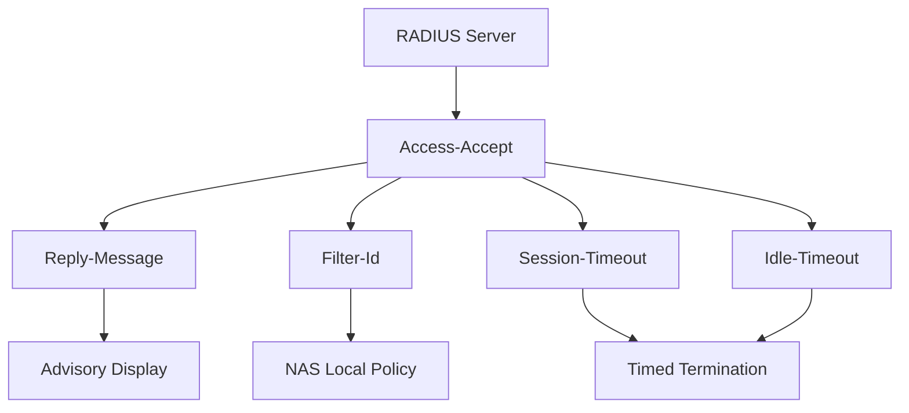

# The Reply-Message, Filter-Id, and Other Attributes That Quietly Change Behaviour

## English

Most discussion of RADIUS focuses on the accept-or-reject decision, but a large part of the protocol's practical power lives in the attributes a server sends back in an Access-Accept. These are instructions to the NAS, and they range from the cosmetic to the deeply consequential. Knowing the common ones turns a RADIUS server from a yes/no gate into a policy engine.

Reply-Message (attribute 18) is the simplest: a human-readable string the NAS may display to the user, often used to explain a rejection or to show a welcome banner. It is advisory — a NAS is free to ignore it — and it must never carry secrets, because it can end up on a user's screen or in a log. Filter-Id (attribute 11) is more interesting: a string the NAS interprets according to its own conventions, classically naming an access control list or a QoS policy to apply to the session. The RADIUS server does not know what the string means; the NAS does. That indirection is deliberate and lets one server serve many vendors, but it also means the meaning of a Filter-Id is a local contract that must be documented, because nothing in the protocol enforces it.

Session-Timeout (attribute 27) and Idle-Timeout (attribute 28) are the levers that make authorisation time-bounded. Session-Timeout tells the NAS to terminate the session after a number of seconds regardless of activity, which is how short-lived access — a guest pass, a maintenance window, a contractor's afternoon — is enforced without any follow-up message from the server. Idle-Timeout disconnects a session that has been quiet for a while, freeing switch ports and wireless associations. Both are advisory in the sense that the NAS must honour them, and a NAS that ignores them breaks the policy silently. Termination-Action (RFC 2865, attribute 29) sits alongside them but means something different: it tells the NAS what to do when the tunnel terminates (for example, re-authenticate the user), not which VLAN to put them in. VLAN placement comes from the tunnel attributes — Tunnel-Type, Tunnel-Medium-Type, and Tunnel-Private-Group-Id, which are standard attributes defined in RFC 2868 (the Vendor-Specific attribute 26 that carries tunnel attributes for arbitrary vendors is defined separately in RFC 2869) — and these work together, with the group ID being a string rather than a number.

Class (attribute 25) is the quiet workhorse. The server may include one or more Class attributes in an Access-Accept, and the NAS must echo them back verbatim in the Accounting-Request for that session. This is how a server correlates accounting records with the authorisation decision that created the session, even when the accounting stream goes to a different process or a different server. Without Class, an accounting record tells you a session existed; with Class, it tells you which policy authorised it. Any attribute the server wants echoed must go in Class, because it is the one attribute the NAS is required to return unmodified.

The operational lesson is that the reply is a contract with a specific NAS, and vendor behaviour varies. Before relying on an attribute, confirm the NAS actually implements it, confirm the value's format (some vendors want a number, some a string, some a comma-separated list), and confirm what happens when the attribute is absent. A policy that works on one switch family may be silently ignored on another. Documenting the reply contract per NAS model — and testing it — is unglamorous but is exactly where many authorisation bugs live.

## 中文

關於 RADIUS 的討論大多集中在接受或拒絕的決定上，但協定實務威力的一大部分，其實藏在伺服器於 Access-Accept 中回送的屬性裡。這些是給 NAS 的指令，從裝飾性的到後果深遠的都有。認識常見的幾個，就能把 RADIUS 伺服器從是/否的閘門變成政策引擎。

Reply-Message（屬性 18）最簡單：一段人類可讀的字串，NAS 可顯示給使用者，常用來解釋拒絕原因或顯示歡迎訊息。它是建議性的——NAS 有權忽略——而且絕不可攜帶機密，因為它可能出現在使用者螢幕或日誌中。Filter-Id（屬性 11）更有意思：一段由 NAS 依自身慣例解讀的字串，典型用途是命名要套用到工作階段的存取控制清單或 QoS 政策。RADIUS 伺服器不知道該字串的意思，NAS 才知道。這種間接是刻意的，讓一部伺服器服務多個廠商，但也意味著 Filter-Id 的意義是本地契約，必須寫成檔案，因為協定本身不強制任何東西。

Session-Timeout（屬性 27）與 Idle-Timeout（屬性 28）是讓授權有時間界限的槓桿。Session-Timeout 告訴 NAS 無論有無活動，都在若干秒後終止工作階段，這就是短期存取——訪客通行證、維護視窗、承包商的一個下午——在伺服器不再發任何後續訊息的情況下被強制執行的方式。Idle-Timeout 則在安靜一段時間後斷開工作階段，釋放交換機埠與無線關聯。兩者在「NAS 必須遵守」的意義上是建議性的，而忽略它們的 NAS 會無聲地破壞政策。Termination-Action（RFC 2865，屬性 29）同它們並列，但意思唔同：佢話嘅係隧道終止時 NAS 應該做咩（例如重新認證使用者），而唔係指定 VLAN。VLAN 分配來自隧道屬性——Tunnel-Type、Tunnel-Medium-Type 同 Tunnel-Private-Group-Id，三者係 RFC 2868 定義嘅標準屬性（承載廠商特定隧道屬性嘅 Vendor-Specific 屬性 26 則另外由 RFC 2869 定義）——三者要一起運作，而且 group ID 是字串而非數字。

Class（屬性 25）是安靜的主力。伺服器可在 Access-Accept 中包含一個或多個 Class 屬性，而 NAS 必須在該工作階段的 Accounting-Request 中原樣回傳。這就是伺服器把會計記錄與建立該工作階段的授權決定關聯起來的方式，即使會計流送往不同程式或不同伺服器也一樣。沒有 Class，會計記錄只告訴你有個工作階段存在；有 Class，它告訴你是哪條政策授權的。伺服器想被回傳的任何屬性都必須放進 Class，因為它是 NAS 被要求原樣回傳的唯一屬性。

營運上的教訓是：回覆是與特定 NAS 的契約，而廠商行為各異。依賴某屬性之前，要確認 NAS 真的實作了它、確認值的格式（有些廠商要數字，有些要字串，有些要逗號分隔清單），並確認屬性缺席時會怎樣。在一家交換機上可行的政策，在另一家可能被無聲忽略。按 NAS 型號記錄回覆契約——並且測試它——雖不光鮮，卻正是許多授權錯誤的所在。

## Key Takeaway

An Access-Accept is not just permission — it is a list of instructions to a specific NAS, and attributes like Class, Session-Timeout, and Filter-Id only work if you know exactly how that NAS interprets them.

## Related Concepts
- RADIUS reply attributes and NAS behaviour
- Accounting correlation via the Class attribute

## Diagram

