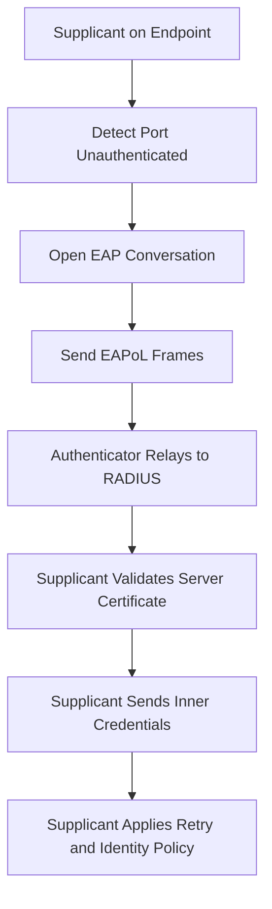

# The Supplicant Side: What the Client Must Actually Do

## English

Most RADIUS discussions treat the server as the interesting part, but the supplicant — the software on the user's machine that drives 802.1X authentication — carries a surprising amount of responsibility. On wired Ethernet, the supplicant is often a service like wpa_supplicant, the Windows native 802.1X client, or a vendor agent; on Wi-Fi it is usually built into the operating system. Its job is to detect that a port is unauthenticated, open an EAP conversation over the link, and hand credentials to the authenticator (the switch or access point) inside EAPoL frames. Because the authenticator is just a relay, every EAP method negotiation, every certificate check, and every inner-identity decision happens on the endpoint.

That means the supplicant is where trust is actually anchored. When you configure PEAP or EAP-TTLS, the supplicant is told which server certificate to expect — its common name, its issuing CA, sometimes a certificate pin. If that check is loose or disabled, the tunnel is encrypted but unauthenticated, and an attacker running a rogue access point with a fake RADIUS server can harvest the inner credentials. This is the classic evil-twin attack, and it is defeated on the client, not the server. Good deployments push a trusted CA and an expected server name through device management so users cannot click past the warning.

The supplicant also decides when to retry, when to fall back to machine authentication versus user authentication, and how to behave during the boot sequence. A laptop that boots before the user logs in can authenticate with its machine certificate, get placed in a restricted VLAN, then re-authenticate as the human user once credentials are available. That two-phase dance is entirely supplicant policy. Some supplicants also support EAP-TLS with hardware-backed keys (TPM, secure enclave), so the private key never leaves the chip.

Operationally, the supplicant is where most support tickets originate. Certificate expiry on the client, a mismatched CA bundle, a supplicant that does not support the EAP method the server offers, or a driver that drops EAPoL frames during sleep — these all look like "the network is broken" to the user. A well-run NAC deployment therefore treats supplicant configuration as a managed, versioned artifact, tests it against the server's offered methods, and monitors authentication failures by client type so a bad supplicant build is spotted before it spreads.

## 中文

大部分 RADIUS 討論都把伺服器當作重點，但 supplicant（用戶端機器上驅動 802.1X 認證的軟件）其實承擔了相當多的責任。在有線乙太網上，supplicant 通常是 wpa_supplicant 這類服務、Windows 內建的 802.1X 用戶端，或廠商代理程式；在 Wi-Fi 上則多半內建於作業系統。它的工作是偵測到連接埠尚未認證、在鏈路上開啟 EAP 對話，並把憑證放進 EAPoL 訊框交給 authenticator（交換機或無線基地台）。因為 authenticator 只是中繼，所有 EAP 方法協商、憑證檢查與內層身分決定，其實都在終端上發生。

換句話說，信任的錨點其實在 supplicant。當你設定 PEAP 或 EAP-TTLS 時，supplicant 會被要求預期哪一張伺服器憑證——它的 common name、簽發的 CA，有時甚至是憑證 pin。如果這項檢查太寬鬆或被關掉，通道雖然加密卻未經驗證，攻擊者只要架設流氓基地台配上假 RADIUS 伺服器，就能收割內層憑證。這就是經典的 evil-twin 攻擊，而防線在用戶端，不在伺服器。良好的部署會透過裝置管理推送受信任的 CA 與預期的伺服器名稱，讓使用者無法隨手略過警告。

Supplicant 也決定何時重試、何時從機器認證退回使用者認證，以及開機流程中如何行為。一台在使用者登入前就開機的筆電，可以先用機器憑證認證、被放進受限 VLAN，等使用者憑證可用後再以人類使用者身分重新認證。這段兩階段流程完全是 supplicant 政策。部分 supplicant 也支援以硬體保護金鑰（TPM、安全隔離區）進行 EAP-TLS，私鑰永遠不離開晶片。

在維運上，supplicant 是多數支援工單的來源。用戶端憑證過期、CA 套件不符、supplicant 不支援伺服器提供的方法，或驅動程式在睡眠時丟棄 EAPoL 訊框——這些對使用者來說都像「網路壞了」。因此，一個管理良好的 NAC 部署會把 supplicant 設定視為受管理、有版本的產物，針對伺服器提供的方法測試，並依用戶端類型監控認證失敗，讓壞掉的 supplicant 版本在擴散前就被發現。

## Key Takeaway

The supplicant on the endpoint is where server trust is actually verified and where most NAC failures surface, so it deserves the same engineering rigour as the RADIUS server itself.

## Related Concepts
- EAP methods
- evil twin attack

## Diagram

