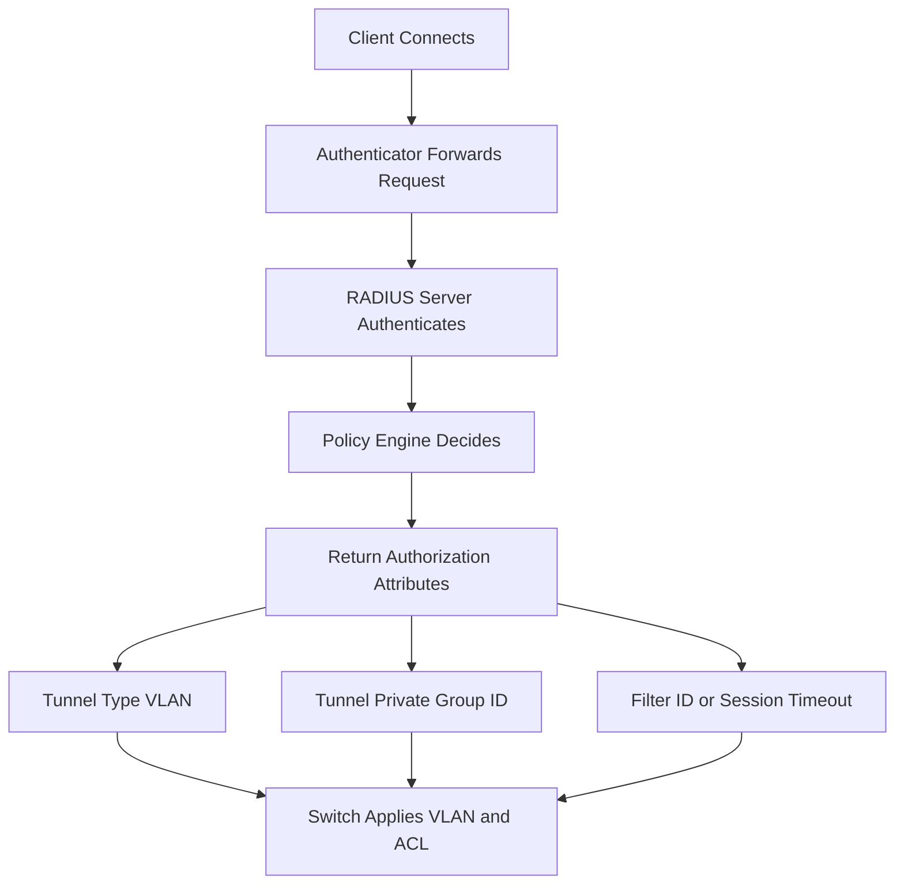

# VLAN Assignment and the Authorization Decision

## English

One of RADIUS's most consequential jobs is telling the network which virtual network a device should land in. When authentication succeeds, the RADIUS server sends back attributes that the authenticator interprets as authorization instructions. The classic trio is Tunnel-Type, Tunnel-Medium-Type, and Tunnel-Private-Group-ID: together they instruct a switch or access point to place the session into a specific VLAN. Tunnel-Type is typically set to VLAN (value 13), Tunnel-Medium-Type to IEEE-802 (value 6), and Tunnel-Private-Group-ID carries the VLAN identifier as a string. Because these are standard attributes, they work across vendors, though a few platforms also accept vendor-specific alternatives.

This is where RADIUS becomes a policy engine rather than a password checker. The server can decide, based on group membership, device posture, time of day, or the SSID the client connected to, that a laptop belongs in the employee VLAN, a guest phone in the guest VLAN, and an unknown device in a quarantine VLAN. The switch does not need to know any of that logic — it simply applies the VLAN it is told to apply. Centralising the decision means one change on the server re-routes thousands of ports at once, which is the whole point of a NAC architecture.

Beyond VLANs, the same mechanism can push a Filter-Id attribute that names an access control list already configured on the switch, or a vendor-specific attribute that sets a QoS profile, an ACL, or a captive-portal redirect. Some deployments use the Class attribute to carry an opaque token the NAS echoes back in accounting records, letting the server correlate sessions with policy decisions later. Others use Session-Timeout to force periodic re-authentication, so a device that has drifted out of compliance is re-evaluated on a schedule rather than staying connected forever.

The subtlety is that authorization attributes are advisory: the NAS decides whether to honour them. A misconfigured switch might ignore Tunnel-Private-Group-ID and dump everyone into the default VLAN, or a vendor might expect a slightly different attribute encoding. Testing the full path — server policy, attribute encoding, switch interpretation — is essential, because a silent mismatch produces a network that authenticates everyone correctly and then puts them all in the wrong place. Monitoring which VLAN each session actually landed in, not just whether authentication succeeded, is the only way to catch this class of bug.

## 中文

RADIUS 最具影響力的工作之一，就是告訴網路某台裝置應該落在哪個虛擬網路。當認證成功，RADIUS 伺服器會回傳一些屬性，authenticator 會把它們解讀為授權指示。經典的三個是 Tunnel-Type、Tunnel-Medium-Type 與 Tunnel-Private-Group-ID：三者合起來指示交換機或基地台把該工作階段放進特定 VLAN。Tunnel-Type 通常設為 VLAN（值 13），Tunnel-Medium-Type 設為 IEEE-802（值 6），Tunnel-Private-Group-ID 則以字串攜帶 VLAN 識別碼。因為這些是標準屬性，跨廠商大致可用，不過少數平台也接受廠商特定的替代屬性。

這裡正是 RADIUS 從密碼檢查器變成政策引擎的地方。伺服器可以根據群組成員身分、裝置狀態、時間，或用戶端連上的 SSID，決定某台筆電屬於員工 VLAN、某支訪客手機屬於訪客 VLAN，而某台未知裝置屬於隔離 VLAN。交換機不需要懂這些邏輯——它只套用被指示的 VLAN。把決策集中化，意味著伺服器上改一次就能同時改變數千個連接埠的走向，這正是 NAC 架構的意義。

除了 VLAN，同一套機制也能推送 Filter-Id 屬性，指向交換機上已設定的存取控制清單；或推送廠商特定屬性，設定 QoS 設定檔、ACL 或強制入口網站重導。有些部署用 Class 屬性攜帶一個不透明權杖，NAS 會在 accounting 記錄中回傳，讓伺服器日後能把工作階段與政策決定對應起來。另一些則用 Session-Timeout 強制定期重新認證，讓偏離合規狀態的裝置按排程重新評估，而不是永遠連著。

微妙之處在於授權屬性是建議性的：NAS 自行決定是否遵守。設定錯誤的交換機可能忽略 Tunnel-Private-Group-ID，把所有人丟進預設 VLAN；廠商也可能期待略有不同的屬性編碼。因此測試整條路徑——伺服器政策、屬性編碼、交換機解讀——至關重要，因為無聲的不匹配會產生一個「每個人都認證成功，然後全被放到錯地方」的網路。監控每個工作階段實際落在哪個 VLAN，而不只是認證是否成功，是捕捉這類錯誤的唯一方法。

## Key Takeaway

VLAN assignment via Tunnel attributes turns RADIUS into a central policy engine, but the NAS must honour what it is told, so end-to-end testing and per-session VLAN monitoring are essential.

## Related Concepts
- Tunnel-Private-Group-ID
- Filter-Id

## Diagram

