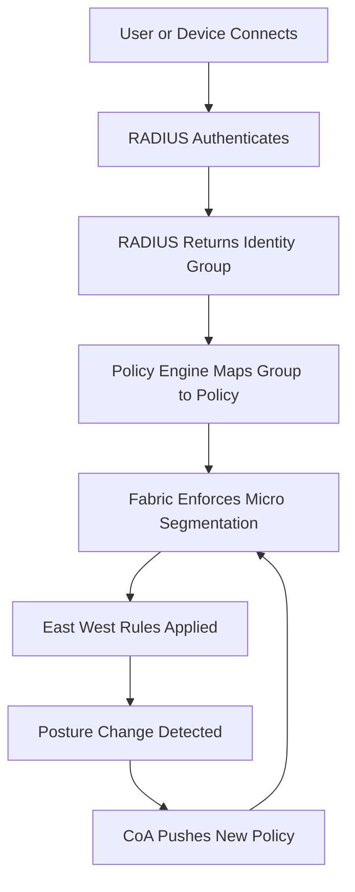

# RADIUS in a Zero Trust World: Segmentation, Micro-Perimeters, and Identity-Aware Networks

## English

For decades RADIUS was the front door: authenticate at the switch port, get a VLAN, and then trust everything inside that VLAN. Zero Trust thinking dismantles that model. If an attacker gets past the door — through a compromised endpoint, a stolen credential, or a misconfigured device — a flat VLAN gives them lateral movement. The modern answer is to use RADIUS not as a one-time gate but as a continuous source of identity that feeds segmentation, so the network knows who is on each packet, not just who opened the port.

One pattern is to combine 802.1X with micro-segmentation. RADIUS still authenticates the device and returns a group, but the group is mapped to a security policy in a software-defined fabric rather than a simple VLAN. The fabric then enforces east-west rules: a developer laptop can reach the code repository but not the finance database, even though both sit on the same physical network. The RADIUS decision becomes an input to policy, and the policy engine can re-evaluate when the device's posture changes, using the dynamic authorization (CoA) mechanism to push a new policy without dropping the link.

Another pattern is identity-aware proxying. Instead of relying solely on network location, access to an application is gated by an identity provider that has already learned who the user is — often via the same directory that backs RADIUS. The network layer and the application layer then share a common identity vocabulary, so a session that RADIUS authenticated as "contractor, unmanaged device" can be treated consistently by the switch, the firewall, and the application gateway. This is where RADIUS, once a standalone protocol, becomes one signal among many in a broader policy fabric.

The practical consequence is that RADIUS deployments now need to expose their decisions as data. Accounting records, session identifiers, and group memberships must be queryable by the segmentation controller, and the controller must be able to ask RADIUS to re-evaluate a session. That closes the loop: authenticate, authorize, monitor, and if something drifts, re-authorize. The protocol itself has not changed much since the 1990s, but its role has shifted from gatekeeper to identity sensor, and the surrounding architecture — directories, policy engines, segmentation fabrics — now does much of the heavy lifting.

## 中文

幾十年來，RADIUS 一直是大門：在交換機連接埠上認證、取得 VLAN，然後信任該 VLAN 內的一切。Zero Trust 思維拆解了這個模型。如果攻擊者越過大門——透過被入侵的終端、竊得的憑證或設定錯誤的裝置——平坦的 VLAN 就給了他們橫向移動的空間。現代的答案是把 RADIUS 當成持續的身分來源，而不是一次性的關卡，讓網路知道每個封包上是誰，而不只是誰打开了連接埠。

一種模式是把 802.1X 與微切分（micro-segmentation）結合。RADIUS 仍然認證裝置並回傳群組，但群組被對應到軟體定義網路中的安全政策，而不是單純的 VLAN。網路織構接著執行東西向規則：開發者筆電可以連到程式碼儲存庫，但碰不到財務資料庫，即使兩者位於同一個實體網路上。RADIUS 的決定成為政策的輸入，而政策引擎可以在裝置狀態改變時重新評估，利用動態授權（CoA）機制推送新政策而不中斷連線。

另一種模式是身分感知代理。存取應用程式不再只依賴網路位置，而是由已經知道使用者是誰的身分提供者把關——通常透過支撐 RADIUS 的同一個目錄。網路層與應用層於是共享一套身分詞彙，讓一個被 RADIUS 認證為「承包商、非受管裝置」的工作階段，能被交換機、防火牆與應用閘道一致地對待。RADIUS 原本是獨立協定，在這裡成為更廣泛政策織構中的一個訊號。

實際後果是，RADIUS 部署現在必須把它的決定當成資料暴露出來。Accounting 記錄、工作階段識別碼與群組成員身分必須能被切分控制器查詢，而控制器必須能要求 RADIUS 重新評估某個工作階段。這就形成閉環：認證、授權、監控，一旦有偏移就重新授權。協定本身自 1990 年代以來變化不大，但它的角色已從守門人轉變為身分感測器，周邊架構——目錄、政策引擎、切分織構——承擔了大部分繁重工作。

## Key Takeaway

In a Zero Trust architecture RADIUS shifts from a one-time gate to a continuous identity sensor that feeds segmentation and policy engines, closing the loop between authentication, authorization, and monitoring.

## Related Concepts
- Zero Trust
- micro-segmentation

## Diagram

