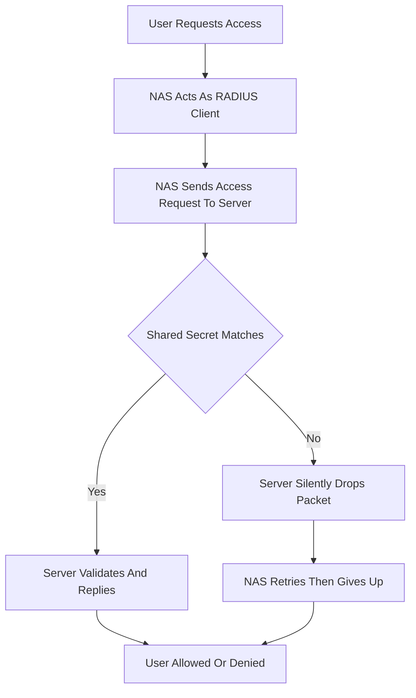

# RADIUS Client Configuration on the NAS: What the Switch Must Know

## English

Every RADIUS conversation starts because a network access server (NAS) — a switch, wireless controller, VPN concentrator, or DSL access multiplexer — decided to ask a question. The NAS is the RADIUS *client*, which confuses people because the human with a laptop is also called a client. Think of the NAS as a customs officer standing at the door: it does not know who you are, so it phones headquarters (the RADIUS server) and repeats what you said. To do that, the NAS needs four things configured: the server's IP address or hostname, the shared secret, a timeout, and a retry count. Get any of these wrong and the symptom is usually the same — users cannot get on the network, and the logs show nothing useful on the server side because the packets never arrived or were silently discarded.

The shared secret is the most common source of grief. RADIUS does not encrypt the whole packet. In an Access-Request the Request Authenticator is simply a 16-octet random value generated by the NAS (RFC 2865, section 3) — it is not derived from the secret at all. The secret is used with MD5 in two other places: to obfuscate the User-Password attribute (b1 = MD5(S + RA)), and to compute the Response Authenticator (MD5(Code + ID + Length + Request Auth + Attributes + Secret)) that allows the client to verify the server's reply. An MD5-based Request Authenticator exists only in an Accounting-Request (RFC 2866, section 3). Now consider a mismatch: if the NAS and server disagree on the secret by even one character, the server still matches the client by source IP address and replies normally. It is the client that fails to verify the Response Authenticator and discards the reply. From the NAS's point of view this looks identical to a dead server, so it retries and eventually gives up. The server discards a packet silently only when the client IP address and port have no shared secret configured. This is why troubleshooting almost always begins with 'did you mistype the secret on both sides?'

Timeouts and retries matter more than they look. Because RADIUS rides on UDP, a lost packet produces no error — just silence. A typical NAS is configured with something like a 3–5 second timeout and 3 retries before it declares the server dead and moves to the next one in its list. Set the timeout too short and a busy server under load will be declared dead while it is merely slow; set it too long and users stare at a spinning login prompt. Many vendors also expose a 'dead time' — how long the NAS ignores a server after marking it dead — so a flapping server does not get hammered.

Beyond credentials, the NAS configuration defines *what it will tell the server*. It sends attributes like NAS-Identifier, NAS-IP-Address, NAS-Port, and Calling-Station-Id so the server can make context-aware decisions. A switch port might report its own interface name; a wireless controller reports the SSID and the access point's MAC. If the NAS is not configured to send the attribute your policy depends on, the policy silently fails open or closed depending on your defaults — a subtle but common bug.

Finally, the NAS is where the enforcement happens. The server's reply is just advice: 'put this user in VLAN 42', 'apply this filter', 'this session gets 10 Mbps'. The NAS must be configured to honour those attributes. A switch that does not have VLAN 42 defined, or that lacks the vendor-specific attribute support, will accept the Access-Accept and then do nothing useful. So when designing a deployment, treat the NAS configuration as a first-class artifact: version it, template it, and test it, because half of all RADIUS outages live there rather than on the server.

## 中文

每一段 RADIUS 對話的起點，都是某部網絡存取伺服器（NAS）——交換機、無線控制器、VPN 集中器或 DSL 存取多工器——決定要問一個問題。NAS 才是 RADIUS 的「客戶端」，這一點常令人混淆，因為拿著筆記型電腦的人類也叫 client。可以把 NAS 想像成站在門口的關員：它不知道你是誰，所以打電話回總部（RADIUS 伺服器），把你說的話重複一遍。為此，NAS 需要配置四樣東西：伺服器的 IP 位址或主機名、共用密鑰（shared secret）、逾時時間、重試次數。任何一項配錯，症狀通常都一樣——用戶上不了網，而伺服器端的日誌甚麼有用的東西都沒有，因為封包根本沒到，或者被靜靜地丟棄了。

共用密鑰是最常見的煩惱來源。RADIUS 並不加密整個封包。在 Access-Request 中，Request Authenticator 只是由 NAS 產生的 16 位元組隨機值（RFC 2865 第 3 節）——它根本不是由密鑰推導出來的。密鑰配合 MD5 用在另外兩處：隱藏 User-Password 屬性（b1 = MD5(S + RA)），以及計算 Response Authenticator（MD5(Code + ID + Length + Request Auth + Attributes + Secret)），讓客戶端得以驗證伺服器的回覆。只有在 Accounting-Request 中，Request Authenticator 才是以 MD5 為基礎的（RFC 2866 第 3 節）。現在看密鑰不符的情況：若 NAS 與伺服器的密鑰相差一個字元，伺服器仍會按來源 IP 位址配對到該客戶端並正常回覆；是客戶端無法驗證 Response Authenticator，因而丟棄了回覆。從 NAS 的角度看，這與伺服器死機完全一樣，所以它會重試，最後放棄。伺服器只有在客戶端的 IP 位址與端口完全沒有設定共用密鑰時，才會靜靜丟棄封包。這就是為甚麼排錯幾乎總是由「兩邊的密鑰有沒有打錯？」開始。

逾時與重試比表面看來重要得多。因為 RADIUS 跑在 UDP 上，封包遺失不會產生錯誤——只有沉默。典型的 NAS 會設定約 3 至 5 秒逾時、重試 3 次，然後宣告該伺服器死亡，轉向清單中的下一部。逾時設得太短，忙碌的伺服器只是慢一點也會被當成死了；設得太長，用戶就對著轉圈的登入畫面發呆。很多廠商還提供「死亡時間」（dead time）——NAS 標記某伺服器死亡後，多久之內不再理它——以免反覆故障的伺服器被不斷打擾。

除了憑證之外，NAS 的配置還決定了它會告訴伺服器甚麼。它會送出 NAS-Identifier、NAS-IP-Address、NAS-Port、Calling-Station-Id 等屬性，讓伺服器能作出有情境意識的判斷。交換機端口可能回報自己的介面名稱；無線控制器則回報 SSID 和接入點的 MAC。若 NAS 沒有配置送出你的政策所依賴的屬性，政策就會默默地失效——視乎預設值而開或關——這是個微妙但常見的錯誤。

最後，NAS 才是執行的地方。伺服器的回覆只是建議：「把這個用戶放進 VLAN 42」、「套用這個過濾器」、「這個工作階段限速 10 Mbps」。NAS 必須配置成會遵守這些屬性。一部沒有定義 VLAN 42、或缺乏相應廠商特定屬性支援的交換機，會接受 Access-Accept 然後甚麼也不做。所以設計部署時，要把 NAS 配置視為一級資產：納入版本控制、做成範本、加以測試，因為一半的 RADIUS 事故都住在那裡，而不是在伺服器上。

## Key Takeaway

The RADIUS client (NAS) configuration — shared secret, timeouts, retries, and which attributes it sends and honours — is where most real-world RADIUS failures actually live.

## Related Concepts
- Shared Secret
- NAS-Identifier

## Diagram

