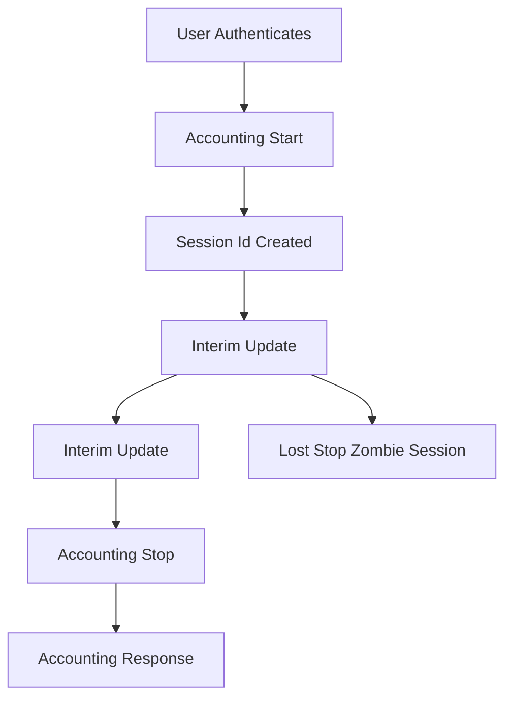

# The Accounting Session: Start, Interim-Update, and Stop as a Lifecycle Record

## English

Authentication gets all the attention, but RADIUS accounting is where the network remembers what actually happened. When a user successfully authenticates, the NAS does not just let them in and forget about it. It opens an *accounting session*: it sends an Accounting-Request with Acct-Status-Type set to Start, carrying a unique Acct-Session-Id, the username, the NAS identity, and a timestamp. Later it sends Interim-Update records at intervals — commonly every five or ten minutes — and finally a Stop record when the session ends, which includes counters such as Acct-Input-Octets, Acct-Output-Octets, Acct-Session-Time, and a termination cause. The server replies with Accounting-Response, and accounting packets *are* retransmitted: RFC 2866 (section 2) explicitly recommends that Accounting-Requests be retried until they are acknowledged, using backoff and multiple resends. That is precisely because a lost or duplicated Stop record is a real problem: the session may appear open forever, or be closed twice and leave the accounting state inconsistent.

Why does this matter beyond billing? Consider a university campus where a student's laptop connects to Wi-Fi in the morning, roams between access points, and disconnects at night. The Start record tells you the session began; the Interim-Updates show the device moving between APs and how much traffic it consumed; the Stop record closes the ledger. If the Stop is lost, the accounting database shows an active session that never ends. Over months, these 'zombie sessions' inflate concurrent-user counts, break capacity planning, and can even block re-authentication on some NAS platforms that enforce a one-session-per-user rule. Good operations teams run reconciliation jobs that close sessions older than a threshold, or rely on Interim-Updates as a heartbeat so a missing update implies the session is dead.

Accounting also underpins security investigation. If a compromised account was used at 3 a.m., the accounting trail shows which NAS it hit, from which port or SSID, how long it stayed, and how much data moved. That is often more actionable than the authentication log, which only says 'accepted'. In regulated environments, accounting records are frequently retained for months or years, so the design must consider storage growth: a large campus can generate millions of records per day.

The protocol details are worth knowing. Accounting-Request packets carry an Acct-Session-Id that must be unique per session and stable across Start, Interim-Update, and Stop. The Acct-Status-Type attribute distinguishes them. There is also Accounting-On and Accounting-Off, which a NAS sends when it reboots or shuts down — a signal that any sessions it previously reported should be considered terminated. This is the network's way of saying 'I lost my state, please clean up'. Servers that ignore Accounting-On end up with stale sessions after every switch reboot.

A practical tip: treat accounting as a separate data pipeline from authentication. It has different volume, different retention needs, and different failure modes. Many deployments send accounting to a dedicated database or SIEM while authentication logs stay local. And remember that accounting is not authenticated the same way — it uses the Request Authenticator and shared secret for integrity, but there is no challenge-response. So protect the accounting path with the same care as authentication, because forged accounting records can hide activity as effectively as they can reveal it.

## 中文

認證吸引了所有注意力，但 RADIUS 計費（accounting）才是網絡真正記住發生了甚麼的地方。當用戶成功認證後，NAS 不只是放行然後忘記。它開啟一個「計費工作階段」：送出 Accounting-Request，Acct-Status-Type 設為 Start，攜帶一個唯一的 Acct-Session-Id、用戶名、NAS 身分和時間戳。之後它會按間隔送出 Interim-Update 記錄——通常是每五或十分鐘——最後在連線結束時送出 Stop 記錄，內含 Acct-Input-Octets、Acct-Output-Octets、Acct-Session-Time 及終止原因等計數。伺服器回覆 Accounting-Response，而計費封包*確實會*重傳：RFC 2866（第 2 節）明確建議 Accounting-Request 應在獲得確認前不斷重試，採用退避（backoff）並多次重送。這正是因為遺失或重複的 Stop 記錄是真正的問題：該工作階段可能永遠顯示為開啟，或者被關閉兩次，令計費狀態不一致。

除了計費之外，這還有何重要？想像一個大學校園，學生的筆記型電腦早上連上 Wi-Fi，在接入點之間漫遊，晚上斷線。Start 記錄告訴你工作階段開始了；Interim-Update 顯示裝置在 AP 之間移動及用了多少流量；Stop 記錄結清賬目。若 Stop 遺失，計費資料庫就會顯示一個永不結束的活躍工作階段。幾個月下來，這些「殭屍工作階段」會虛增並行用戶數、破壞容量規劃，甚至在某些強制一人一工作階段的 NAS 平台上阻止重新認證。優秀的營運團隊會執行對賬工作，關閉超過門檻的舊工作階段，或倚賴 Interim-Update 作為心跳，一旦缺少更新就推斷該工作階段已死。

計費也是安全調查的基礎。若某個被入侵的帳戶在凌晨三點被使用，計費軌跡會顯示它打了哪部 NAS、從哪個端口或 SSID、停留多久、傳了多少數據。這往往比只說「已接受」的認證日誌更有行動價值。在受監管的環境中，計費記錄常被保留數月至數年，所以設計時必須考慮儲存增長：一個大型校園每天可產生數百萬條記錄。

協議細節值得了解。Accounting-Request 封包帶有 Acct-Session-Id，必須每個工作階段唯一，且在 Start、Interim-Update、Stop 之間保持穩定。Acct-Status-Type 屬性用來區分它們。另外還有 Accounting-On 和 Accounting-Off，是 NAS 重啟或關機時送出的——表示它之前報告過的任何工作階段都應視為已終止。這是網絡在說「我丟了狀態，請清理」。忽略 Accounting-On 的伺服器，每次交換機重啟後都會留下過時的工作階段。

一個實用貼士：把計費視為與認證分開的數據管道。它的流量、保留需求和故障模式都不同。很多部署把計費送到專用資料庫或 SIEM，而認證日誌留在本機。還要記住計費的認證方式不同——它用 Request Authenticator 和共用密鑰保證完整性，但沒有挑戰回應。所以要用與認證同等的小心保護計費路徑，因為偽造的計費記錄既能揭示活動，也能同樣有效地隱藏活動。

## Key Takeaway

Accounting turns RADIUS from a yes/no gate into a full session ledger, and its Start/Interim-Update/Stop lifecycle is what makes billing, capacity planning, and forensic investigation possible.

## Related Concepts
- Acct-Session-Id
- Accounting-Request

## Diagram

