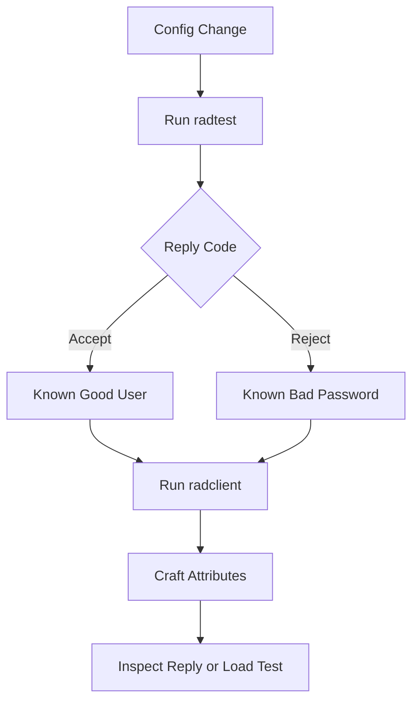

# Testing a RADIUS Deployment: radclient, radtest, and the Art of Synthetic Probes

## English

You cannot trust a RADIUS deployment you have never poked at with a packet. Fortunately, the FreeRADIUS ecosystem ships two small command-line tools that let you act like a NAS without touching a switch: `radtest` and `radclient`. They are the equivalent of `ping` and `curl` for AAA, and learning them turns vague 'the Wi-Fi is broken' complaints into precise, reproducible facts.

`radtest` is the quick one. A typical invocation looks like `radtest alice secretpass localhost 0 testing123`, where the arguments are username, password, server, NAS port number, and shared secret. It sends a single Access-Request and prints the reply code — Access-Accept, Access-Reject, or Access-Challenge. This is the first thing to run after any configuration change: does a known-good user still get accepted? Does a known-bad password still get rejected? If `radtest` fails but the switch works, the problem is likely in the NAS configuration or the network path; if `radtest` also fails, the server is the suspect. That single distinction saves hours.

`radclient` is the power tool. It reads a file of attribute-value pairs and can send any packet type — the packet types FreeRADIUS 4.0.0 radclient supports are `auth`, `acct`, `status`, `disconnect` and `auto` — with arbitrary attributes. Note that there is no named `coa` type: a CoA-Request (code 40) can only be sent by passing the raw decimal packet code. Want to test whether your policy correctly assigns VLAN 42 to a user in a particular group? Craft a request with the right User-Name and Calling-Station-Id, send it, and inspect the reply attributes. Want to verify that a CoA actually disconnects a session? Send a Disconnect-Request with the Acct-Session-Id and watch the NAS respond. `radclient` also supports sending many requests in a loop, which is how you load-test or fuzz a policy before it meets real users.

A few practical patterns make these tools far more useful. First, always test from a host whose IP the server recognises as a client — otherwise the server silently drops the packet because the source is not in `clients.conf`. Second, capture the exchange with `tcpdump` or Wireshark on UDP port 1812 (authentication) and 1813 (accounting) so you can see exactly what was sent and received, including the absence of a reply. Third, keep a small library of test users covering the interesting cases: a valid user, an expired account, a disabled account, a user in each VLAN group, and a user who should trigger a Challenge. Running that suite after every change is a poor person's regression test.

Finally, remember what these tools cannot tell you. They verify the server's decision, not the NAS's enforcement. A server can correctly return VLAN 42 while the switch quietly ignores it. So pair synthetic probes with real-device tests: authenticate from an actual laptop on an actual port and confirm the VLAN, the filter, and the bandwidth actually applied. The gap between 'the server said yes' and 'the user got the right access' is exactly where production incidents hide, and closing that gap is what separates a working deployment from a merely configured one.

## 中文

你不可能信任一個從未用封包戳過的 RADIUS 部署。幸運的是，FreeRADIUS 生態附帶兩個小型命令列工具，讓你不用碰交換機也能扮演 NAS：`radtest` 和 `radclient`。它們相當於 AAA 世界的 `ping` 和 `curl`，學會它們就能把含糊的「Wi-Fi 壞了」投訴，變成精確、可重現的事實。

`radtest` 是快速的那個。典型用法像 `radtest alice secretpass localhost 0 testing123`，參數依次是使用者名稱、密碼、伺服器、NAS 端口號、共用密鑰。它送出單一 Access-Request 並印出回覆碼——Access-Accept、Access-Reject 或 Access-Challenge。任何配置改動後第一件要跑的就是它：一個已知良好的用戶是否仍被接受？一個已知錯誤的密碼是否仍被拒絕？若 `radtest` 失敗但交換機正常，問題很可能在 NAS 配置或網絡路徑；若 `radtest` 也失敗，嫌疑就在伺服器。單是這個區分就能省下數小時。

`radclient` 是重型工具。它讀取一個屬性-值對檔案，可送出任何封包類型——FreeRADIUS 4.0.0 的 radclient 支援的封包類型為 `auth`、`acct`、`status`、`disconnect` 與 `auto`——並附帶任意屬性。注意當中並沒有命名為 `coa` 的類型：CoA-Request（代碼 40）只能以原始十進位代碼送出。想測試你的政策是否正確地把某群組的用戶分配到 VLAN 42？構造一個帶正確 User-Name 和 Calling-Station-Id 的請求，送出，然後檢查回覆屬性。想驗證 CoA 是否真的斷開某個工作階段？送出帶 Acct-Session-Id 的 Disconnect-Request，觀察 NAS 的回應。`radclient` 還支援在迴圈中送出大量請求，這就是你在政策接觸真實用戶之前做壓力測試或模糊測試的方法。

幾個實用模式令這些工具更有用。第一，永遠從伺服器認可為客戶端的主機測試——否則伺服器會因為來源不在 `clients.conf` 而靜靜丟棄封包。第二，用 `tcpdump` 或 Wireshark 在 UDP 端口 1812（認證）和 1813（計費）擷取交換過程，讓你能確切看到送了甚麼、收了甚麼，包括「沒有回覆」這件事。第三，保留一小組測試用戶，覆蓋有趣的情況：有效用戶、過期帳戶、停用帳戶、每個 VLAN 群組各一用戶，以及一個應觸發 Challenge 的用戶。每次改動後跑這套測試，就是窮人的回歸測試。

最後，記住這些工具不能告訴你的事。它們驗證的是伺服器的決定，不是 NAS 的執行。伺服器可以正確地回覆 VLAN 42，而交換機靜靜地忽略它。所以要把合成探測與真實裝置測試配對：從真實的筆記型電腦、真實的端口認證，並確認 VLAN、過濾器和頻寬確實套用了。「伺服器說可以」與「用戶得到正確存取」之間的落差，正是生產事故藏身之處；填補這個落差，就是把「能運作」的部署與「僅被配置」的部署分開的關鍵。

## Key Takeaway

radtest and radclient let you reproduce and isolate RADIUS problems from a laptop, but they only prove what the server decided — real-device tests are still needed to prove the NAS enforced it.

## Related Concepts
- radclient
- Access-Request

## Diagram

