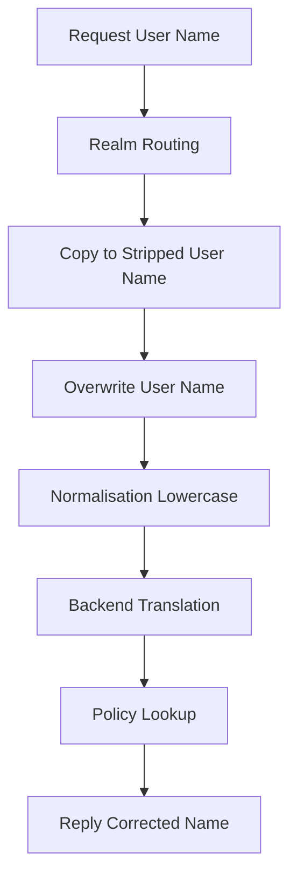

# The User-Name Attribute and Identity Rewriting: What the Server Can Change Before It Answers

## English

The User-Name attribute (attribute 1, string type) is the one field almost every RADIUS request carries, and it is tempting to think of it as a fixed label the client sends and the server merely reads. In practice it is a mutable field that policy can rewrite mid-flight, and understanding that is the difference between a working deployment and one that silently fails on edge cases.

The first reason it is mutable is realm routing. A supplicant typically sends something like alice@staff.example.edu, and the server strips the @staff.example.edu portion (the realm) to find the bare account name, while using the realm to decide which virtual server or proxy target handles the request. In FreeRADIUS this is done in the preprocess or realm-handling stage, and the classic pattern is to copy the original into a custom attribute such as Stripped-User-Name before overwriting User-Name. If you overwrite without preserving, you lose the ability to log who actually connected.

The second reason is normalisation. Directories are case-insensitive about usernames, but RADIUS strings are byte comparisons, so alice@example.edu and Alice@Example.edu can hit different policy branches. Many deployments lowercase the User-Name early so that later comparisons, group lookups, and accounting joins behave consistently. Similarly, backends that expect a domain-qualified name (DOMAIN\alice) while the supplicant sends alice@domain may need translation in both directions, and the reply must sometimes carry a corrected name back.

A subtle trap is that the User-Name in the request is often the outer identity for tunnelled EAP (PEAP/TTLS), which may be anonymous or a realm-only placeholder, while the real inner identity arrives later inside the TLS tunnel. Policy that keys off User-Name before the tunnel is established can therefore make decisions on a value that is deliberately meaningless. This is why the inner identity is usually copied into a separate attribute once decrypted, and why authorization rules should reference that attribute, not the outer one.

Finally, remember that User-Name appears in accounting packets too. If the request path rewrote the name but the accounting path did not, your session records will not join to your authentication logs, and troubleshooting becomes guesswork. The practical discipline is: define one canonical identity form, normalise to it as early as possible, preserve the original in a custom attribute, and apply the identical transformation to Access-Request and Accounting-Request alike.

## 中文

User-Name 屬性（屬性編號 1，字串型別）幾乎是每個 RADIUS 請求都會攜帶的欄位，很容易令人以為它是客戶端送出、伺服器只負責讀取的固定標籤。實際上它是一個可以在傳輸途中被政策改寫的可變欄位，明白這一點，就是能夠正常運作與在邊界情況悄悄失敗之間的差別。

它之所以可變，第一個原因是 realm 路由。supplicant 通常會送出類似 alice@staff.example.edu 的字串，伺服器會剝掉 @staff.example.edu 這一段（即 realm），找出真正的帳戶名稱，同時利用 realm 決定由哪個 virtual server 或代理目標處理請求。在 FreeRADIUS 中，這在 preprocess 或 realm 處理階段完成，典型做法是先將原值複製到自訂屬性（例如 Stripped-User-Name），然後才覆寫 User-Name。若只覆寫而不保留，就會失去記錄「實際上是誰連線」的能力。

第二個原因是正規化。目錄服務對使用者名稱大小寫不敏感，但 RADIUS 字串是逐位元組比較，所以 alice@example.edu 與 Alice@Example.edu 可能落入不同的政策分支。許多部署會及早將 User-Name 轉為小寫，令後續的比較、群組查詢與帳務關聯行為一致。同樣地，若後端期望的是帶網域的名稱（DOMAIN\alice），而 supplicant 送出 alice@domain，就可能需要在兩個方向翻譯，回覆中有時也要帶回修正後的名稱。

一個微妙的陷阱是：請求中的 User-Name 在通道化 EAP（PEAP/TTLS）情境下往往是外層身分，可能只是匿名或僅含 realm 的佔位值，真正的內層身分要等 TLS 通道建立後才到達。因此在通道建立之前就以 User-Name 作判斷的政策，可能基於一個刻意無意義的值來做決定。這就是為何內層身分解密後通常會複製到另一個屬性，而授權規則應該引用該屬性，而非外層那個。

最後要記住，User-Name 也會出現在帳務封包中。若請求路徑改寫了名稱而帳務路徑沒有，工作階段紀錄就無法與認證日誌對上，排查問題便變成猜謎。實務上的紀律是：定義單一標準身分格式，盡早正規化，把原值保留在自訂屬性中，並對 Access-Request 與 Accounting-Request 套用完全相同的轉換。

## Key Takeaway

User-Name is a policy variable, not a fixed label: normalise it early, preserve the original, and apply the same rewrite on both the authentication and accounting paths.

## Related Concepts
- Realm routing and stripping
- Tunnelled EAP inner identity

## Diagram

