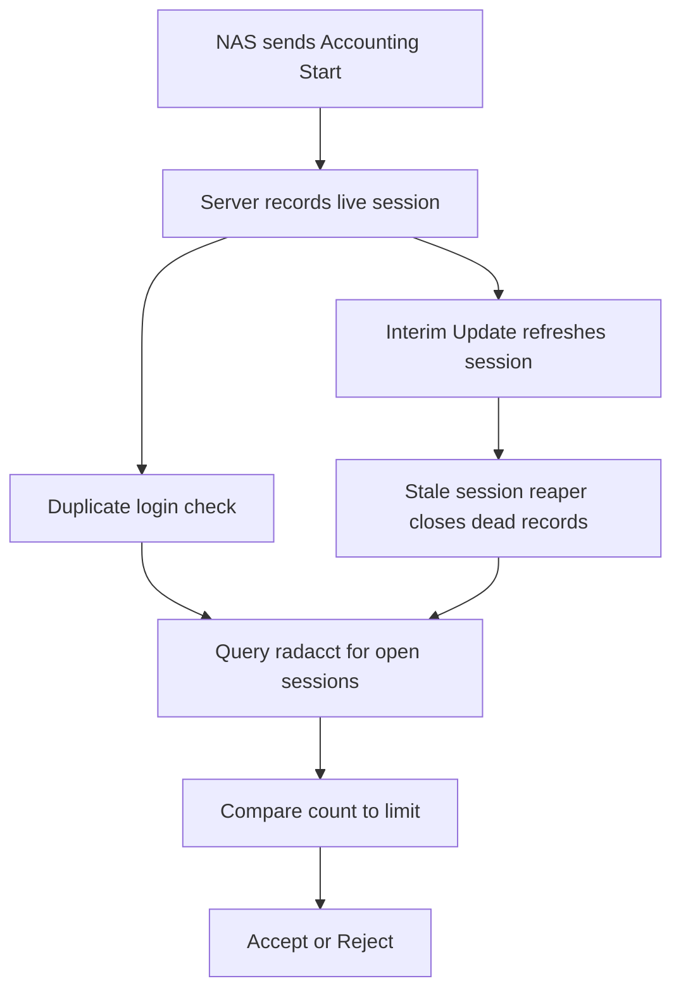

# Session Limits and Simultaneous-Use: Counting Who Is Already Online

## English

A RADIUS server does not only decide yes or no; it can also decide how many. The Simultaneous-Use feature answers the question 'is this account already connected somewhere else?' and it is one of the few places where the server must consult its own state rather than an external directory. It is also one of the most commonly misconfigured.

The mechanism relies on accounting. When a NAS sends an Accounting-Request with Acct-Status-Type set to Start, the server records the session; Interim-Update refreshes it; Stop removes it. To check for a duplicate login, the server queries those live session records for the incoming username. In FreeRADIUS the check is expressed in policy as a lookup against the radacct table (or the equivalent SQL view), and the classic implementation is the `simul_count_query` of the rlm_sql module, run from the session section: it counts the rows where AcctStopTime is null for that user and compares the result to a configured Simultaneous-Use limit. Do not confuse it with rlm_sqlcounter, which measures cumulative session time with SUM(AcctSessionTime) for lifetime or daily quotas rather than counting concurrent sessions.

The difficulty is that accounting is inherently lossy. UDP packets are dropped, NAS devices reboot without sending Stop, and links fail mid-session. A naive counter therefore accumulates phantom sessions and eventually locks users out of their own accounts. Production deployments handle this with a stale-session reaper: a scheduled job that closes records whose AcctStartTime is older than a threshold, or that have not received an Interim-Update within a reasonable window. Some servers also consult the NAS directly via CoA or a vendor-specific query to confirm whether a session still exists before counting it.

A second subtlety is that the check must be scoped correctly. Counting across all NAS devices enforces a global 'one device at a time' rule, which is right for a single-user licence but wrong for a campus where a student legitimately has a laptop and a phone. Scoping by NAS-Identifier or NAS-IP-Address narrows the rule to per-access-point limits. Scoping by Calling-Station-Id lets you distinguish devices. The policy must also decide what happens when the count query itself fails, and the safe default is usually to allow rather than to deny, because a database outage should not become a campus-wide lockout.

Finally, there is an ordering problem. The duplicate check runs during authorization, before the new session exists; but the Start record for the new session may arrive a moment later, and two simultaneous logins can both pass the check in a race. Real deployments mitigate this with a short grace period, by counting only sessions older than a few seconds, or by relying on the NAS to enforce its own port limits. The lesson is that Simultaneous-Use is a best-effort policy built on an unreliable accounting stream, and it should be designed with that unreliability in mind rather than treated as an exact count.

## 中文

RADIUS 伺服器不只是決定「可以」或「不可以」，它也可以決定「幾多個」。Simultaneous-Use 功能回答的問題是「這個帳戶是否已在別處連線？」，而這是少數需要伺服器查閱自身狀態、而非外部目錄的地方之一。它同時也是最常被錯誤設定的功能之一。

這個機制依賴帳務（accounting）。當 NAS 送出 Acct-Status-Type 為 Start 的 Accounting-Request，伺服器便記錄該工作階段；Interim-Update 會更新它；Stop 則移除它。要檢查重複登入，伺服器會就用戶名稱查詢這些現行工作階段紀錄。在 FreeRADIUS 中，這個檢查以政策形式表達，即對 radacct 資料表（或等效的 SQL 檢視）進行查詢，經典實作是 rlm_sql 模組的 `simul_count_query`，由 session 區段呼叫：它計算該使用者 AcctStopTime 為 null 的資料列數目，再與設定的 Simultaneous-Use 上限比較。不要與 rlm_sqlcounter 混淆 —— 後者用 SUM(AcctSessionTime) 量度累積上線時間，處理的是終身或每日配額，而不是計算同時連線數。

困難在於帳務本質上會遺失資料。UDP 封包會被丟棄，NAS 裝置會未送出 Stop 便重新啟動，連線會在工作階段中途中斷。因此單純的計數器會累積幽靈工作階段，最終把使用者鎖在自己的帳戶之外。生產環境會以「過期工作階段清理器」應對：一個排程工作，將 AcctStartTime 早於某個門檻、或在合理時間內未收到 Interim-Update 的紀錄關閉。部分伺服器亦會透過 CoA 或廠商特定的查詢直接向 NAS 確認工作階段是否仍然存在，然後才計數。

第二個微妙之處是檢查的範圍必須正確。跨所有 NAS 裝置計數，等於執行全域的「一次只准一台裝置」規則，這對單一使用者授權是對的，但對校園而言是錯的——學生同時擁有手提電腦與手機是合理的。以 NAS-Identifier 或 NAS-IP-Address 界定範圍，可將規則收窄為每個存取點的上限；以 Calling-Station-Id 界定則可區分不同裝置。政策亦須決定計數查詢本身失敗時怎麼辦，而安全的預設通常是放行而非拒絕，因為資料庫故障不應演變成全校鎖死。

最後是次序問題。重複檢查在授權階段執行，此時新工作階段尚未存在；但新工作階段的 Start 紀錄可能稍後才到達，兩個同時登入可能雙雙通過檢查，形成競態。真實部署會以短暫寬限期、只計數數秒之前的工作階段，或依賴 NAS 執行本身的埠口上限來緩解。教訓是：Simultaneous-Use 是建立在不可靠帳務串流之上的盡力而為政策，設計時應以此不確定性為前提，而非當作精確的計數。

## Key Takeaway

Simultaneous-Use is enforced by counting live accounting sessions, so it is only as reliable as your accounting stream and needs stale-session cleanup to stay usable.

## Related Concepts
- Accounting Start/Interim-Update/Stop
- sqlcounter and per-user limits

## Diagram

