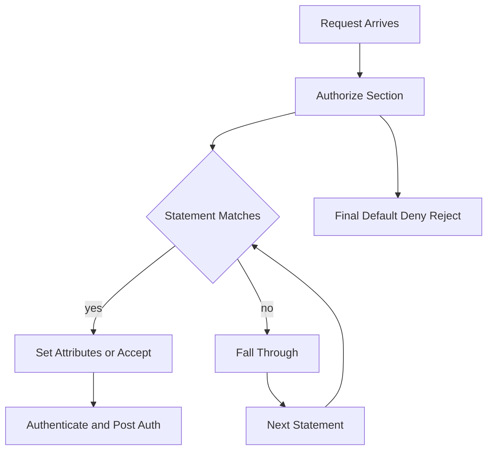

# Default Deny, Fall-Through, and the Order of Policy Evaluation

## English

Most of the interesting behaviour in a RADIUS deployment comes not from any single rule but from the order in which rules are evaluated and what happens when none of them match. This is the policy engine's control flow, and getting it wrong produces the two classic failure modes: everybody gets in, or nobody does.

In FreeRADIUS the request passes through named sections in a fixed sequence, roughly authorize, authenticate, post-auth (with preacct and accounting on the accounting path). Each section is a list of statements evaluated top to bottom. A statement can match and set attributes, can explicitly reject, or can simply do nothing, in which case evaluation continues to the next statement. This 'fall-through' is the default and it is where confusion begins: a rule that fails to match does not deny the request, it merely declines to decide. Only an explicit reject, or the absence of any accept anywhere in the chain, produces a denial.

The conventional structure is therefore default-deny: at the end of the authorize section, a final statement rejects anything that has not already been accepted by a handler. Without this, an unknown user or an unrecognised realm may simply sail through authorize, reach the authentication stage with no credentials to check, and be accepted by a permissive fallback. The security of the whole server rests on that last line, and it is the first thing an auditor should look for.

Ordering also matters for correctness, not just security. Attribute checks that depend on a value set by an earlier statement must come after it; a group membership test must come after the directory lookup that populates the group attributes; a VLAN assignment must come after the decision about which policy applies. Because the language is imperative rather than declarative, moving a block changes meaning. A common bug is placing a reject above the block that sets the attribute it examines, so the reject never fires because the attribute is still empty.

A related trap is the difference between 'not found' and 'error'. If the LDAP or SQL backend is unreachable, a lookup returns an error rather than an empty result, and a naive policy may treat the error as a non-match and fall through to the default deny, which is safe but confusing, or worse, treat it as a match. Good configurations distinguish the three outcomes explicitly: found, not found, and backend failure, and choose a deliberate action for each. Thinking of the policy as an ordered decision tree with an explicit default at the bottom, rather than a bag of independent rules, is what makes a RADIUS configuration auditable.

## 中文

RADIUS 部署中大部分有趣的行為，並非來自任何單一規則，而是來自規則被評估的次序，以及當所有規則都不匹配時會發生什麼。這就是政策引擎的控制流，弄錯它會產生兩種經典的失敗模式：所有人都進得去，或者所有人都進不去。

在 FreeRADIUS 中，請求會依固定次序經過具名區段，大致是 authorize、authenticate、post-auth（帳務路徑上則是 preacct 與 accounting）。每個區段都是一份由上而下評估的語句清單。語句可以匹配並設定屬性、可以明確拒絕，也可以什麼都不做——此時評估便繼續前往下一條語句。這種「落空續行」（fall-through）是預設行為，也是混亂的起點：一條未能匹配的規則並不會拒絕請求，它只是拒絕作出決定。只有明確的 reject，或整條鏈上任何地方都沒有 accept，才會產生拒絕。

因此慣常的結構是預設拒絕：在 authorize 區段末端，以最後一條語句拒絕任何尚未被某個處理器接受的請求。沒有這條語句，未知使用者或無法辨識的 realm 可能就此順利通過 authorize，在沒有憑證可檢查的情況下抵達認證階段，再被寬鬆的後備規則接受。整個伺服器的安全性就繫於這最後一行，也是稽核人員首先應該查看的地方。

次序亦關乎正確性，而不只是安全性。依賴前一條語句所設定的屬性之檢查，必須排在其後；群組成員測試必須排在填充群組屬性的目錄查詢之後；VLAN 指派必須排在「適用哪項政策」的判斷之後。由於這種語言是命令式而非宣告式，搬動一個區塊就會改變意義。常見的錯誤是把 reject 放在設定它所檢查之屬性的區塊之上，結果該屬性仍是空的，reject 永遠不會觸發。

另一個相關陷阱是「找不到」與「錯誤」之別。若 LDAP 或 SQL 後端無法連線，查詢會回傳錯誤而非空結果，天真的政策可能把錯誤當作不匹配而落空至預設拒絕（安全但令人困惑），更糟的是把它當作匹配。良好的設定會明確區分三種結果：找到、找不到、後端故障，並為每一種選擇刻意的動作。把政策視為一棵有序的決策樹、底部有明確的預設值，而不是一堆彼此獨立的規則，才能讓 RADIUS 設定可供稽核。

## Key Takeaway

RADIUS policy is an ordered, fall-through decision list, so a configuration is only as safe as its final default-deny statement and the order of its checks.

## Related Concepts
- authorize and post-auth sections
- Backend error vs. no-match handling

## Diagram

