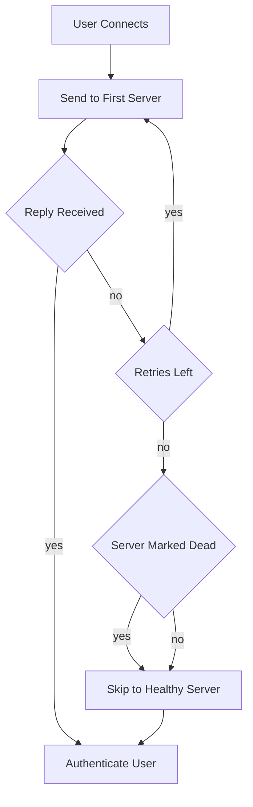

# RADIUS Client Failover and Dead Detection: How a NAS Decides Which Server to Trust

## English

Most RADIUS diagrams show one supplicant, one switch, and one server. Real deployments have at least two servers, and the burden of choosing between them falls on the NAS — the network access server, the switch or wireless controller that sits between the user and the RADIUS tier. This is the client-side half of high availability, and it behaves quite differently from server-side clustering.

The NAS keeps an ordered list of RADIUS servers per authentication method. When a user connects, the NAS sends an Access-Request to the first server and waits. If no reply arrives within its configured timeout, it retransmits — often with a small backoff — up to a configured retry count. Only after exhausting retries does it move to the next server in the list. This means failover is slow by design: a switch with a three-second timeout and three retries may wait nine seconds or more before trying the secondary. Users notice this as a long pause before the login prompt rejects or accepts.

To avoid that pause, many NAS platforms implement dead detection. After repeated failures to a given server, the NAS marks it dead for a cooldown period and skips it entirely for new requests, sending traffic straight to the healthy server. When the cooldown expires, the NAS probes the dead server with a fresh request — if it answers, it is marked alive again. The exact parameters (how many failures mark a server dead, how long the cooldown lasts) vary by vendor, but the concept is universal: fail fast rather than wait for timeouts on every request.

A subtlety is that RADIUS retransmission is not idempotent in the way HTTP GET is. The server may have processed the first request and be preparing a reply when the NAS times out and retransmits. The RADIUS identifier field helps here: the server can recognise a duplicate request with the same identifier and source and simply resend the cached reply rather than re-evaluating policy. But if the NAS fails over to a different server mid-flight, the second server has no memory of the first request and may issue a fresh Access-Challenge or a different session identifier, confusing the supplicant.

Operationally, this means the client configuration matters as much as the server configuration. Timeouts that are too short cause spurious failovers under load; timeouts that are too long cause users to wait through outages. Dead detection windows that are too aggressive can flap servers in and out of rotation. The practical advice is to keep both servers reachable from every NAS, use dead detection with a cooldown of tens of seconds rather than minutes, and monitor the failover events in the NAS logs — because a silent failover is often the first sign that half your AAA tier is broken and nobody noticed.

## 中文

大部分 RADIUS 示意圖都只畫一個 supplicant、一台交換機、一台伺服器。真實部署至少會有兩台伺服器，而選擇哪一台的責任落在 NAS（network access server，網絡存取伺服器，即使用者與 RADIUS 層之間的交換機或無線控制器）身上。這是高可用性的用戶端一半，運作方式與伺服器端的叢集截然不同。

NAS 會為每種認證方法維護一份有序的 RADIUS 伺服器清單。使用者連線時，NAS 向第一台伺服器送出 Access-Request 並等待。若在設定的逾時時間內沒有回應，它會重傳（通常帶輕微的退避），直至達到設定的重試次數。只有在重試耗盡之後，它才切換到清單中的下一台。這代表故障轉移天生就慢：一台設定三秒逾時、三次重試的交換機，可能要等九秒以上才嘗試備援伺服器。使用者會感受到登入提示遲遲未回應。

為了避免這種停頓，許多 NAS 平台實作 dead detection（死機偵測）。對某台伺服器連續失敗數次後，NAS 會把它標記為 dead，在冷卻期內完全跳過，新請求直接送往健康的那一台。冷卻期結束後，NAS 會用一個新請求試探該死機伺服器；若有回應，就重新標記為 alive。具體參數（幾次失敗才算死、冷卻多久）因廠商而異，但概念是通用的：寧可快速失敗，也不要每個請求都等到逾時。

一個微妙之處是：RADIUS 的重傳不像 HTTP GET 那樣冪等。伺服器可能已經處理了第一個請求、正在準備回應時，NAS 就逾時並重傳。RADIUS 的 identifier 欄位在此發揮作用：伺服器可憑相同 identifier 與來源辨識出重複請求，直接重送快取的答覆，而不重新評估政策。但如果 NAS 在請求進行中轉移到另一台伺服器，第二台伺服器對第一個請求一無所知，可能發出全新的 Access-Challenge 或不同的 session identifier，令 supplicant 一頭霧水。

在營運層面，這代表用戶端設定的重要性不亞於伺服器設定。逾時太短會在負載下造成誤判故障轉移；逾時太長會令使用者在故障期間乾等。死機偵測窗口太激進會令伺服器在輪替中反覆進出。實務建議是：確保每台 NAS 都能到達兩台伺服器、使用數十秒而非數分鐘的冷卻期，並監控 NAS 日誌中的故障轉移事件——因為一次靜默的故障轉移，往往是「一半 AAA 層已經壞掉卻無人察覺」的第一個徵兆。

## Key Takeaway

Failover lives on the NAS, not the server, and dead detection is what turns a slow timeout-driven fallback into a fast, predictable switch.

## Related Concepts
- Dead detection
- NAS client configuration

## Diagram

