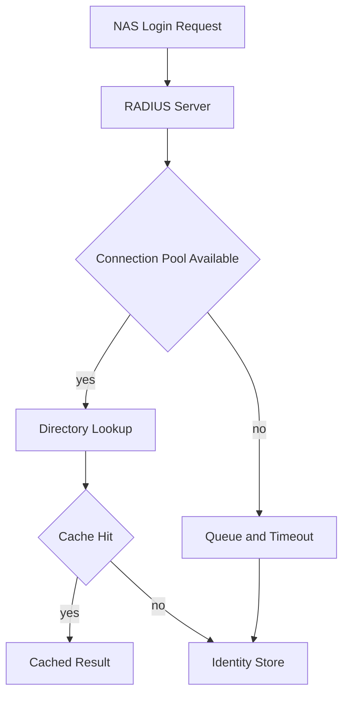

# RADIUS and the Identity Store: Caching, Connection Pooling, and the Cost of Every Login

## English

When a RADIUS server validates credentials against an external identity store — Active Directory via LDAP, an SQL database, or an OAuth introspection endpoint — the network login inherits the performance and failure characteristics of that backend. A switch port authentication that takes 200 milliseconds when the directory is healthy can take 30 seconds when it is not, and the RADIUS server becomes the amplifier of that latency across every NAS on campus.

The first mechanism that matters is connection pooling. Opening an LDAP or SQL connection per authentication is expensive: TLS handshakes, bind operations, and TCP setup can dominate the total time. Production RADIUS servers keep a pool of pre-established connections to the directory and hand them out per request. The pool size must be tuned to the peak concurrent authentication rate, not the average — a campus morning rush can be ten times the baseline. If the pool is exhausted, requests queue, and the queue depth becomes the effective timeout.

The second mechanism is caching. Many deployments cache successful authentication results or group memberships for a short window (seconds to minutes) to absorb bursts — for example, when a wireless controller re-authenticates hundreds of clients after a reboot. Caching is a trade-off: it reduces directory load but delays the propagation of revocations. A user removed from a group may still be authorised until the cache entry expires. The right cache TTL depends on how quickly the organisation expects access changes to take effect, and it should be documented, not left to default.

The third mechanism is graceful degradation. When the directory is unreachable, the RADIUS server can either fail closed (reject all logins, which is safe but disruptive) or fail open (accept based on cached or local credentials, which is convenient but risky). Most organisations choose fail closed for privileged network segments and may allow a narrowly scoped fail-open for guest or low-risk access. Some deployments use a local fallback account store with a break-glass procedure, audited and time-limited.

A fourth consideration is the shape of the query itself. LDAP searches that traverse large subtrees or follow referrals can be dramatically slower than targeted lookups against a known base DN. A well-designed RADIUS integration uses a specific base DN, a narrow filter, and only the attributes it needs, rather than a broad search that happens to work in a lab. The performance of the identity store is not abstract — it is the latency every user feels when they plug in a cable or join the Wi-Fi, and it is worth measuring explicitly rather than assuming.

## 中文

當 RADIUS 伺服器透過外部身分存放區（例如經 LDAP 的 Active Directory、SQL 資料庫或 OAuth introspection 端點）驗證憑證時，網絡登入就繼承了該後端的效能與故障特性。目錄健康時只需 200 毫秒的交換機埠認證，在目錄不健康時可能要 30 秒，而 RADIUS 伺服器會把這份延遲放大到全校每一台 NAS。

第一個關鍵機制是連線池。每次認證都開一條新的 LDAP 或 SQL 連線代價高昂：TLS 握手、bind 操作、TCP 建立都可能主導整體時間。生產級 RADIUS 伺服器會維持一個預先建立的目錄連線池，按請求分配。連線池大小要按峰值並發認證率調整，而非平均值——校園早上高峰可以是基線的十倍。連線池耗盡時請求會排隊，而佇列深度就變成實質的逾時時間。

第二個機制是快取。許多部署會快取成功的認證結果或群組成員資格一小段時間（數秒至數分鐘），以吸收突發流量——例如無線控制器重啟後重新認證數百個用戶端。快取是取捨：它減輕目錄負載，但延遲撤銷的傳播。被移出群組的使用者可能在快取條目過期前仍獲授權。合適的快取 TTL 取決於組織期望存取變更多快生效，應該明文記錄，而非沿用預設值。

第三個機制是優雅降級。目錄無法到達時，RADIUS 伺服器可以選擇 fail closed（拒絕所有登入，安全但會中斷服務）或 fail open（依快取或本機憑證放行，方便但有風險）。多數組織對特權網段選擇 fail closed，對訪客或低風險存取則可能容許範圍極窄的 fail open。有些部署使用本機備援帳戶庫配合 break-glass 程序，並要求稽核與時限。

第四個考量是查詢本身的形狀。橫掃大型子樹或跟隨 referral 的 LDAP 搜尋，可以比針對已知 base DN 的精準查詢慢得多。設計良好的 RADIUS 整合會使用特定 base DN、狹窄的 filter，且只取所需屬性，而不是一個「在實驗室剛好能用」的寬鬆搜尋。身分存放區的效能不是抽象概念——它就是使用者插線或連 Wi-Fi 時感受到的延遲，值得明確量測，而非憑假設。

## Key Takeaway

Every RADIUS login is only as fast and as reliable as the identity store behind it, so connection pooling, cache TTLs, and fail-open versus fail-closed policy are first-class design decisions.

## Related Concepts
- LDAP and Active Directory backends
- Fail-open versus fail-closed

## Diagram

