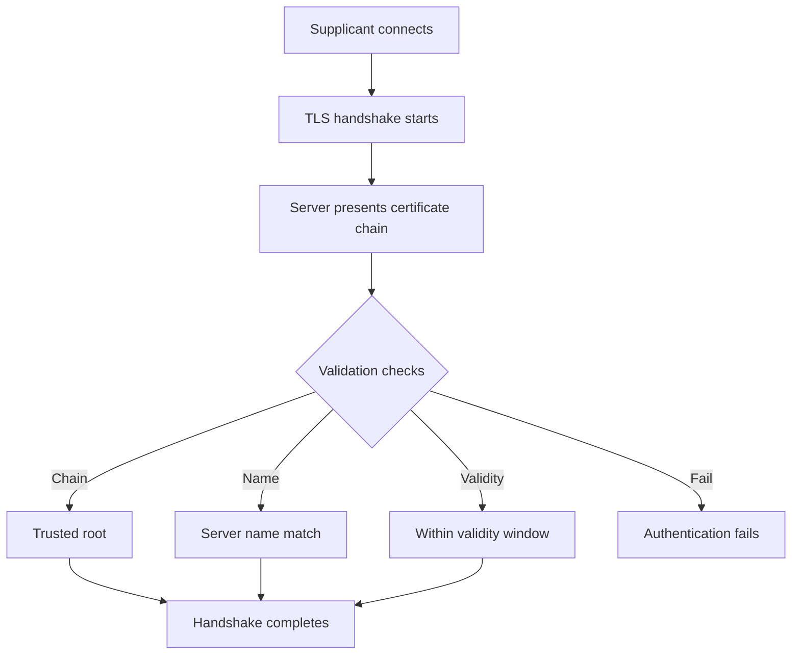

# TLS Certificate Lifecycle Inside RADIUS: The Expiry That Breaks Wi-Fi at 3 A.M.

## English

When RADIUS carries EAP methods that tunnel inside TLS — PEAP, EAP-TTLS, EAP-TLS — the server presents a certificate to the supplicant, and the supplicant validates it against a trusted CA. That certificate is not a static configuration detail; it is a piece of infrastructure with a lifecycle, and its expiry is one of the most common causes of sudden, total authentication failure.

The supplicant's validation rules are strict and easy to underestimate. It checks that the certificate chains to a trusted root, that the subject or subjectAltName matches the expected server name, and that the certificate is within its validity window. If any of these fail, the supplicant refuses to complete the TLS handshake, and the authentication fails — often with a generic error that gives no hint about the certificate. Worse, many supplicants have been configured to trust a specific CA and will not fall back gracefully if the server presents a certificate from a different CA, even a valid one.

The renewal process has several traps. First, the server name in the certificate must match what supplicants expect — commonly the FQDN that clients are configured to use, or a realm-based name. Changing the server's hostname or the certificate's subject without updating client profiles will break authentication. Second, the certificate must be installed on every RADIUS server in the pool, not just one, or failover to a server with an older certificate will cause intermittent failures. Third, intermediate certificates must be included in the chain presented to clients; a server that sends only its leaf certificate may work with some supplicants and fail with others.

Automation reduces risk but introduces its own failure modes. A renewal script that runs on schedule but fails silently — because the ACME client cannot reach the CA, or the private key permissions are wrong — leaves the server serving an expiring certificate until it lapses. Monitoring must therefore check the certificate's remaining validity from the client's perspective, not just whether the file exists. A probe that connects to the RADIUS server's TLS port and inspects the presented certificate, alerting well before expiry, is far more reliable than a file-timestamp check.

The operational lesson is to treat the RADIUS server certificate like any other critical TLS asset: inventory it, automate renewal, monitor expiry, and test the full supplicant handshake after every renewal. The classic outage — Wi-Fi fails at 3 a.m. because a certificate expired — is entirely preventable, and the prevention is process, not protocol. The protocol did exactly what it was designed to do; the certificate lifecycle is what failed.

## 中文

當 RADIUS 承載在 TLS 內穿隧的 EAP 方法——PEAP、EAP-TTLS、EAP-TLS——伺服器會向 supplicant 出示憑證，而 supplicant 會用受信任的 CA 驗證它。這張憑證不是靜態設定細節，而是一項有生命週期的基礎設施，它的到期是突然全面認證失敗最常見的原因之一。

supplicant 的驗證規則嚴格且容易低估。它會檢查憑證是否鏈到受信任的根、subject 或 subjectAltName 是否符合預期的伺服器名稱，以及憑證是否在有效期限內。任何一項失敗，supplicant 就拒絕完成 TLS 握手，認證失敗——通常只給出一個對憑證隻字不提的籠統錯誤。更糟的是，許多 supplicant 被設定為只信任特定 CA，若伺服器出示另一 CA 的憑證（即使有效），也不會優雅地退回。

續期流程有幾個陷阱。第一，憑證中的伺服器名稱必須符合 supplicant 的預期——通常是用戶端設定使用的 FQDN，或基於 realm 的名稱。若更改伺服器主機名或憑證 subject 而不同步更新用戶端設定檔，認證就會中斷。第二，憑證必須安裝在池中每一台 RADIUS 伺服器上，而非只有一台，否則故障轉移到持有舊憑證的伺服器時會造成間歇性失敗。第三，必須在出示給用戶端的鏈中包含中繼憑證；只送 leaf 憑證的伺服器可能對某些 supplicant 可用、對另一些卻失敗。

自動化降低風險，但也引入自身的故障模式。一個按時執行卻靜默失敗的續期腳本——因為 ACME 用戶端無法連上 CA，或私鑰權限錯誤——會讓伺服器繼續使用即將到期的憑證，直到它失效。因此監控必須從用戶端角度檢查憑證剩餘有效期，而非只檢查檔案是否存在。一個連上 RADIUS 伺服器 TLS 埠並檢視所出示憑證的探測，能在到期前及早告警，遠比檔案時間戳檢查可靠。

營運上的教訓是把 RADIUS 伺服器憑證當作任何關鍵 TLS 資產：建立清冊、自動續期、監控到期，並在每次續期後測試完整的 supplicant 握手。經典事故——凌晨三點 Wi-Fi 掛掉因為憑證過期——完全可以預防，而預防靠的是流程，不是協定。協定只是做了它設計要做的事；失敗的是憑證生命週期。

## Key Takeaway

In TLS-based EAP, the server certificate is a living asset whose expiry, chain, and name must be monitored and renewed as carefully as any production TLS endpoint.

## Related Concepts
- EAP-TLS and PEAP server certificates
- Certificate expiry monitoring

## Diagram

