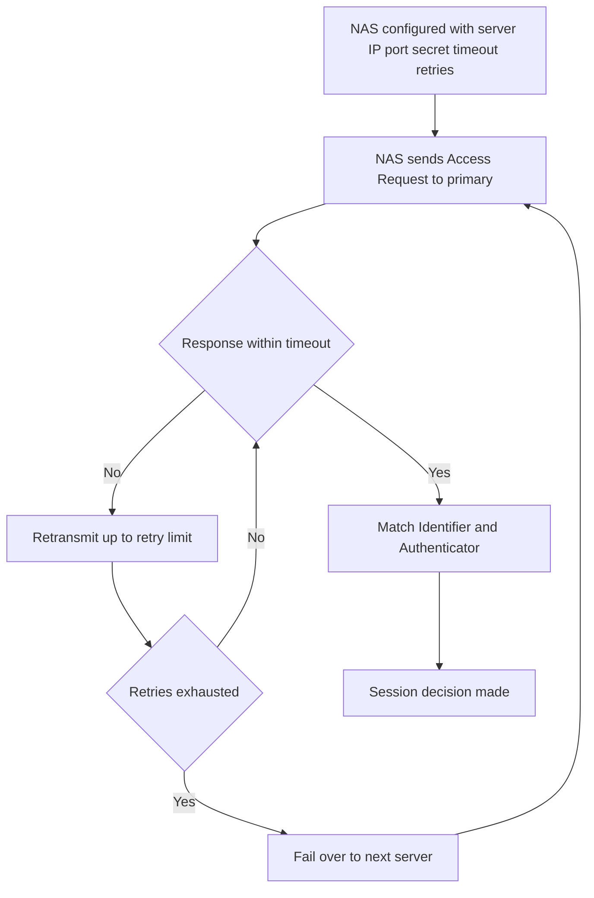

# How a NAS Chooses and Reaches Its RADIUS Server: The Client-Side Configuration Contract

## English

Every RADIUS conversation begins with a device that is not the server: the NAS (Network Access Server), which in practice is a switch port, a wireless controller, or a VPN concentrator. The NAS is configured with a short list of facts about each RADIUS server it trusts: an IP address or hostname, a UDP port (1812 for authentication, 1813 for accounting by IANA assignment), a shared secret, and a timeout and retry policy. Those four values form a contract. If the secret on the NAS does not match the secret on the server, the server silently discards the request — it cannot verify the Request Authenticator and has no safe way to answer, so the NAS simply sees a timeout. This is why a "wrong secret" bug looks identical to a "server down" bug, and why the first debugging step is always to confirm the secret on both sides.

The NAS also decides *which* server to talk to and for how long to wait. A typical configuration lists a primary and one or more secondaries, plus a timeout (commonly a few seconds) and a retry count. When the primary does not answer within the timeout, the NAS retransmits to the same server up to the retry limit, then fails over to the next server in the list. Some implementations mark a server as "dead" after repeated failures and skip it for a cool-down period, then probe it again later. This is a client-side health model, and it is deliberately simple: the NAS has no protocol-level heartbeat, so it infers liveness from whether answers arrive.

A subtle but important detail is that the NAS must bind the request and the response together. The RADIUS packet carries a one-byte Identifier and a 16-byte Request Authenticator; the server's response must echo the Identifier and compute its Response Authenticator over the request's authenticator. The NAS uses these to match a reply to the outstanding request and to reject forgeries. It also uses the Identifier space (0–255) to keep multiple in-flight requests distinct, so a busy NAS with many simultaneous logins must manage that small space carefully — usually by serialising or by tracking per-Identifier state.

Source addresses matter too. The server identifies a client by the source IP of the UDP packet, so if the NAS sends from a different interface than the one the server expects, the request is dropped as unknown. Multi-homed NASes and NAT devices in the path are classic causes of "it works from the lab but not from the floor." Many deployments therefore pin the source address explicitly in the NAS configuration.

Finally, the NAS is where policy becomes visible to the user. When the server replies with Access-Accept, the NAS reads the attributes — VLAN assignment, a filter identifier, a session timeout — and enforces them on the port. The NAS is not a passive relay; it is the enforcement point, and its configuration determines whether the server's decision actually takes effect.

## 中文

每一段 RADIUS 對話的起點都不是伺服器，而是一部 NAS（Network Access Server，網路存取伺服器）——實務上就是交換機的某個埠、無線控制器，或者 VPN 集中器。NAS 會為每一部它信任的 RADIUS 伺服器設定少數幾項資料：IP 位址或主機名、UDP 埠（IANA 指派認證用 1812、計費用 1813）、共享金鑰（shared secret），以及逾時與重試策略。這四項數值合起來就是一份契約。若 NAS 上的金鑰與伺服器上的不一致，伺服器會靜靜丟棄請求——它無法驗證 Request Authenticator，也沒有安全的方式回覆，於是 NAS 只會看到逾時。這就是為何「金鑰設錯」的症狀與「伺服器掛掉」一模一樣，也是為何排查的第一步永遠是核對兩邊的金鑰。

NAS 亦要決定跟哪一部伺服器對話、以及願意等多久。典型設定會列出主要伺服器與一至多部備援，加上逾時（常見為數秒）與重試次數。主要伺服器在逾時內沒有回應時，NAS 會向同一部伺服器重傳至重試上限，然後切換到清單中的下一部。部分實作會在連續失敗後把伺服器標記為「死亡」，在冷卻期內略過它，之後再探測。這是使用者端一側的健康判斷模型，刻意保持簡單：NAS 沒有協定層級的心跳，只能憑「有沒有回應」推斷對方是否活著。

一個細微但關鍵的細節，是 NAS 必須把請求與回應綁在一起。RADIUS 封包帶有一個一位元組的 Identifier 與 16 bytes 的 Request Authenticator；伺服器的回應必須回填同一個 Identifier，並以請求的 authenticator 計算 Response Authenticator。NAS 靠這些欄位把回應配對到未完成的請求，並拒絕偽造品。它亦要用 Identifier 空間（0–255）區分多個在途請求，所以同時有大量登入的繁忙 NAS 必須小心管理這個細小的空間——通常靠序列化，或為每個 Identifier 追蹤狀態。

來源位址同樣重要。伺服器是靠 UDP 封包的來源 IP 辨認使用者端，所以若 NAS 從伺服器不認識的介面送出，請求就會被當成未知使用者端丟棄。多網絡卡 NAS 與路徑上的 NAT 裝置，就是「實驗室行、現場不行」的經典成因。因此許多部署會在 NAS 設定中明確繫結來源位址。

最後，NAS 才是政策對使用者顯現的地方。伺服器回覆 Access-Accept 後，NAS 會讀取屬性——VLAN 指派、過濾器識別碼、工作階段逾時——並在埠上執行。NAS 不是被動轉發器，而是執行點；它的設定決定伺服器的決定最終是否真正生效。

## Key Takeaway

The NAS is the enforcement point and the first place to look when RADIUS fails: its secret, timeout, retry, and source-address settings decide whether the server's decision ever reaches the port.

## Related Concepts
- Shared secret mismatch symptoms
- NAS failover and dead detection

## Diagram

