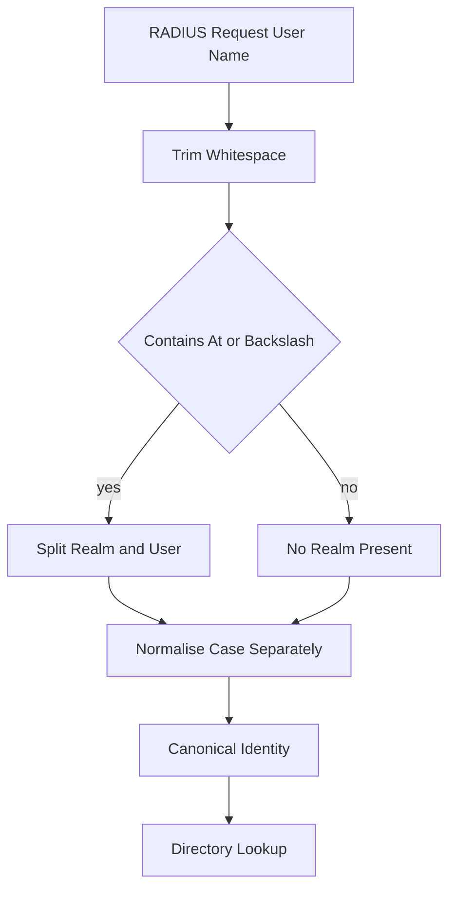

# The RADIUS User-Name Is Not Sacred: Identity Normalisation Before the Lookup

## English

A RADIUS request arrives carrying a User-Name attribute that is just a string. Nothing in the protocol says it must be lowercase, must lack whitespace, must be a bare username, or must even resemble what the identity store expects. In real deployments the string is often messy: `DOMAIN\\alice`, `alice@example.org`, `alice@EXAMPLE.ORG`, ` alice`, or `alice` with a trailing carriage return from a misbehaving supplicant. The server's job, before it ever queries a directory, is to normalise this string into a canonical form. This step is called identity normalisation, and it is one of the highest-leverage places to get right, because a single unnormalised character turns a valid login into a mysterious rejection.

A common pattern is to split the string into a realm and a user part. If the name contains an `@`, everything after it is the realm; if it contains a backslash, the part before it is the realm or domain. The realm then selects which backend or virtual server handles the request, while the user part is what gets looked up. Stripping the realm before the lookup is essential when the directory stores bare usernames, and preserving it is essential when the directory expects a full UPN. Getting this backwards produces the classic "the password is definitely right but it still fails" ticket.

Case is another trap. Some directories are case-insensitive for usernames, some are not; some are case-insensitive for the realm but not the user part. A robust server normalises consistently — for example, lowercasing the realm and the user part separately — and then applies the same rule everywhere, including in accounting records and in group lookups. If the server normalises for authentication but not for authorisation, a user can authenticate successfully and then fail to match a group membership because the stored group entry has different casing.

Whitespace and invisible characters deserve explicit handling. Leading and trailing spaces, tabs, and stray newlines are common from hand-edited configuration files and from clients that read a username from a file. Trimming is almost always correct; silently accepting an untrimmed name is almost always wrong, because the resulting lookup fails and the failure is hard to explain. Likewise, some deployments must reject names containing control characters outright rather than pass them to a backend.

Finally, normalisation must be *logged* in a way that is useful for debugging but safe for privacy. Recording that a name was transformed (for example, that a realm was stripped) helps operators; recording the raw and transformed forms in full may leak personal data into logs that are kept far longer than the authentication event. The practical rule is to normalise early, once, in a single well-tested place, and to make the transformation visible in debug output without dumping the raw credential-bearing request.

## 中文

RADIUS 請求帶來的 User-Name 屬性不過是一個字串。協定本身沒有規定它必須是小寫、不得含空白、必須是純使用者名稱，甚至不要求它長得像身分儲存庫所期望的樣子。在真實部署中，這個字串往往很髒：`DOMAIN\\alice`、`alice@example.org`、`alice@EXAMPLE.ORG`、` alice`，或者因為使用者端程式有 bug 而帶尾隨回車的 `alice`。伺服器的職責，是在查詢任何目錄之前，先把這個字串正規化成標準形式。這一步叫身分正規化（identity normalisation），也是最值得做對的高槓桿環節之一，因為一個未正規化的字元，就能把一次合法登入變成莫名其妙的拒絕。

常見做法是把字串拆成 realm 與使用者部分。若名稱含 `@`，其後全部是 realm；若含反斜線，其前部分是 realm 或網域。realm 之後決定由哪個後端或虛擬伺服器處理請求，而使用者部分才是拿去查詢的物件。當目錄儲存的是純使用者名稱時，查詢前必須剝掉 realm；當目錄期望完整 UPN 時，則必須保留。把這兩種情況弄反，就會產生經典的「密碼肯定對，但就是登入不了」工單。

大小寫是另一個陷阱。有些目錄對使用者名稱不分大小寫，有些不分；有些對 realm 不分大小寫，但對使用者部分分。穩健的伺服器會一致地正規化——例如分別把 realm 與使用者部分轉小寫——然後在每一處套用同一規則，包括計費記錄與群組查詢。若伺服器只在認證時正規化、授權時不正規化，使用者可以成功認證，卻因為儲存的群組專案大小寫不同而配不上群組成員資格。

空白與不可見字元值得明確處理。前後空格、tab、殘留換行，常見於手改的設定檔，以及從檔案讀取使用者名稱的使用者端。修剪幾乎永遠正確；默默接受未修剪的名稱幾乎永遠錯誤，因為查詢會失敗，而失敗原因極難解釋。同樣地，某些部署必須直接拒絕含控制字元的名稱，而不是把它們送進後端。

最後，正規化必須以「有助排查但保護私隱」的方式記錄。記錄「名稱曾被轉換」（例如剝掉了 realm）對營運者有用；把原始與轉換後的形式完整寫進日誌，則可能讓個人資料洩漏到儲存期遠長於認證事件的日誌中。實務原則是：及早、一次性地、在單一經過充分測試的地方做正規化，並在除錯輸出中讓轉換可見，但不要整份傾印含憑證的原始請求。

## Key Takeaway

Normalise the User-Name once, early, and consistently across authentication, authorisation, and accounting — most "wrong password" tickets are really unnormalised identity strings.

## Related Concepts
- Realm stripping and routing
- Directory lookup and case sensitivity

## Diagram

