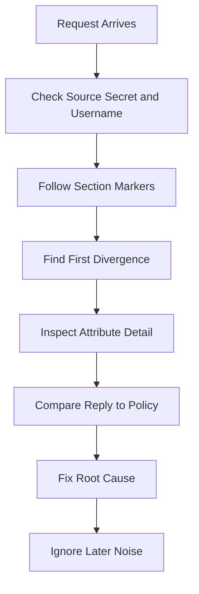

# Reading a RADIUS Log: Turning Debug Output into a Diagnosis

## English

A RADIUS server in debug mode prints a torrent of lines: packets received, attributes parsed, sections entered, policies evaluated, backends queried, replies sent. To a newcomer it looks like noise; to an operator it is a trace of a decision. Learning to read it is a distinct skill from knowing the protocol, because the log tells you *where* the decision went wrong, not just *that* it went wrong. The goal is to locate the first line where reality diverges from expectation, and to ignore everything after it until that line is understood.

Start at the top. The log typically shows the request arriving from a client IP, the packet code (Access-Request), the Identifier, and the list of attributes. Check three things immediately: is the source IP a client the server knows, is the shared secret correct (a bad secret usually produces a decode error or silence), and does the User-Name look like what you expect after normalisation? If the request never appears, the problem is upstream — the NAS, a firewall, or the wrong port — and no amount of server-side reading will help.

Next, follow the section markers. A well-structured server logs which virtual server or policy section it entered and which it skipped, and why. This is where you see whether the request went to the right backend, whether a group check failed, or whether a policy short-circuited with a reject. The key habit is to read the *first* divergence: if the log says the user was not found in the directory, everything later (password check, group lookup, reply construction) is downstream noise. Fixing the lookup is the task; the rest will follow.

Attribute-level detail is where most real bugs hide. The log shows the attributes the server received and the attributes it intends to send back. Compare the reply against what the NAS expects: is the VLAN attribute present and in the right format, is the tunnel type set, is the filter identifier spelled the way the NAS understands? A common failure is a perfectly successful authentication followed by a NAS that ignores the reply because an attribute is malformed or uses a vendor-specific encoding the NAS does not recognise. The log will show the attribute was sent; only the NAS's own logs will show it was rejected.

Finally, treat the log as evidence to be preserved, not a stream to be skimmed. Capture the full exchange for a single failing login — request, all policy steps, backend calls, reply — and keep it alongside the NAS-side log for the same timestamp. The pair almost always explains the problem, and having both prevents the classic argument between network and identity teams about whose side is at fault.

## 中文

RADIUS 伺服器在除錯模式下會印出大量行：收到封包、解析屬性、進入區段、評估政策、查詢後端、送出回覆。對新手而言這是噪音；對營運者而言，這是一份決策的軌跡。讀懂它是一項與「懂協定」不同的技能，因為日誌告訴你決策在*哪裡*出錯，而不只是*出了錯*。目標是找出「現實與預期首次分歧」的那一行，並在理解它之前忽略之後的一切。

由頂部開始。日誌通常顯示請求來自哪個使用者端 IP、封包程式碼（Access-Request）、Identifier，以及屬性清單。立刻檢查三件事：來源 IP 是否為伺服器認識的使用者端；共享金鑰是否正確（金鑰錯誤通常導致解碼錯誤或完全靜默）；正規化後的 User-Name 是否如你所料。若請求根本沒出現，問題在上游——NAS、防火牆，或埠號錯了——在伺服器端讀多久都沒用。

接著，跟隨區段標記。結構良好的伺服器會記錄它進入了哪個虛擬伺服器或政策區段、跳過了哪個、以及原因。這裡可以看到請求有否送往正確後端、群組檢查是否失敗、或某條政策是否以拒絕短路。關鍵習慣是讀*第一個*分歧：若日誌說在目錄中找不到使用者，之後的一切（密碼檢查、群組查詢、回覆建構）都是下游噪音。修好查詢才是任務，其餘會隨之而來。

屬性層級的細節，是多數真實 bug 藏身之處。日誌顯示伺服器收到的屬性，以及它打算送回的屬性。把回覆與 NAS 的期望對照：VLAN 屬性是否存在且格式正確？tunnel 型別有否設定？過濾器識別碼的拼法是否為 NAS 所理解？常見的失敗是認證完全成功，但 NAS 因為某屬性格式錯誤、或用了 NAS 不認識的廠商特定編碼而忽略回覆。日誌會顯示屬性已送出；只有 NAS 自己的日誌才會顯示它被拒絕。

最後，把日誌當作要儲存的證據，而不是匆匆掃過的水流。為單一次失敗登入擷取完整交換——請求、所有政策步驟、後端呼叫、回覆——並與同一時間戳的 NAS 端日誌放在一起。兩者合看幾乎總能解釋問題，也能避免網路團隊與身分團隊之間「究竟是誰的錯」的經典爭論。

## Key Takeaway

Debug logs are a decision trace: find the first line where reality diverges from expectation, fix that, and pair the server log with the NAS log before blaming either side.

## Related Concepts
- First-divergence debugging
- Correlating NAS and server logs

## Diagram

