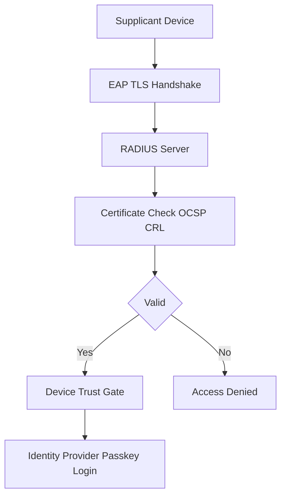

# RADIUS in the Age of Passkeys and Certificate-Bound Credentials

## English

Most RADIUS deployments still authenticate with a password or a shared key, but the broader identity world has moved toward phishing-resistant credentials: passkeys (WebAuthn/FIDO2) and certificate-bound identities. The awkward fact is that RADIUS predates all of this, so the question becomes how a 1990s AAA protocol carries a modern credential. The answer is usually not to change RADIUS itself but to change what rides inside EAP. EAP-TLS, for example, already performs mutual certificate authentication: the supplicant proves possession of a private key, and the server proves its own identity with a certificate chain. That is conceptually the same shape as a passkey — a key pair where the private half never leaves the device — except the transport is a TLS handshake inside EAP rather than a browser API.

The harder problem is user presence and attestation. A passkey on a phone is unlocked by a biometric or PIN, and the authenticator can assert that a human was present. RADIUS has no native notion of 'user presence'; it only sees the result of the EAP conversation. So deployments that want passkey-grade assurance typically bridge the two worlds: the network authenticates the device or a machine certificate via EAP-TLS, and a separate identity provider handles the human-facing passkey login for applications. The network layer becomes a device-trust gate, and the application layer becomes the human-trust gate.

Certificate-bound credentials also expose a lifecycle problem that passwords do not. A password can be reset in seconds; a certificate must be issued, renewed, and revoked, and revocation must reach the RADIUS server quickly enough to matter. This is why many designs pair EAP-TLS with OCSP (Online Certificate Status Protocol) or CRL checking at the RADIUS tier, and why the certificate authority becomes a critical dependency of the network itself. If the CA is down and the RADIUS server cannot validate a chain, logins fail even though nothing about the user changed.

A practical middle ground many organisations adopt is certificate-based device authentication combined with a second factor for the human: the device proves itself with EAP-TLS, then the user completes an inner authentication (a password, or a one-time code) inside the tunnel. This keeps RADIUS doing what it is good at — carrying an EAP conversation and returning an authorization decision — while the credential quality is raised by the EAP method rather than by the protocol. The lesson is that RADIUS is a carrier, not a credential format, and modernising authentication usually means swapping the payload, not the envelope.

## 中文

大部分 RADIUS 部署仍然用密碼或共用金鑰做認證，但整個身份認證世界已經走向抗釣魚的憑證：passkey（WebAuthn/FIDO2）以及繫結憑證的身份。尷尬的事實在於，RADIUS 比這些東西都要老，所以問題變成：一個 1990 年代的 AAA 協定，怎樣承載現代憑證？答案通常不是改 RADIUS 本身，而是改 EAP 裡面載的東西。以 EAP-TLS 為例，它本身已經做雙向憑證認證：supplicant 證明自己持有私鑰，伺服器則用憑證鏈證明自己的身份。這在概念上與 passkey 形狀相同——一對金鑰，私鑰那一半永遠不離開裝置——分別只在於傳輸是 EAP 裡面的 TLS 握手，而不是瀏覽器 API。

更難的問題是使用者存在證明（user presence）與 attestation。手機上的 passkey 要靠生物辨識或 PIN 解鎖，authenticator 可以聲稱「有人在場」。RADIUS 本身沒有「使用者存在」這個概念，它只看到 EAP 對話的結果。所以想要 passkey 級保證的部署，通常要把兩個世界接起來：網路用 EAP-TLS 認證裝置或機器憑證，而另一個 identity provider 負責應用程式那邊、面向人的 passkey 登入。網路層變成裝置信任的閘門，應用層則成為人的信任閘門。

繫結憑證亦暴露了密碼沒有的生命週期問題。密碼幾秒鐘就可以重設；憑證則要簽發、續期、撤銷，而撤銷必須夠快傳到 RADIUS 伺服器才有意義。這就是為什麼很多設計會在 RADIUS 層配上 OCSP（Online Certificate Status Protocol）或 CRL 檢查，也是為什麼憑證授權機構（CA）會成為網路本身的關鍵依賴。如果 CA 掛了、RADIUS 伺服器無法驗證憑證鏈，即使使用者什麼都沒變，登入一樣失敗。

不少機構採用的實用折衷方案，是把憑證式的裝置認證，與針對人的第二因素結合：裝置先用 EAP-TLS 證明自己，然後使用者在隧道內完成內層認證（密碼或一次性驗證碼）。這樣 RADIUS 繼續做它擅長的事——承載 EAP 對話並回傳授權決定——而憑證的品質則由 EAP 方法本身提升，而不是由協定提升。教訓是：RADIUS 是載體，不是憑證格式；要現代化認證，通常要換的是信封裡的內容，而不是信封本身。

## Key Takeaway

RADIUS is a transport for EAP, so raising credential strength means changing the EAP method (e.g. EAP-TLS, certificate-bound identities) rather than changing RADIUS itself.

## Related Concepts
- EAP-TLS mutual authentication
- Certificate revocation and OCSP

## Diagram

