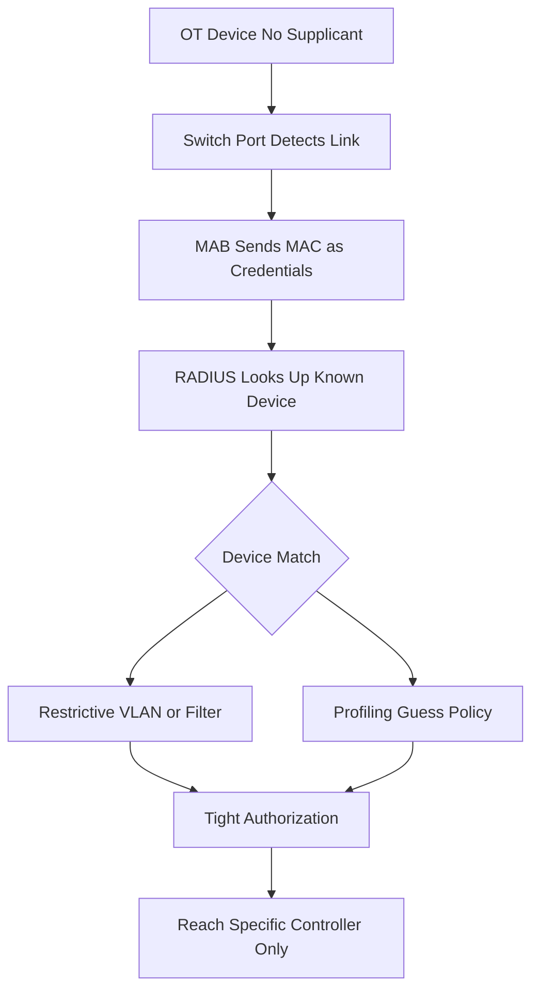

# RADIUS in OT and Industrial Networks: When the Endpoint Cannot Run a Supplicant

## English

Enterprise IT assumes endpoints can run software: a laptop has an 802.1X supplicant, a phone has a profile, a server has a configured interface. Operational technology (OT) — programmable logic controllers, remote terminal units, building-management gear, medical devices — breaks that assumption. Many of these devices run stripped-down firmware, cannot install certificates, have no supplicant, and in some cases cannot even be rebooted without stopping a physical process. Yet they sit on networks that increasingly need access control, because a compromised controller can do physical harm. This is where RADIUS designs have to bend.

The most common pattern is MAC Authentication Bypass (MAB): the switch sends the device's MAC address as both User-Name and User-Password (or as a Calling-Station-Id attribute), and RADIUS looks it up in a database of known devices. This is weak authentication — MAC addresses are trivially spoofable — so mature deployments treat MAB as a starting point, not an endpoint. The RADIUS server may return a restrictive VLAN or a Filter-Id that only permits the device to reach its specific controller, and the switch may additionally apply a port-level profile based on what it has learned about the device. The security comes from the combination of weak identity plus tight authorisation, not from the identity alone.

A second pattern is profiling: the RADIUS or NAC tier passively observes DHCP fingerprints, LLDP/CDP advertisements, HTTP user-agent strings, and TCP behaviour to guess what a device is, then assigns a policy. Profiling is probabilistic, so it is usually paired with an explicit allow-list of known MAC addresses for the most sensitive devices. The practical rule is that anything that can hurt someone physically should not rely on profiling alone.

A third pattern is network segmentation with a dedicated RADIUS realm. OT traffic is often placed on its own VLANs and given its own RADIUS virtual server or policy set, so that an IT-side misconfiguration cannot accidentally grant access to a controller. Some organisations go further and put the OT RADIUS tier behind a firewall from the IT tier, accepting the operational cost of a separate identity store because the blast radius of a shared one is unacceptable.

The recurring theme is that RADIUS in OT is less about strong authentication and more about containment. You cannot always prove who a device is, so you prove what it is allowed to reach, and you make that authorisation as narrow as the process requires. The RADIUS server becomes a policy engine for a population of devices that will never cooperate, and the design succeeds or fails on how carefully those policies are scoped.

## 中文

企業 IT 假設終端可以執行軟體：手提電腦有 802.1X supplicant、手機有設定檔、伺服器有配置好的介面。營運技術（OT）——可程式邏輯控制器、遠端終端單元、樓宇管理裝置、醫療器材——就打破了這個假設。很多這類裝置跑的是精簡韌體，裝不到憑證、沒有 supplicant，有些甚至不能重啟，因為一重啟就會令實際流程停頓。但他們所在的網路卻越來越需要存取控制，因為一個被入侵的控制器可以造成實體傷害。RADIUS 的設計就要在這裡讓步。

最常見的模式是 MAC Authentication Bypass（MAB）：交換機把裝置的 MAC 位址同時當作 User-Name 與 User-Password（或放在 Calling-Station-Id 屬性）送出，RADIUS 就在已知裝置資料庫裡查。這是弱認證——MAC 位址很容易偽造——所以成熟的部署會把 MAB 當作起點而非終點。RADIUS 伺服器可能回傳一個受限的 VLAN，或一個只准該裝置接觸其專屬控制器的 Filter-Id，交換機亦可能根據它對裝置的認識再加一層埠級設定檔。安全性來自「弱身份 + 嚴格授權」的組合，而不是身份本身。

第二個模式是 profiling：RADIUS 或 NAC 層被動觀察 DHCP fingerprint、LLDP/CDP 廣播、HTTP user-agent 字串、TCP 行為，去猜測裝置是什麼，然後套用政策。Profiling 是機率性的，所以通常會與一份最敏感裝置的明確 MAC allow-list 並用。實務原則是：任何可以令人身體受傷的東西，都不應該單靠 profiling。

第三個模式是用專屬 RADIUS realm 做網路分段。OT 流量通常放在自己的 VLAN，並配自己的 RADIUS virtual server 或 policy set，令 IT 那邊的錯誤配置不會意外授權進入控制器。有些機構更進一步，把 OT 的 RADIUS 層放在防火牆後面與 IT 層隔開，寧願承受分開身份儲存庫的營運成本，因為共用一個儲存庫的爆炸半徑太大。

反覆出現的主題是：OT 裡的 RADIUS，重點不在強認證，而在圍堵。你未必能證明裝置是誰，所以你就證明它可以接觸什麼，並把授權收窄到流程所需的最小範圍。RADIUS 伺服器於此變成一個政策引擎，服務一群永遠不會合作的裝置；設計的成敗，取決於那些政策界定得有多小心。

## Key Takeaway

In OT environments RADIUS often cannot rely on strong endpoint authentication, so security comes from tight authorisation and segmentation rather than from proving device identity.

## Related Concepts
- MAC Authentication Bypass (MAB)
- Network segmentation and VLAN assignment

## Diagram

