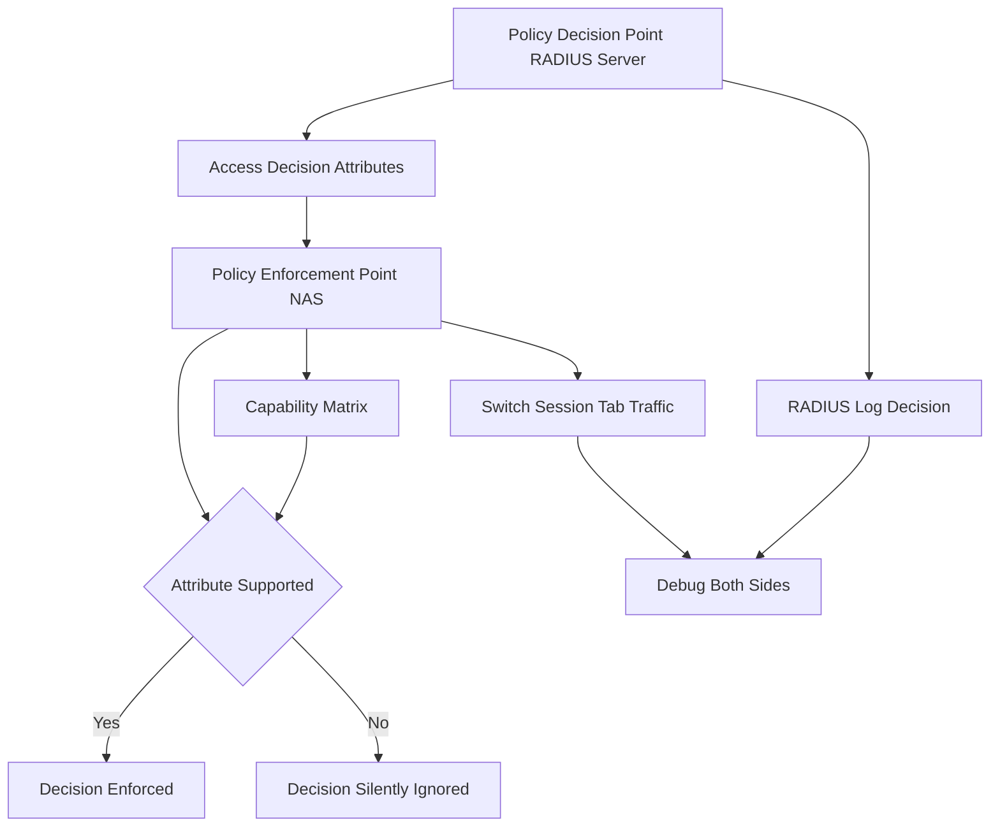

# RADIUS as a Policy Decision Point: Separating Decision from Enforcement

## English

It helps to see RADIUS through the lens of the classic PDP/PEP split from policy-based networking. The Policy Decision Point (PDP) is the thing that decides whether access is granted and under what conditions; the Policy Enforcement Point (PEP) is the thing that actually blocks or allows traffic. In a RADIUS deployment, the RADIUS server is the PDP and the NAS — switch, wireless controller, VPN concentrator — is the PEP. This sounds like academic taxonomy, but it explains a lot of real behaviour and a lot of real bugs.

The split matters because the PDP can only influence what the PEP is willing to enforce. If the switch does not support a particular attribute, the RADIUS server can send it all day and nothing happens. If the switch supports VLAN assignment but not per-user ACLs, then a policy that depends on a Filter-Id will silently degrade. This is why mature deployments maintain a capability matrix: for each NAS vendor and model, which attributes are honoured, which are ignored, and which cause the request to be rejected outright. The PDP's policy language can be perfectly correct and still produce the wrong outcome because the PEP did not implement the decision.

A second consequence is that the PDP often does not have the full picture. The RADIUS server sees the attributes the NAS chose to send — User-Name, Calling-Station-Id, NAS-Port-Id, sometimes device posture data — but it does not see the actual traffic. If the policy is 'this user may reach the finance VLAN', the RADIUS server expresses that as a VLAN assignment or an ACL, and the switch enforces it. If the switch's ACL is wrong, the policy is wrong, regardless of what the RADIUS server intended. Debugging therefore requires reading both sides: the RADIUS log shows the decision, and the switch's session table shows the enforcement.

A third consequence is that some decisions cannot be made at authentication time at all. Whether a session should continue depends on events the PDP never sees directly — a change in posture, a threat-detection alert, an administrator revoking access. This is exactly the gap that CoA (Change of Authorization) fills: the PDP pushes a new decision to the PEP mid-session. Without CoA, the PDP's authority ends at the moment of authentication, and the PEP enforces a decision that may already be stale.

Thinking in PDP/PEP terms also clarifies where to put complexity. Identity lookup, group resolution, and policy evaluation belong on the PDP, where they can be centralised, versioned, and audited. Traffic filtering, VLAN tagging, and port state belong on the PEP, where they happen at line rate. Designs that blur the line — for example, trying to make the switch evaluate group membership — tend to be brittle, because the PEP is optimised for enforcement, not for reasoning.

## 中文

用政策式網路中經典的 PDP/PEP 分工來看 RADIUS，會很有幫助。Policy Decision Point（PDP）是決定「是否授權、在什麼條件下授權」的一方；Policy Enforcement Point（PEP）則是實際封鎖或放行流量的一方。在 RADIUS 部署裡，RADIUS 伺服器是 PDP，而 NAS——交換機、無線控制器、VPN 集中器——是 PEP。這聽起來像學術分類，但它解釋了很多真實行為，也解釋了很多真實的 bug。

這個分工之所以重要，是因為 PDP 只能影響 PEP 願意執行的東西。如果交換機不支援某個屬性，RADIUS 伺服器送一整天也沒有用。如果交換機支援 VLAN 指派但不支援逐使用者 ACL，那麼依賴 Filter-Id 的政策就會靜靜地降級。這就是為什麼成熟部署會維護一份能力矩陣：對每個 NAS 廠牌與型號，哪些屬性會被執行、哪些會被忽略、哪些會令請求直接被拒。PDP 的政策語言可以完全正確，卻仍然產生錯誤結果，因為 PEP 沒有實作那個決定。

第二個後果是 PDP 往往看不到全貌。RADIUS 伺服器只看到 NAS 選擇送出的屬性——User-Name、Calling-Station-Id、NAS-Port-Id，有時還有裝置 posture 資料——但它看不到實際流量。如果政策是「這位使用者可以進入財務 VLAN」，RADIUS 伺服器會把它表達成 VLAN 指派或 ACL，由交換機執行。如果交換機的 ACL 寫錯，政策就是錯的，無論 RADIUS 伺服器原本想怎樣。所以除錯要兩邊一起讀：RADIUS 日誌顯示決定，交換機的 session table 顯示執行。

第三個後果是，有些決定根本不可能在認證那一刻做出。一個 session 應否繼續，取決於 PDP 不會直接看到的事件——posture 改變、威脅偵測警報、管理員撤銷存取。這正是 CoA（Change of Authorization）填補的缺口：PDP 在 session 中途把新決定推給 PEP。沒有 CoA，PDP 的權威在認證完成那一刻就結束，PEP 執行的可能已經是過時的決定。

用 PDP/PEP 的角度思考，也會釐清複雜度應該放在哪裡。身份查詢、群組解析、政策評估屬於 PDP，因為它們可以集中、版本化、可稽核。流量過濾、VLAN 標記、埠狀態屬於 PEP，因為它們要線上速執行。把界線模糊掉的設計——例如想叫交換機去評估群組成員資格——通常很脆弱，因為 PEP 是為執行而最佳化，不是為推理而最佳化。

## Key Takeaway

RADIUS is the policy decision point and the NAS is the enforcement point, so a correct decision only becomes a correct outcome if the NAS actually supports and applies the attributes sent.

## Related Concepts
- Policy Decision Point vs Policy Enforcement Point
- NAS capability matrix and attribute support

## Diagram

