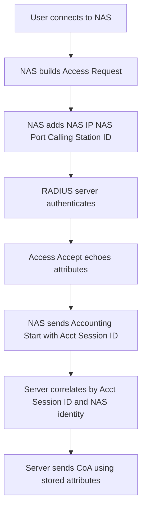

# The RADIUS Session Is a Lie We Agree to Believe

## English

RADIUS is built on UDP and is stateless at the protocol level: every Access-Request is a self-contained question, and the server keeps no mandatory memory of the previous exchange. Yet almost everything an operator cares about — simultaneous-use limits, CoA targeting, accounting correlation, troubleshooting a single user's login — depends on the fiction that a "session" exists. That session is manufactured entirely out of attributes the NAS volunteers to send. The NAS stamps each Access-Request with NAS-IP-Address or NAS-Identifier plus NAS-Port (or NAS-Port-Id for descriptive strings like "GigabitEthernet1/0/12") and, in 802.1X deployments, Calling-Station-Id (the supplicant MAC) and Called-Station-Id (the AP or switch identity, often with SSID appended). The server echoes these back in the Access-Accept, and later uses them as the addressing key for CoA-Request packets. If the NAS omits or mangles a field, the server cannot later revoke that user's access, because it has no reliable way to say "you, on that port, disconnect now."

Accounting is the other half of the illusion. RFC 2866 defines Accounting-Request with Acct-Status-Type values of Start, Interim-Update, and Stop, plus a mandatory Acct-Session-Id that the NAS generates. That Acct-Session-Id is the closest thing RADIUS has to a primary key for a session, and it is entirely the NAS's invention — two different vendors may format it differently, and a reboot may reset the counter. The server correlates Start and Stop records by matching Acct-Session-Id together with the NAS identity, not by any server-side session object. If a Stop record is lost (UDP, remember), the server may believe a user is still online forever, which is why production deployments pair accounting with periodic Interim-Updates and often a reconciliation job that expires sessions with no recent activity.

Simultaneous-Use enforcement makes the tension vivid. A FreeRADIUS server implementing Simultaneous-Use counts active sessions in its radacct table by querying Accounting records, then compares against a configured limit. Nothing in the protocol enforces this — the server is trusting the NAS to have sent accurate Start and Stop records, and trusting its own database to be consistent. A NAS that fails to send a Stop on link flap, or a server that loses a database write, silently breaks the policy. This is why many operators treat Simultaneous-Use as advisory rather than a security control, and why the real enforcement usually lives in the NAS's own port-security or in a CoA-driven disconnect triggered by the server after it detects the violation.

The practical lesson: when you debug a RADIUS problem, ask which side owns the session identity. If CoA disconnects are failing, check whether the NAS is sending the same NAS-Port-Id and Calling-Station-Id values in the original Access-Request that it will accept in the CoA-Request — vendors are inconsistent here, and a mismatch means the disconnect is silently dropped or answered with a NAK. If accounting is showing ghost sessions, check Interim-Update intervals and whether the NAS sends Stop on administrative shutdown as well as on link-down. The protocol gives you a vocabulary for sessions but no guarantees; the guarantees come from careful configuration on both ends and from monitoring that treats accounting records as evidence, not truth.

## 中文

RADIUS 建基於 UDP，在協定層面是無狀態的：每個 Access-Request 都是一條自成一體的問題，伺服器並不強制記住上一次交換的內容。然而，營運者幾乎所有關心的東西——同時使用上限、CoA 的目標定位、計費關聯、排查某個用戶的單次登入——都依賴「工作階段存在」這個虛構。這個工作階段完全是由 NAS 主動送出的屬性堆砌出來的。NAS 在每個 Access-Request 蓋上 NAS-IP-Address 或 NAS-Identifier，加上 NAS-Port（或描述性字串如「GigabitEthernet1/0/12」的 NAS-Port-Id），在 802.1X 部署中還有 Calling-Station-Id（supplicant 的 MAC）與 Called-Station-Id（AP 或交換機的身份，通常附上 SSID）。伺服器把這些屬性回送在 Access-Accept 中，日後再拿它們當作 CoA-Request 封包的定址鍵。若 NAS 漏送或弄壞某個欄位，伺服器日後就無法撤銷該用戶的存取權，因為它沒辦法可靠地說「你，在那個埠上，立即斷線」。

計費是這個幻象的另一半。RFC 2866 定義 Accounting-Request，Acct-Status-Type 的值有 Start、Interim-Update、Stop，另加一個由 NAS 產生的強制性 Acct-Session-Id。這個 Acct-Session-Id 是 RADIUS 最接近工作階段主鍵的東西，而它完全是 NAS 的發明——不同廠商格式各異，重新開機可能令計數器歸零。伺服器是靠 Acct-Session-Id 配合 NAS 身份來關聯 Start 與 Stop 記錄，而不是靠任何伺服器端的工作階段物件。若 Stop 記錄遺失（別忘了是 UDP），伺服器可能永遠以為用戶仍在線，所以生產部署會把計費配合週期性的 Interim-Update，並常加一個對賬工作，把太久沒有活動的工作階段過期掉。

同時使用（Simultaneous-Use）的執行把這個張力活現出來。實施 Simultaneous-Use 的 FreeRADIUS 伺服器，會查 radacct 表按計費記錄數出活躍工作階段，再與設定的上限比較。協定本身並不執行這件事——伺服器是信任 NAS 送來了準確的 Start 與 Stop 記錄，也信任自己的資料庫一致。若 NAS 在連線翻覆時漏送 Stop，或伺服器遺失一次資料庫寫入，政策就被無聲破壞。這就是為何許多營運者把 Simultaneous-Use 當作提示性而非安全控制，而真正的執行通常落在 NAS 自身的埠安全，或由伺服器偵測違規後以 CoA 觸發斷線。

實務教訓：排查 RADIUS 問題時，先問哪一方擁有工作階段身份。若 CoA 斷線失敗，檢查 NAS 在原本 Access-Request 送出的 NAS-Port-Id 與 Calling-Station-Id 值，是否與它在 CoA-Request 中會接受的值一致——廠商在這方面並不統一，一旦不匹配，斷線請求會被靜默丟棄或回以 NAK。若計費出現幽靈工作階段，檢查 Interim-Update 間隔，以及 NAS 是否在管理性關機與連線中斷兩種情況下都會送 Stop。協定給你工作階段的詞彙，但不給保證；保證來自兩端的謹慎設定，以及把計費記錄當作證據而非真相的監察。

## Key Takeaway

RADIUS has no real sessions — the session is a fiction reconstructed from NAS-supplied attributes and accounting records, so its accuracy is only as good as both ends' discipline.

## Related Concepts
- Accounting Session Lifecycle
- CoA Target Identification

## Diagram

