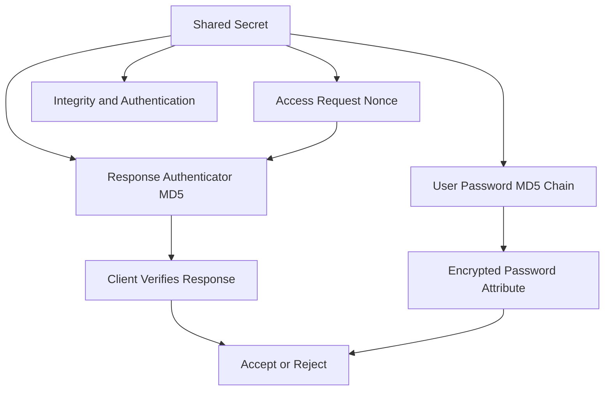

# The Shared Secret Is a Key, Not a Password: What It Actually Protects

## English

Every RADIUS packet carries a 16-byte Authenticator field, and its meaning depends on the packet code. For an Access-Request, the Authenticator is a random nonce chosen by the NAS; for responses (Access-Accept, Access-Reject, Access-Challenge) it is computed as an MD5 hash over the response code, the identifier, the packet length, the request Authenticator, the response attributes, and the shared secret. That construction — defined in RFC 2865 — is what lets the client verify that a response actually came from someone holding the secret, and that it corresponds to the request it sent. It is not a signature over the whole packet in the modern sense; it is a keyed checksum with specific inputs, and understanding exactly which inputs matters when you debug why a client rejects a perfectly good Access-Accept.

User passwords travel inside the User-Password attribute, but never in the clear. RFC 2865 specifies that the NAS pads the password to a multiple of 16 bytes, then XORs it with an MD5 hash of the shared secret concatenated with the request Authenticator. For passwords longer than 16 bytes, the process chains: each block is XORed with MD5(secret + previous ciphertext block). This is why the shared secret is genuinely a cryptographic key for the password field — without it, an attacker who captures the packet cannot recover the plaintext, but with it they can. It also explains a subtle operational rule: the shared secret must be identical on both ends byte-for-byte, and changing it requires coordinated rotation, because a mismatch doesn't produce a clear error — it produces an Access-Reject that looks exactly like a wrong password.

The secret protects integrity and authentication of the exchange, but it does not provide confidentiality for the rest of the packet. Attributes other than User-Password — User-Name, Calling-Station-Id, NAS-Port-Id, and everything else — are sent in cleartext. An observer on the path sees who is logging in, from which MAC, on which port, even though they cannot read the password. This is precisely the gap that RadSec (RADIUS over TLS, RFC 6614) closes by wrapping the entire conversation in TLS, and the reason EAP methods like PEAP and TTLS exist: they tunnel the actual credential exchange inside a TLS session negotiated end-to-end between supplicant and server, so the shared secret only protects the outer EAP-Message relay, not the credentials themselves.

Response Authenticator verification also underpins Message-Authenticator, an attribute defined in RFC 3579 and made mandatory for EAP-containing packets. Message-Authenticator is an HMAC-MD5 over the entire packet using the shared secret as key, and it exists because the plain response Authenticator does not cover the request's attributes in a way that prevents certain tampering attacks on EAP exchanges. When a NAS rejects a packet with a Message-Authenticator failure, the usual causes are a secret mismatch, a middlebox rewriting attributes, or a vendor that computes the HMAC over a subtly different byte range — all of which are painful because the error message rarely tells you which.

Operationally, treat the shared secret as you would a TLS private key: long, random, unique per NAS, stored in a secrets manager rather than in a flat clients.conf, and rotated on a schedule. The rotation procedure matters more than the secret itself — because there is no in-protocol key agreement, you must either accept a brief window where the NAS tries the new secret and falls back to the old, or coordinate a maintenance window. Many operators run two secrets per client during rotation and remove the old one after confirming the new one works. And remember the asymmetry: the secret authenticates the server to the client and encrypts the password field, but it does not hide the metadata of who is logging in where — for that you need RadSec or a tunneled EAP method.

## 中文

每個 RADIUS 封包都帶一個 16 位元組的 Authenticator 欄位，其意義取決於封包碼。對於 Access-Request，Authenticator 是 NAS 選出的隨機 nonce；對於回應（Access-Accept、Access-Reject、Access-Challenge），它是對回應碼、識別碼、封包長度、請求 Authenticator、回應屬性與共享密鑰做 MD5 雜湊計算出來的。這個由 RFC 2865 定義的構造，讓客戶端能驗證回應確實來自持有密鑰的一方，且對應於它送出的請求。它不是現代意義上對整個封包的簽名，而是帶密鑰的校驗和，輸入範圍特定；正因為如此，當你排查客戶端為何拒絕一個明明正確的 Access-Accept 時，弄清楚究竟哪些輸入被涵蓋就很重要。

用戶密碼放在 User-Password 屬性內傳送，但從不以明文出現。RFC 2865 規定 NAS 先把密碼填充到 16 位元組的倍數，再與「共享密鑰串接請求 Authenticator 的 MD5 雜湊」做 XOR。密碼長於 16 位元組時會鏈式處理：每個區塊與 MD5(secret + 前一個密文區塊) 做 XOR。這就是為何共享密鑰對密碼欄位而言是真正的密碼學密鑰——沒有它，截獲封包的攻擊者無法還原明文；有它就可以。這也解釋了一條微妙的營運規則：共享密鑰在兩端必須逐位元組完全相同，更改時要協調輪換，因為不匹配不會產生清晰錯誤——它產生的 Access-Reject 看起來與密碼錯誤一模一樣。

密鑰保護交換的完整性與認證，但不為封包其餘部分提供機密性。User-Password 以外的屬性——User-Name、Calling-Station-Id、NAS-Port-Id 及其他——都以明文傳送。路徑上的觀察者看得到誰在登入、從哪個 MAC、在哪個埠，雖然讀不到密碼。這正是 RadSec（RADIUS over TLS，RFC 6614）把整個對話包進 TLS 所填補的缺口，也是 PEAP 與 TTLS 這類 EAP 方法存在的原因：它們把真正的憑證交換隧道化在 supplicant 與伺服器之間端到端協商的 TLS 工作階段內，於是共享密鑰只保護外層的 EAP-Message 轉發，而非憑證本身。

回應 Authenticator 驗證也是 Message-Authenticator 的基礎，後者是 RFC 3579 定義、對含 EAP 的封包屬強制性的屬性。Message-Authenticator 是以共享密鑰為鍵、對整個封包做 HMAC-MD5，它存在的原因是單純的回應 Authenticator 並未以能防止 EAP 交換遭篡改的方式涵蓋請求屬性。當 NAS 因 Message-Authenticator 失敗而拒絕封包，常見原因是密鑰不匹配、中間裝置改寫屬性，或廠商對 HMAC 計算的位元組範圍有微妙差異——這些都令人頭痛，因為錯誤訊息很少告訴你是哪一種。

營運上，把共享密鑰當成 TLS 私鑰來對待：長、隨機、每個 NAS 獨立、存放在密鑰管理系統而非扁平的 clients.conf，並定期輪換。輪換程序比密鑰本身更重要——因為協定內沒有密鑰協商，你必須要麼接受 NAS 先試新密鑰再回退舊密鑰的短暫窗口，要麼協調維護時段。許多營運者在輪換期間為每個客戶端同時保留兩把密鑰，確認新密鑰可用後才移除舊的。並記住這種不對稱：密鑰向客戶端認證伺服器並加密密碼欄位，但不隱藏誰在哪裡登入的元數據——要達到後者，你需要 RadSec 或隧道化的 EAP 方法。

## Key Takeaway

The shared secret is a cryptographic key that authenticates responses and encrypts the password field, but it leaves all other attributes in cleartext — which is exactly what RadSec and tunneled EAP exist to fix.

## Related Concepts
- User-Password Encryption
- Message-Authenticator

## Diagram

