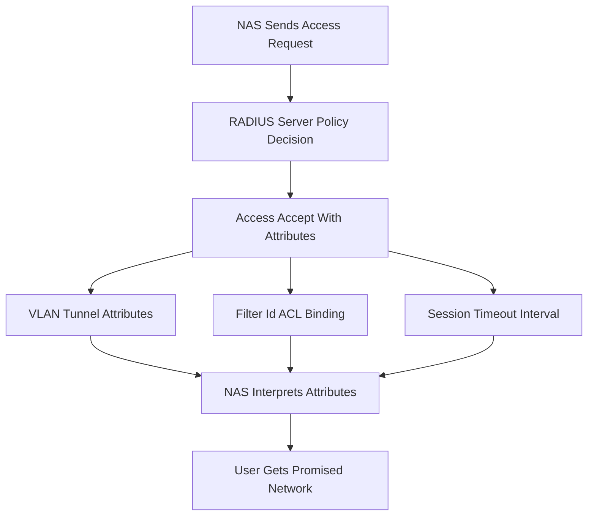

# Why the Reply Is Not the Decision: Policy, Provisioning, and the Side Effects of Access-Accept

## English

It is tempting to think of RADIUS as a question-and-answer service: the NAS asks, the server answers Accept or Reject, and the network enforces. In practice the Access-Accept is often the beginning of a chain of side effects that the server must orchestrate, and the hardest bugs live in the gap between "the server said yes" and "the user actually got the network they were promised." The server is not just an authenticator; it is a policy decision point whose output is a set of attributes — VLAN assignment via Tunnel-Type/Tunnel-Medium-Type/Tunnel-Private-Group-Id, Filter-Id for ACL binding, Session-Timeout for reauthentication intervals, Acct-Interim-Interval for accounting cadence — and the NAS is the enforcement point that must interpret them correctly.

Consider VLAN assignment. The classic trio is Tunnel-Type = VLAN (value 13), Tunnel-Medium-Type = IEEE-802 (value 6), and Tunnel-Private-Group-Id = the VLAN identifier as a string. These are RFC 3580 conventions, not a single "VLAN" attribute, and vendors differ in how strictly they follow them: some accept the numeric VLAN ID as a string, some accept a VLAN name, some require the tags to be set in a specific order. A server that emits the right values but the wrong tags, or the right tags but a VLAN the switch port doesn't have configured, produces an Access-Accept that the switch silently ignores or logs as a warning — the user is authenticated but lands in the wrong VLAN or the default one. This is why "the RADIUS server accepted me but I have no network" is almost never a RADIUS problem; it is an attribute-interpretation problem on the NAS.

Session-Timeout and Terminate-Action deserve similar care. Session-Timeout (RFC 2865) tells the NAS how many seconds the session may last before it must reauthenticate; a value of zero or absence means no limit. But the NAS's behaviour on expiry is vendor-specific: some silently re-run the whole 802.1X exchange, some send a CoA-driven reauth, some just drop the port. Terminate-Action (RFC 3580) is supposed to tell the NAS what to do on CoA disconnect — whether to reauthenticate, bounce the port, or just remove the session — but support is patchy. An operator who assumes Session-Timeout means "re-prompt the user every hour" may find that on one switch model it means "drop the port and wait for the supplicant to retry," which is a very different user experience.

The provisioning side effects are where things get genuinely subtle. Many deployments want to do more than authorize: register the device's MAC in an inventory system, push a firewall rule, add the user to a group, log to a SIEM. These are not RADIUS operations — they are side effects the server triggers before or after emitting the reply. If the side effect fails, what should the server do? Fail closed (Reject the user, even though authentication succeeded) or fail open (Accept and log the failure)? Neither is universally right, and the choice must be explicit. A common pattern is to make non-critical side effects asynchronous and best-effort, while treating identity-store writes as blocking — but that requires the server's policy language to distinguish the two, which in FreeRADIUS means careful use of unlang sections and understanding which modules can fail without aborting the request.

The deeper point is that Access-Accept is a promise about the future, and the server is only one of the parties that must keep it. Good operational practice is to test the whole chain, not just the RADIUS exchange: after an Access-Accept, verify the switch actually applied the VLAN, the ACL actually bound, the accounting actually started. Tools like radclient confirm the server's answer; they do not confirm the network's behaviour. The most valuable monitoring is often a synthetic probe that authenticates, then checks from inside the assigned VLAN that the expected resources are reachable. That closes the loop between decision and enforcement, which is where the real failures hide.

## 中文

人們很容易把 RADIUS 想成一問一答的服務：NAS 問，伺服器答 Accept 或 Reject，網路執行。實務上，Access-Accept 往往是一連串伺服器必須協調的副作用之開端，而最難搞的錯誤就住在「伺服器說可以」與「使用者真的得到承諾的網路」之間的縫隙裡。伺服器不只是認證者；它是政策決策點，其輸出是一組屬性——以 Tunnel-Type/Tunnel-Medium-Type/Tunnel-Private-Group-Id 做 VLAN 指派、以 Filter-Id 繫結 ACL、以 Session-Timeout 設定重新認證間隔、以 Acct-Interim-Interval 設定計費節奏——而 NAS 是必須正確解讀它們的執行點。

以 VLAN 指派為例。經典三件套是 Tunnel-Type = VLAN（值 13）、Tunnel-Medium-Type = IEEE-802（值 6）、Tunnel-Private-Group-Id = 以字串表示的 VLAN 識別碼。這些是 RFC 3580 的慣例，而非單一「VLAN」屬性，而廠商遵循的嚴格程度各異：有些接受數字 VLAN ID 當字串，有些接受 VLAN 名稱，有些要求標籤以特定順序設定。伺服器送出正確的值但標籤錯，或標籤對但交換機埠沒設定那個 VLAN，就會產生一個被交換機靜默忽略或記錄為警告的 Access-Accept——使用者透過認證，卻落在錯的 VLAN 或預設 VLAN。這就是為何「RADIUS 伺服器接受了我，但我沒有網路」幾乎從來不是 RADIUS 問題，而是 NAS 上的屬性解讀問題。

Session-Timeout 與 Terminate-Action 也值得同樣小心。Session-Timeout（RFC 2865）告訴 NAS 工作階段可持續多少秒才必須重新認證；值為零或不存在代表無限制。但 NAS 到期時的行為是廠商特定的：有些靜默重跑整個 802.1X 交換，有些送 CoA 觸發重新認證，有些直接關掉埠。Terminate-Action（RFC 3580）本應告訴 NAS 在 CoA 斷線時該做什麼——重新認證、彈跳埠，還是隻移除工作階段——但支援參差不齊。假設 Session-Timeout 意思是「每小時重新提示使用者」的營運者，可能發現在某款交換機上它意味著「關掉埠，等 supplicant 重試」，那是非常不同的使用者體驗。

佈建方面的副作用才是真正微妙之處。許多部署想做的遠不止授權：把裝置 MAC 登記到資產系統、推送防火牆規則、把使用者加入群組、記錄到 SIEM。這些不是 RADIUS 操作——它們是伺服器在送出回應前後觸發的副作用。若副作用失敗，伺服器該怎麼辦？失敗即關閉（即使使用者認證成功也 Reject）還是失敗即放行（Accept 並記錄失敗）？兩者都不是放諸四海皆準，而選擇必須明確。常見模式是讓非關鍵副作用非同步且盡力而為，而把身份庫寫入視為阻塞性——但那要求伺服器的政策語言能區分兩者，在 FreeRADIUS 中意味著小心運用 unlang 區段，並理解哪些模組可以失敗而不中止請求。

更深的要點是：Access-Accept 是對未來的承諾，而伺服器只是必須守諾的其中一方。良好的營運實務是測試整條鏈，而非只測 RADIUS 交換：Access-Accept 之後，驗證交換機真的套用了 VLAN、ACL 真的繫結了、計費真的開始了。radclient 這類工具確認伺服器的答覆，卻不確認網路行為。最有價值的監察往往是一個合成探針：先認證，再從被指派的 VLAN 內部檢查預期資源可達。這把決策與執行之間的迴路閉合起來，而真正的故障就藏在那裡。

## Key Takeaway

Access-Accept is a promise the server cannot keep alone — the attributes it emits are only meaningful if the NAS interprets them correctly, so test the whole chain from decision to enforcement, not just the RADIUS exchange.

## Related Concepts
- VLAN Assignment Attributes
- Policy Decision Versus Enforcement

## Diagram

