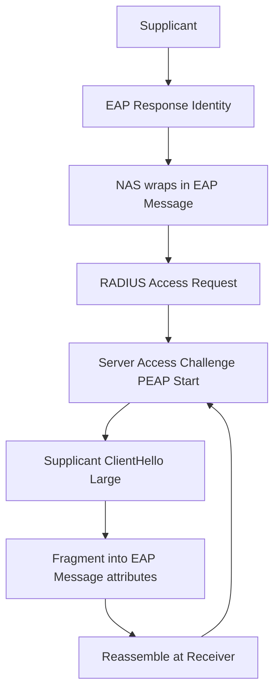

# The EAP-Message Attribute: How a Whole Conversation Fits in One Field

## English

RADIUS was designed in the early 1990s, long before anyone imagined that a single access request would need to carry a full TLS handshake. The protocol's answer was elegant: instead of inventing new packet types, it defined a single attribute, EAP-Message (attribute 79), whose value is simply an opaque chunk of EAP bytes. From RADIUS's point of view, an 802.1X login is just a series of Access-Request and Access-Challenge packets that happen to contain this attribute. From EAP's point of view, RADIUS is a dumb pipe that carries messages between the supplicant and the authentication server. Neither side needs to understand the other, which is why the design has survived for decades.

The catch is that RADIUS has a hard limit: a single packet cannot exceed 4096 bytes, and the EAP-Message attribute itself is capped at 253 bytes because an attribute's length field is one octet. A TLS handshake with a certificate chain easily blows past that. The fix is fragmentation: a single EAP packet is split across multiple EAP-Message attributes in the same RADIUS packet, and if there are still too many bytes, the EAP packet is split across multiple RADIUS packets. Each fragment carries the same Identifier so the receiver can reassemble them in order. This is why the EAP-Message attribute is often described as the workhorse of 802.1X — every certificate exchange, every inner authentication round, every TLS alert rides through it.

A concrete example: a supplicant starts PEAP. It sends an EAP-Response/Identity. The NAS wraps that in EAP-Message and forwards it to the RADIUS server. The server replies with an Access-Challenge containing EAP-Request/PEAP-Start. The supplicant responds with a ClientHello, which may be 200 bytes or may be 1500 bytes if it carries many cipher suites. The server replies with a ServerHello and certificate, which is frequently several kilobytes and requires three or four RADIUS packets. Each round-trip looks identical at the RADIUS layer — same Code (11 for Access-Challenge, 1 for Access-Request), same Identifier, only the EAP-Message payload changes.

The State attribute is the glue. When the server sends an Access-Challenge, it includes a State attribute (attribute 24) that the NAS must echo back verbatim in the next Access-Request. This lets a stateless server correlate the fragments of a conversation without keeping per-session state in memory. If a NAS drops State, the conversation breaks. If a proxy rewrites State, the conversation breaks. This is one of the reasons EAP through a proxy chain is fragile.

Finally, the Message-Authenticator attribute (attribute 80) was added specifically because EAP-Message cannot be protected by the shared secret alone. The classic RADIUS Request Authenticator is an MD5 hash over the packet and the shared secret, but with EAP-Message the payload is attacker-influenceable, so RFC 3579 mandates a separate HMAC-MD5 over the whole packet. Without it, an on-path attacker could inject EAP-Success and bypass authentication entirely — a known attack class that's why modern deployments reject EAP packets lacking Message-Authenticator.

## 中文

RADIUS 誕生於 1990 年代初，當時根本沒有人想像過，一個存取請求竟然需要承載完整的 TLS 握手。協議的答案非常優雅：它沒有發明新的封包類型，而是定義了一個屬性 EAP-Message（屬性編號 79），其值只是一段不透明的 EAP 位元組。從 RADIUS 的角度看，一次 802.1X 登入不過是一連串 Access-Request 和 Access-Challenge 封包，剛好含有這個屬性。從 EAP 的角度看，RADIUS 只是一條把訊息從 supplicant 送到認證伺服器的笨管道。兩邊都不需要理解對方，這就是這個設計能夠存活數十年的原因。

問題在於 RADIUS 有硬性上限：單一封包不得超過 4096 位元組，而 EAP-Message 屬性本身被限制在 253 位元組，因為屬性的長度欄位只有一個位元組。一個帶憑證鏈的 TLS 握手輕易就超過這個限制。解法是分片：單一 EAP 封包被拆散到同一個 RADIUS 封包內的多個 EAP-Message 屬性；如果位元組仍然太多，EAP 封包就再拆散到多個 RADIUS 封包。每個分片都帶著相同的 Identifier，讓接收端能依序重組。這就是為何 EAP-Message 常被形容為 802.1X 的主力：每一次憑證交換、每一輪內部認證、每一個 TLS 警示，全都靠它承載。

具體例子：supplicant 啟動 PEAP，送出 EAP-Response/Identity。NAS 把它包進 EAP-Message 轉發給 RADIUS 伺服器。伺服器回一個 Access-Challenge，內含 EAP-Request/PEAP-Start。supplicant 回一個 ClientHello，可能只有 200 位元組，也可能因為帶了許多加密套件而有 1500 位元組。伺服器回 ServerHello 加憑證，通常有好幾 KB，需要三到四個 RADIUS 封包。在 RADIUS 層面，每一輪看起來都一樣——相同的 Code（11 代表 Access-Challenge，1 代表 Access-Request）、相同的 Identifier，只有 EAP-Message 的內容在變。

State 屬性是黏著劑。伺服器送出 Access-Challenge 時，會附上一個 State 屬性（屬性編號 24），NAS 必須在下一個 Access-Request 中原封不動地回傳。這讓無狀態的伺服器可以關聯一次對話的分片，而不需要在記憶體中保存每個 session 的狀態。如果 NAS 丟掉 State，對話就斷了。如果代理改寫 State，對話也斷了。這也是為什麼透過代理鏈傳遞 EAP 特別脆弱。

最後，Message-Authenticator 屬性（屬性編號 80）正是因為 EAP-Message 無法只靠共享密鑰保護才被加入。傳統 RADIUS 的 Request Authenticator 是對封包與共享密鑰做 MD5 雜湊，但有了 EAP-Message，內容可能被攻擊者影響，所以 RFC 3579 規定必須另外對整個封包做 HMAC-MD5。沒有它，路徑上的攻擊者可以注入 EAP-Success 完全繞過認證——這是已知的攻擊類型，也是現代部署拒絕缺少 Message-Authenticator 的 EAP 封包的原因。

## Key Takeaway

EAP-Message turns RADIUS into a transparent carrier for arbitrary authentication conversations, and the State and Message-Authenticator attributes are what keep that carrier trustworthy.

## Related Concepts
- Message-Authenticator attribute
- EAP fragmentation

## Diagram

