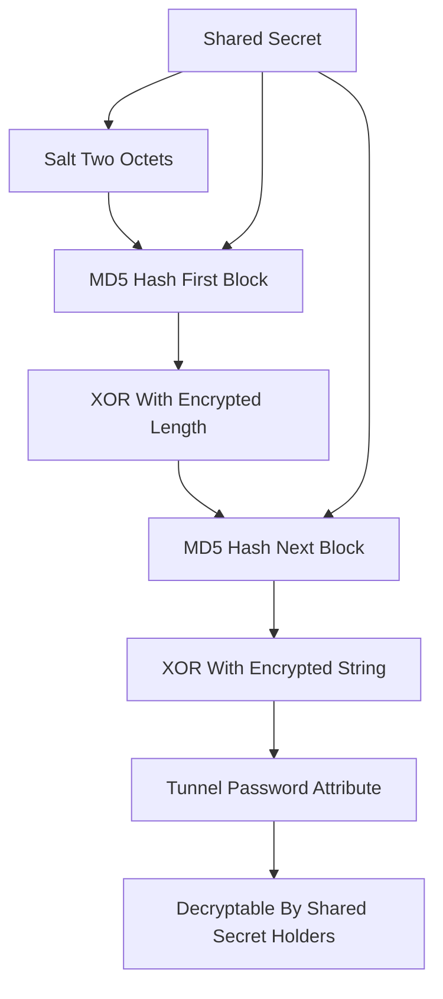

# The Tunnel-Password Attribute and the Illusion of Encrypted Attributes

## English

One of the most misunderstood corners of RADIUS is the Tunnel-Password attribute (attribute 69), defined in RFC 2868. Its name suggests it carries a password inside a tunnel, and indeed its value is encrypted — but the encryption is not what most people assume. It's not TLS, it's not a session key negotiated between NAS and server, and it isn't even a modern cipher. It is a scheme built on MD5, salted with a shared secret and a per-attribute salt, designed in the late 1990s for a specific purpose: carrying a Wi-Fi WEP key or similar secret from the RADIUS server to the access point without exposing it in plaintext on the wire.

The mechanism is worth understanding because it illustrates a broader pattern. The attribute value contains a salt (two octets), an encrypted length, and the encrypted string. The encryption is a chained XOR over MD5 hashes of the shared secret plus the salt plus the previous block. The shared secret is the same one used for the Request Authenticator, which means anyone who knows the shared secret can decrypt the attribute. In practice, this means Tunnel-Password provides confidentiality against passive eavesdroppers on the network path, but not against anyone who has obtained the shared secret — which in many deployments is written in a configuration file readable by more people than anyone would like.

Why does this matter? Because Tunnel-Password is the canonical example of a RADIUS attribute that looks encrypted and is encrypted, but is encrypted under assumptions that don't match modern threat models. The same shared secret that protects the tunnel-password also authenticates every Access-Request, so if it leaks, the attacker can both forge requests and decrypt stored credentials. The MD5-based construction is also considered weak by today's standards, though no practical break of the specific construction has been published that would let an attacker without the shared secret recover the plaintext.

A related but distinct case is the User-Password attribute (attribute 2), which is also obfuscated using MD5 and the shared secret. Both are sometimes described as "encrypted" in vendor documentation, which leads operators to assume more protection than exists. The honest framing is that they are protected against on-path observation but not against anyone who has the shared secret, and the shared secret is often stored in plaintext on both the NAS and the RADIUS server. This is one reason RadSec (RADIUS over TLS) is increasingly preferred: it moves the protection boundary from "shared secret" to "TLS certificate," which is a much stronger and more manageable trust anchor.

A practical implication: if you're auditing a RADIUS deployment, look for Tunnel-Password and User-Password in the traffic and ask who can read the shared secret. If the answer is "anyone with shell on the NAS," then those attributes are effectively plaintext for anyone who compromises the NAS. If you're using RadSec, the attributes are still obfuscated the same way inside the TLS tunnel, but the tunnel adds a second layer that the shared secret alone doesn't provide. Understanding this distinction is what separates an operator who trusts the word "encrypted" from one who knows what it actually protects against.

## 中文

RADIUS 中最常被誤解的角落之一，就是 RFC 2868 定義的 Tunnel-Password 屬性（屬性編號 69）。它的名字暗示它帶著隧道內的密碼，而它的值確實經過加密——但這個加密並不是大多數人以為的那樣。它不是 TLS，不是 NAS 與伺服器之間協商的 session key，甚至不是現代密碼。它是一套建立在 MD5 上的機制，用共享密鑰和每個屬性專屬的 salt 來加鹽，1990 年代末設計出來是為了特定目的：把 Wi-Fi WEP 密鑰或類似機密從 RADIUS 伺服器送到存取點，而不在網路上以明文暴露。

這個機制值得理解，因為它揭示了更廣泛的模式。屬性值包含一個 salt（兩個 octet）、一個加密後的長度，以及加密後的字串。加密方式是對「共享密鑰加 salt 加前一個區塊」的 MD5 雜湊做連鎖 XOR。共享密鑰就是保護 Request Authenticator 的同一把密鑰，這意味著任何知道共享密鑰的人都能解密這個屬性。實務上，這表示 Tunnel-Password 對網路路徑上的被動竊聽者提供機密性，但對任何已取得共享密鑰的人則毫無保護——而在許多部署中，共享密鑰就寫在一個設定檔裡，能讀取的人比任何人願意承認的都多。

為什麼這很重要？因為 Tunnel-Password 是 RADIUS 屬性的典型例子：看起來加密、確實也加密，但加密的假設與現代威脅模型並不相符。保護 tunnel-password 的同一把共享密鑰也用來認證每一個 Access-Request，所以一旦洩漏，攻擊者既能偽造請求，也能解密儲存的憑證。以今天的標準，MD5 建構的機制也被視為偏弱，儘管目前沒有已發表的實用破解能讓沒有共享密鑰的攻擊者還原明文。

另一個相關但不同的案例是 User-Password 屬性（屬性編號 2），它同樣用 MD5 和共享密鑰做混淆。兩者在廠商文件中都被描述為「加密」，這讓維運人員誤以為保護程度比實際更高。誠實的說法是：它們能防止路徑上的觀察，但無法防止任何持有共享密鑰的人；而共享密鑰往往以明文同時存在於 NAS 和 RADIUS 伺服器上。這也是為什麼 RadSec（RADIUS over TLS）越來越受青睞：它把保護邊界從「共享密鑰」移到「TLS 憑證」，而後者是更強、也更好管理的信任錨。

實務上的意涵：如果你在稽核 RADIUS 部署，請在流量中尋找 Tunnel-Password 和 User-Password，並問誰能讀取共享密鑰。如果答案是「任何在 NAS 上有 shell 的人」，那麼對任何已攻陷 NAS 的人來說，這些屬性實際上就是明文。如果你使用 RadSec，屬性在 TLS 隧道內仍然以相同方式混淆，但隧道多加了一層共享密鑰本身無法提供的保護。理解這個差別，就是區分「相信加密這個詞」的維運人員，與「知道它實際保護什麼」的維運人員的關鍵。

## Key Takeaway

Tunnel-Password and User-Password are obfuscated with MD5 and the shared secret, not truly encrypted — their confidentiality collapses the moment the shared secret leaks.

## Related Concepts
- User-Password attribute
- RadSec

## Diagram

