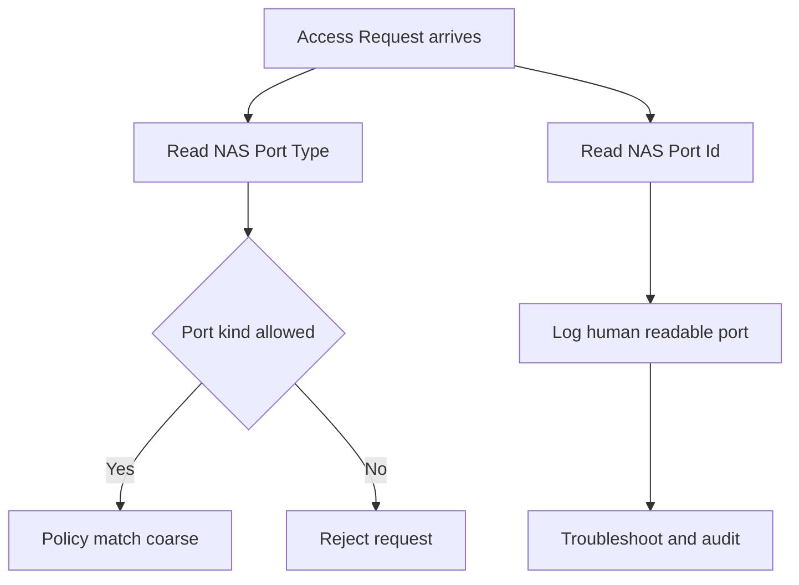

# The NAS-Port-Type and NAS-Port-Id: How the Network Describes the Door

## English

When a NAS sends an Access-Request, it includes a set of attributes that describe not just who is asking, but where they are asking from. Two of the most operationally important are NAS-Port-Type (attribute 61) and NAS-Port-Id (attribute 87). They look similar — both describe a port — but they answer different questions and are used in different ways by policy. Understanding the distinction is essential for writing policies that actually behave the way you intend.

NAS-Port-Type is a numeric enumeration that classifies the kind of connection. RFC 2865 defines a long list: 0 for Async, 5 for Virtual, 15 for Ethernet, 17 for Cable, 18 for Wireless-Other, 19 for Wireless-802.11, and so on. It answers the question "what kind of port is this?" without saying which specific port. A policy like "only allow Ethernet and 802.11, deny everything else" is expressed entirely in terms of NAS-Port-Type. It's a coarse but highly reliable classification, because the NAS knows what kind of interface it is — a switch port is Ethernet, an access point association is Wireless-802.11.

NAS-Port-Id is a string, and its format is vendor-specific. On a Cisco switch it might be "GigabitEthernet1/0/15". On a wireless controller it might be the SSID plus the AP name. On a DSL access concentrator it might be a circuit identifier. The string is meant for humans and for logging — it tells you which physical or logical port the user came in on, which is invaluable when you need to troubleshoot "why is this user on the wrong VLAN?" or "which switch port is flapping?" But because the format is vendor-specific, you cannot safely write a policy that assumes a particular structure unless you control the vendor and the firmware.

A third attribute, NAS-Port (attribute 5), is a numeric identifier of the port within the NAS. It's less useful in modern deployments because the numbering is often arbitrary and not stable across reboots, but it's still present in most Access-Requests. Together, NAS-Port, NAS-Port-Type, and NAS-Port-Id form a triad: the first says "which port number," the second says "what kind of port," and the third says "the port's human-readable name." Policies usually key on NAS-Port-Type for classification and on NAS-Port-Id for logging, and treat NAS-Port as a legacy field.

Why does this matter in practice? Because misusing these attributes is a common source of policy bugs. A policy that tries to match a specific switch port by string-matching NAS-Port-Id will break the moment the vendor changes the format, or when a port-channel renames the interface. A policy that classifies by NAS-Port-Type is stable across vendors because the enumeration is standardized. The right pattern is: use NAS-Port-Type for decisions, use NAS-Port-Id for logs and alerts, and never assume the two carry the same information. That separation is what lets a policy survive a hardware refresh.

## 中文

當 NAS 送出 Access-Request 時，它會附上一組屬性，不只描述「誰在問」，也描述「從哪裡問」。其中兩個在維運上最重要的，是 NAS-Port-Type（屬性編號 61）和 NAS-Port-Id（屬性編號 87）。它們看起來相似——都在描述一個埠——但回答的是不同問題，也被政策以不同方式使用。理解這個區別，對於寫出真正如你所願運作的政策至關重要。

NAS-Port-Type 是一個數值列舉，用來分類連線的種類。RFC 2865 定義了一長串：0 是 Async、5 是 Virtual、15 是 Ethernet、17 是 Cable、18 是 Wireless-Other、19 是 Wireless-802.11，諸如此類。它回答的是「這是哪一種埠？」，而不說「是哪一個具體的埠」。像「只允許 Ethernet 和 802.11，其餘一律拒絕」這樣政策，完全可以用 NAS-Port-Type 來表達。這是一種粗糙但高度可靠的分類，因為 NAS 自己知道介面是什麼型別——交換器埠就是 Ethernet，無線基地臺關聯就是 Wireless-802.11。

NAS-Port-Id 是一個字串，格式由廠商自訂。在 Cisco 交換器上可能是「GigabitEthernet1/0/15」。在無線控制器上可能是 SSID 加上 AP 名稱。在 DSL 存取集中器上可能是電路識別碼。這個字串是給人看的，也是給日誌用的——它告訴你使用者從哪個實體或邏輯埠進來，這在排查「為什麼這個使用者在錯誤的 VLAN？」或「哪個交換器埠在 flapping？」時極其寶貴。但因為格式是廠商自訂的，除非你同時控制廠商和韌體，否則不能安全地寫出假設特定結構的政策。

第三個屬性 NAS-Port（屬性編號 5）是 NAS 內部埠的數值識別碼。它在現代部署中較少用，因為編號往往是任意的，且重開機後不穩定，但大多數 Access-Request 仍然帶著它。合起來，NAS-Port、NAS-Port-Type、NAS-Port-Id 構成三件套：第一個說「哪個埠號」，第二個說「哪種埠」，第三個說「埠的人類可讀名稱」。政策通常以 NAS-Port-Type 做分類、以 NAS-Port-Id 做日誌，並把 NAS-Port 當成遺留欄位。

為什麼實務上重要？因為誤用這些屬性是政策 bug 的常見來源。試圖用字串比對 NAS-Port-Id 來匹配特定交換器埠的政策，會在廠商改變格式的那一刻、或在 port-channel 重新命名介面時失效。用 NAS-Port-Type 分類的政策則跨廠商穩定，因為列舉值是標準化的。正確的模式是：用 NAS-Port-Type 做決策，用 NAS-Port-Id 做日誌與告警，絕不假設兩者攜帶相同資訊。這樣的區分，才能讓政策在硬體汰換後依然存活。

## Key Takeaway

NAS-Port-Type is standardized and safe for policy decisions, while NAS-Port-Id is vendor-specific and belongs in logs — mixing the two is a classic source of brittle RADIUS policy.

## Related Concepts
- NAS-Port-Type enumeration
- RADIUS policy attributes

## Diagram

