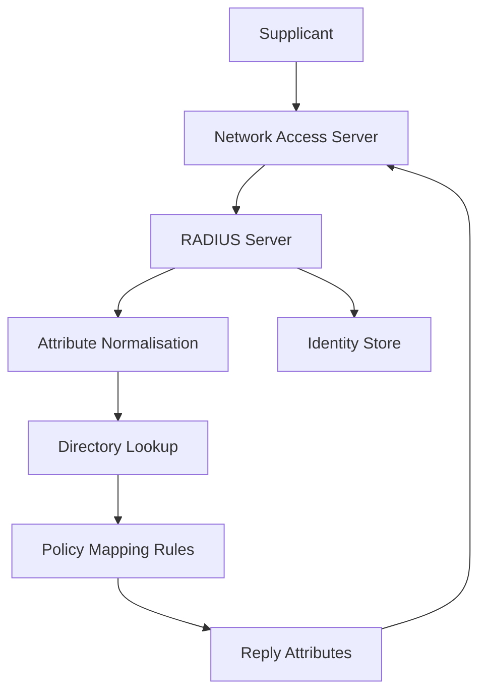

# RADIUS Between Two Worlds: Translating Between Legacy Network Gear and Modern Identity

## English

A RADIUS server almost never sits alone. On one side it faces network access servers (NAS) — switches, wireless controllers, VPN concentrators — that speak a narrow dialect of vendor-specific attributes and expect specific reply attributes in return. On the other side it faces identity stores: LDAP directories, Active Directory, SQL tables, or token services. The RADIUS server's real job, beyond authenticating anyone, is translation. A switch may send a Calling-Station-Id in one format while the directory stores MAC addresses with colons and the policy expects hyphens; a wireless controller may want a Tunnel-Private-Group-Id (the VLAN number) while the directory only knows group names. The server must map one vocabulary into the other.

This translation layer is where most operational pain lives. Consider a typical enterprise: Active Directory stores users in organisational units and groups, but the network team's policy is expressed as VLANs and filter IDs. Someone must decide that membership in the group 'WiFi-Staff' becomes VLAN 20 plus a Filter-Id of 'staff-acl'. That mapping is not in AD and not in the switch — it lives in the RADIUS policy configuration, usually as a series of conditional rules evaluated top to bottom. When a user reports 'I can't get on the network', the fault may be in any of the three layers: the credential, the directory lookup, or the mapping rule that silently fell through to a default.

A second translation problem is attribute normalisation. The User-Name may arrive as 'DOMAIN\alice', 'alice@example.com', or 'alice' depending on the supplicant and the NAS. Before the directory lookup, the server should strip the realm, lowercase the value, and decide which form is canonical. If it does not, the same human being can appear as three different accounts, breaking simultaneous-use counting and audit trails. Similarly, the NAS-IP-Address and NAS-Identifier must be normalised so that client-specific policy (different shared secrets, different VLAN ranges per building) applies reliably.

A third issue is capability mismatch. Modern identity providers increasingly speak SAML or OIDC, which are web-oriented and carry no concept of a NAS port or a VLAN. A RADIUS gateway in front of them must invent the missing attributes — often by looking up the user in a separate authorisation store or by attaching static policy per client. This is why 'just point RADIUS at our IdP' rarely works cleanly: the IdP can say who you are, but only the network side can say which port you are on and what that port should grant.

Practically, treat the RADIUS server as an integration hub. Document every attribute that crosses each boundary, keep the mapping rules in version control, and test with synthetic probes that exercise each mapping path, not just 'does alice authenticate'. When something breaks, ask first which boundary failed: did the NAS send what we expected, did the directory return what we expected, and did the mapping produce the reply the NAS needed?

## 中文

RADIUS 伺服器幾乎不會孤立存在。它一邊面對網路存取伺服器（NAS）——交換機、無線控制器、VPN 集中器——這些裝置講的是一種狹窄的方言，帶著廠商特定的屬性，並且期望收到特定的回覆屬性。另一邊它面對身分存放區：LDAP 目錄、Active Directory、SQL 資料表或權杖服務。RADIUS 伺服器真正的職責，除了驗證身分之外，其實是翻譯。交換機可能用一種格式送出 Calling-Station-Id，而目錄儲存的 MAC 位址用冒號分隔、政策卻期望用連字號；無線控制器可能想要 Tunnel-Private-Group-Id（即 VLAN 編號），而目錄只知道群組名稱。伺服器必須把一套詞彙對映成另一套。

這個翻譯層正是大部分營運痛苦的來源。設想一個典型企業：Active Directory 把使用者存放在組織單位與群組裡，但網路團隊的政策是用 VLAN 與 filter ID 表達的。必須有人決定「WiFi-Staff」群組的成員要變成 VLAN 20 加上 Filter-Id「staff-acl」。這個對映既不在 AD 裡，也不在交換機裡——它存在於 RADIUS 的政策設定中，通常是一連串由上而下評估的條件規則。當使用者回報「我連不上網路」時，故障可能在任何一層：憑證、目錄查詢，或是一條悄悄落到預設值的對映規則。

第二個翻譯問題是屬性正規化。User-Name 可能以「DOMAIN\alice」、「alice@example.com」或「alice」抵達，取決於 supplicant 與 NAS。在目錄查詢之前，伺服器應該剝掉 realm、轉成小寫，並決定哪一種形式是正規形式。若不這樣做，同一個人可能以三個不同帳號出現，破壞同時使用計數與稽核軌跡。同樣地，NAS-IP-Address 與 NAS-Identifier 必須正規化，這樣使用者端特定的政策（不同共享金鑰、每棟樓不同的 VLAN 範圍）才能可靠套用。

第三個問題是能力落差。現代身分提供者愈來愈常講 SAML 或 OIDC，這些是面向網頁的協定，根本沒有 NAS 埠或 VLAN 的概念。放在它們前面的 RADIUS 閘道必須發明缺少的屬性——通常靠查詢另一個授權存放區，或為每個使用者端附加靜態政策。這就是為什麼「把 RADIUS 直接指向我們的 IdP」很少能乾淨運作：IdP 能說你是誰，但只有網路這一側能說你在哪個埠上、那個埠該授予什麼。

實務上，把 RADIUS 伺服器當成整合樞紐。記錄每一個跨越各邊界的屬性，把對映規則放進版本控制，並用合成探測測試每一條對映路徑，而不只是「alice 能不能驗證成功」。出問題時，先問是哪個邊界失敗了：NAS 有沒有送出我們預期的東西、目錄有沒有回傳我們預期的東西、對映有沒有產生 NAS 所需的回覆？

## Key Takeaway

A RADIUS server is fundamentally a translator between the narrow dialect of network gear and the vocabulary of identity stores, and most integration failures happen at those translation boundaries rather than in authentication itself.

## Related Concepts
- Attribute normalisation
- Identity provider integration

## Diagram

