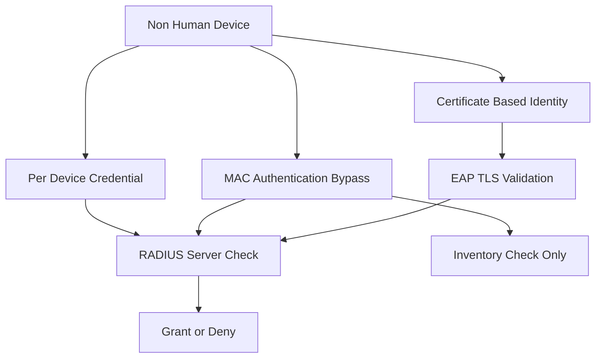

# RADIUS Without a User: Service Accounts, Machine Credentials, and the Non-Human Majority

## English

Most discussions of RADIUS imagine a person typing a password. In real networks, a large share of authentications involve no human at all. Printers, badge readers, IP cameras, hypervisor management interfaces, IoT sensors, and backup appliances all need network access, and many of them cannot run a supplicant, cannot prompt for a password, and sometimes cannot even store a certificate safely. The RADIUS design must account for this non-human majority, and the way it does so has consequences for security that are easy to overlook.

The simplest pattern is a per-device credential: a username and password provisioned on the device, often derived from its serial number or MAC. The RADIUS server then validates it against a local table or the directory. This is convenient but fragile: credentials get copied between devices during cloning, they never rotate, and they usually live in plaintext configuration files. A better pattern is MAC Authentication Bypass (MAB), where the NAS sends the device's MAC address as both User-Name and User-Password (or as Calling-Station-Id) and the server decides based on that. MAB is not authentication in any meaningful sense — MAC addresses are broadcast and trivially spoofed — so it should be treated as an inventory check, not a trust decision, and paired with profiling or port-based segmentation.

A stronger option is certificate-based device identity: each device holds a client certificate issued by an internal CA, and the RADIUS server validates it through EAP-TLS. This gives real cryptographic proof and supports revocation, but it requires certificate lifecycle management — issuance, renewal, and revocation — which is exactly where many deployments quietly fail. A certificate that expires at 3 a.m. can take an entire fleet of sensors offline, and if the device has no way to report the error, the outage looks like a network fault rather than an identity one.

The policy question is subtler than the credential question. For a human, you can ask 'should this person be on the staff VLAN?' For a printer, the right question is 'is this device the printer we think it is, and is it plugged into the port we expect?' A printer that suddenly appears on a different switch port is a signal — it may have been moved legitimately, or it may be an attacker spoofing its MAC. Good RADIUS policy for devices therefore combines the credential with location attributes: NAS-Identifier, NAS-Port-Id, and the switch port's expected role. A mismatch can trigger a restricted VLAN, a quarantine, or an alert rather than a flat accept.

Operationally, treat non-human identities as a first-class inventory. Give each device a unique credential rather than a shared one, rotate where the device supports it, record what it is and where it lives, and monitor for the same identity appearing from two places at once. The goal is not to make a printer as secure as a laptop — it is to make sure you would notice if the printer started behaving like something else.

## 中文

大部分關於 RADIUS 的討論都想像一個人在輸入密碼。但在真實網路中，很大一部分驗證根本不涉及人。印表機、讀卡機、IP 攝影機、hypervisor 管理介面、IoT 感測器與備份裝置都需要網路存取，而它們大多無法執行 supplicant、無法提示輸入密碼，有時甚至無法安全地儲存憑證。RADIUS 的設計必須顧及這群「非人類多數」，而它的做法對安全性有容易被忽略的後果。

最簡單的模式是每臺裝置一組憑證：在裝置上配置使用者名稱與密碼，通常由序號或 MAC 推導而來。RADIUS 伺服器再拿它對照本地表或目錄來驗證。這很方便但很脆弱：裝置複製時憑證會被一起複製、永不輪替，而且通常以明文存在設定檔中。更好的模式是 MAC 認證繞行（MAB），由 NAS 把裝置的 MAC 位址同時當成 User-Name 與 User-Password（或放在 Calling-Station-Id）送出，伺服器據此決定。MAB 在任何有意義的層面上都不算驗證——MAC 位址會被廣播、可輕易偽造——所以應視為盤點檢查而非信任決策，並搭配裝置側寫或埠為基礎的網段隔離。

更強的選項是以憑證為基礎的裝置身分：每臺裝置持有由內部 CA 簽發的使用者端憑證，RADIUS 伺服器透過 EAP-TLS 驗證它。這提供真正的密碼學證明並支援撤銷，但需要憑證生命週期管理——簽發、更新與撤銷——而這正是許多部署悄悄失敗的地方。一張在凌晨三點到期的憑證，可能讓一整批感測器離線；若裝置無法回報錯誤，這場故障看起來像網路問題而不是身分問題。

政策問題比憑證問題更微妙。對人，你可以問「這個人該不該在員工 VLAN？」對印表機，正確的問題是「這臺裝置是不是我們認為的那臺印表機，它有沒有插在我們預期的埠上？」一臺印表機突然出現在不同的交換機埠上是一個訊號——它可能被合法搬動，也可能是攻擊者偽造了它的 MAC。因此良好的裝置 RADIUS 政策會把憑證與位置屬性結合：NAS-Identifier、NAS-Port-Id，以及該交換機埠預期的角色。不匹配時可以觸發受限 VLAN、隔離區或告警，而不是一律接受。

營運上，把非人類身分當成第一級資產清冊。給每臺裝置唯一憑證而非共用憑證，在裝置支援時輪替，記錄它是什麼、在哪裡，並監控同一個身分是否同時從兩個地方出現。目標不是讓印表機跟筆記型電腦一樣安全——而是確保當印表機開始表現得像別的東西時，你會注意到。

## Key Takeaway

Non-human devices make up a large share of RADIUS authentications, and giving each one a unique, location-aware identity is what turns a weak inventory check into a real security signal.

## Related Concepts
- MAC Authentication Bypass
- Certificate-based device identity

## Diagram

