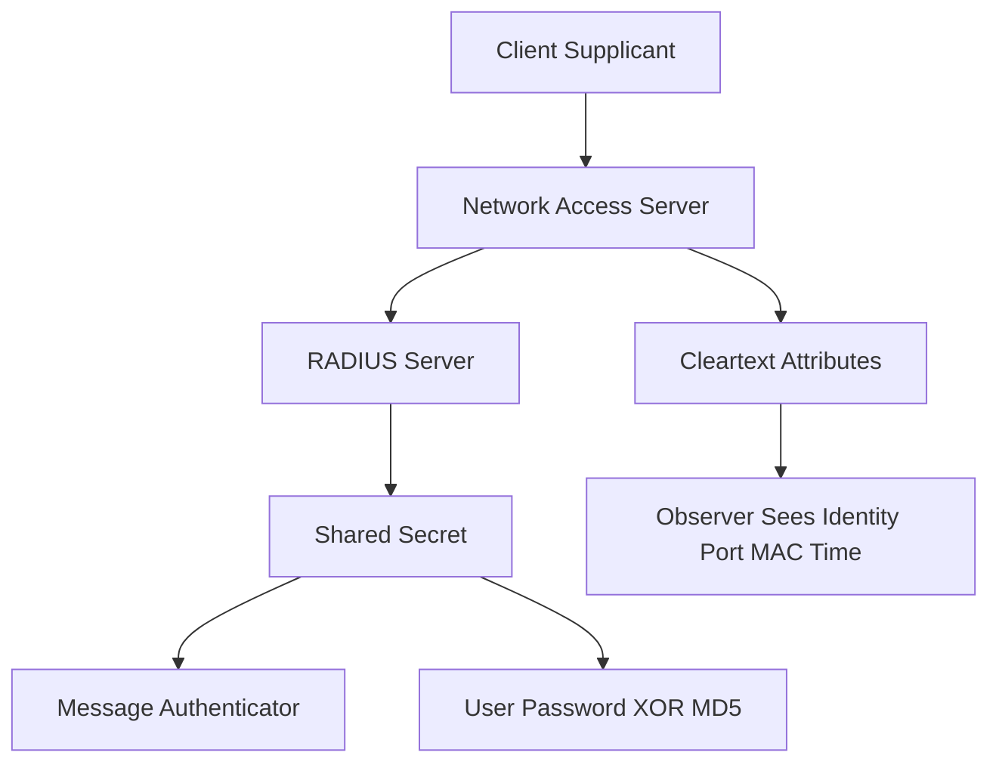

# The Shared Secret Is Not the Only Secret: What RADIUS Leaks Even When It Works

## English

It is tempting to think that because RADIUS packets are protected by a shared secret, the conversation is private. It is not. The shared secret is used to compute a Message-Authenticator and to encrypt the User-Password attribute, but it does not encrypt the rest of the packet. Every other attribute — User-Name, Calling-Station-Id, NAS-IP-Address, NAS-Port-Id, and all the vendor-specific fields — travels in the clear. Anyone who can observe the traffic between the NAS and the RADIUS server sees who is logging in, from which MAC address, on which switch port, and at what time. That is a detailed map of your network's activity, even though no password is exposed.

The User-Password attribute deserves special attention. It is not encrypted with a block cipher in the usual sense; it is obscured by XORing it with an MD5 hash of the shared secret and a request authenticator. This means the protection is only as strong as the shared secret. A short or reused secret — say, the same string across fifty switches, or something guessable like a site name — turns the obscuring into a formality. Worse, an attacker who captures a challenge and a response can attempt offline guesses against the shared secret, because the computation is deterministic given the packet contents. Long, random, per-client secrets are not paranoia; they are the actual security boundary.

Then there is the EAP layer. In EAP-based methods such as PEAP and EAP-TTLS, the inner authentication is protected by TLS, so the password or token exchange inside is genuinely confidential. But the outer identity — the User-Name sent before the TLS tunnel is established — is visible. Many deployments send an anonymous outer identity and the real one inside, which is good practice. Others send the real identity outside, leaking usernames to anyone on the path. The outer realm, if present, also reveals which organisation or domain the user belongs to, which can be useful reconnaissance.

The reply direction leaks too. Attributes such as Tunnel-Private-Group-Id, Filter-Id, and Reply-Message are sent in the clear from server to NAS, so an observer learns which VLAN a user was placed in and what policy was applied. Reply-Message is particularly risky because it is often used for human-readable text that may contain hints about why access was denied — 'account locked', 'password expired', 'unknown user' — which is exactly the kind of information an attacker uses to distinguish a valid account from an invalid one.

The practical conclusion is that RADIUS should be treated as a protocol that needs a protected transport, not one that protects itself. Options include running it inside an IPsec tunnel, on a dedicated management VLAN that ordinary users cannot reach, or over RadSec (RADIUS over TLS), which encrypts the entire conversation including all attributes. Whichever you choose, remember that the shared secret protects integrity and obscures one attribute; it does not make the packet confidential.

## 中文

人們很容易以為，既然 RADIUS 封包受共享金鑰保護，整個對話就是私密的。事實並非如此。共享金鑰用來計算 Message-Authenticator 並加密 User-Password 屬性，但它並不加密封包的其他部分。其他每一個屬性——User-Name、Calling-Station-Id、NAS-IP-Address、NAS-Port-Id，以及所有廠商特定欄位——都以明文傳送。任何能觀察 NAS 與 RADIUS 伺服器之間流量的人，都能看到誰在登入、從哪個 MAC 位址、在哪個交換機埠、在什麼時間。這是一張詳細的網路活動地圖，即使沒有任何密碼被暴露。

User-Password 屬性值得特別注意。它不是用一般意義上的區塊加密法加密，而是把它與共享金鑰和請求 authenticator 的 MD5 雜湊做 XOR 來遮蔽。這意味著保護強度只等於共享金鑰的強度。一個短小或重複使用的金鑰——比如五十臺交換機共用同一個字串，或是像站點名稱這種可猜測的東西——會讓這層遮蔽形同虛設。更糟的是，攻擊者若擷取到挑戰與回應，可以對共享金鑰做離線猜測，因為給定封包內容後這個計算是確定性的。長、隨機、每個使用者端各自的金鑰不是偏執，而是真正的安全邊界。

接著是 EAP 層。在 PEAP 與 EAP-TTLS 這類以 EAP 為基礎的方法中，內層驗證受 TLS 保護，所以裡面交換的密碼或權杖確實是機密的。但外層身分——在 TLS 隧道建立前送出的 User-Name——是可見的。許多部署送出匿名外層身分、把真實身分放在內層，這是好做法。其他部署則把真實身分放在外層，把使用者名稱洩漏給路徑上任何人。外層 realm 若存在，也會透露使用者屬於哪個組織或網域，這對偵察很有用。

回覆方向也會洩漏。Tunnel-Private-Group-Id、Filter-Id 與 Reply-Message 等屬性由伺服器以明文送到 NAS，所以觀察者會得知使用者被放進哪個 VLAN、套用了什麼政策。Reply-Message 特別有風險，因為它常用來放人類可讀的文字，可能包含為何拒絕存取的線索——「帳號已鎖定」、「密碼已過期」、「未知使用者」——而這正是攻擊者用來區分有效帳號與無效帳號的資訊。

實務結論是：RADIUS 應被視為需要受保護傳輸的協定，而不是能自我保護的協定。選項包括把它跑在 IPsec 隧道內、放在一般使用者無法到達的專用管理 VLAN 上，或使用 RadSec（RADIUS over TLS），後者會加密整個對話包括所有屬性。無論選哪一種，記住共享金鑰保護的是完整性並遮蔽一個屬性；它並不讓封包變得機密。

## Key Takeaway

The shared secret protects integrity and obscures only the User-Password attribute, so RADIUS traffic still needs a protected transport such as RadSec, an IPsec tunnel, or a dedicated management VLAN.

## Related Concepts
- RadSec
- EAP outer identity

## Diagram

