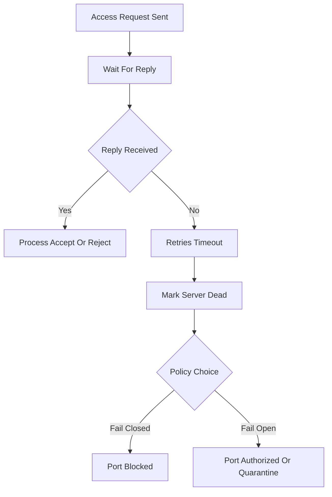

# When RADIUS Is Down: Fail-Open, Fail-Closed, and the Critical Unreachable Policy

## English

Every 802.1X deployment eventually faces the same question: what should a switch or wireless controller do when its RADIUS server stops answering? This is the "critical port" or "unreachable authentication policy" decision, and it is one of the most consequential settings in the entire design. When a NAS (Network Access Server — the switch, WLC, or VPN concentrator acting as the RADIUS client) sends an Access-Request and gets no reply after retries and timeouts, the port is in limbo. The switch must choose: leave the port blocked (fail-closed) or let traffic through unauthenticated (fail-open). Neither answer is universally right, and the choice usually lives on a per-interface or per-SSID basis rather than globally.

Fail-closed is the security default: no server, no access. For a corporate wired port carrying regulated data, that is correct — an outage becomes an availability problem, not a breach. But fail-closed on a voice VLAN means emergency phones stop working, and fail-closed on a wireless SSID means guests and staff lose connectivity the moment the AAA tier hiccups. Fail-open is the availability default: if the server is unreachable, the port is authorised anyway, sometimes into a restricted quarantine VLAN rather than the full production network. That middle path — a fallback VLAN with limited reachability — is often the pragmatic compromise, because it keeps the device online without granting it the keys to everything.

The subtlety is distinguishing "server is down" from "this user failed authentication." A rejected Access-Request (Access-Reject) is a policy decision and must never trigger fail-open; only a genuine unreachable condition should. NAS platforms typically track this via a server-dead timer, marking a RADIUS server unreachable after N consecutive timeouts and optionally re-probing it periodically. If you configure fail-open, you must also ensure the fallback state does not persist silently — a switch that quietly decided to fail-open three weeks ago and never recovered is a security incident nobody noticed.

Operationally, this is where monitoring and design meet. Health probes against the RADIUS servers, alerts on the server-dead transition, and a documented runbook for what fail-open actually grants are all part of the design. In high-security environments, some teams deliberately accept the availability hit of fail-closed and invest instead in making the AAA tier highly available — redundant servers, load balancers, and fast dead detection. The trade-off is explicit: you are choosing which failure you would rather explain.

Finally, remember that fail-open is not binary. You can fail open into a VLAN that reaches only the internet, or only a remediation portal, or only a specific set of internal services. That gives you a defensible middle ground: users stay productive, but the blast radius of an AAA outage stays bounded. Whatever you choose, write it down and test it — pull the RADIUS cable in a lab and watch what the port actually does.

## 中文

每一個 802.1X 部署最終都會面對同一個問題：當 RADIUS 伺服器停止回應時，交換機或無線控制器應該怎麼做？這就是「critical port」或「unreachable authentication policy」的抉擇，也是整個設計中最具影響力的設定之一。當 NAS（Network Access Server，即扮演 RADIUS 客戶端的交換機、無線控制器或 VPN 集中器）發出 Access-Request，經過重試與逾時後仍收不到任何回覆，連線埠就陷入懸而未決的狀態。交換機必須二選一：繼續封鎖連線埠（fail-closed），還是讓流量在未經認證下透過（fail-open）。兩個答案都沒有絕對正確，而且這個選擇通常按介面或按 SSID 分別設定，而非全域統一。

Fail-closed 是安全上的預設：沒有伺服器，就沒有存取。對於承載受規管資料的企業有線連線埠，這是正確的——中斷只是可用性問題，而不是資料外洩。但語音 VLAN 若採用 fail-closed，緊急電話就會失效；無線 SSID 若採用 fail-closed，AAA 層一出狀況，訪客與員工就立即斷線。Fail-open 則是可用性上的預設：伺服器無法觸及時，連線埠照樣授權，有時會放入受限的隔離 VLAN，而非完整生產網路。這條中間路線——可達範圍有限的備援 VLAN——往往是務實的折衷，因為它讓裝置保持上線，卻不給予它通往一切的鑰匙。

微妙之處在於區分「伺服器掛了」與「這位使用者認證失敗」。Access-Reject 是政策決定，絕不應觸發 fail-open；只有真正無法觸及的情況才應該。NAS 平臺通常以 server-dead 計時器追蹤：連續 N 次逾時後把 RADIUS 伺服器標記為不可達，並可選擇定期重新探測。若你設定 fail-open，就必須確保備援狀態不會無聲地持續——某臺交換機三星期前悄悄決定 fail-open 而一直沒有恢復，就是無人察覺的安全事故。

在運維層面，這正是監控與設計交匯之處。對 RADIUS 伺服器做健康探測、在 server-dead 狀態轉換時告警、以及為 fail-open 實際授予什麼許可權撰寫明確的執行手冊，都是設計的一部分。在高安全環境中，有些團隊刻意接受 fail-closed 的可用性代價，轉而投資讓 AAA 層高可用——備援伺服器、負載平衡器、快速 dead detection。取捨是明確的：你在選擇哪一種故障比較容易解釋。

最後要記住，fail-open 並非二元。你可以 fail open 到一個只能上網的 VLAN，或只能連到修復入口網站的 VLAN，或只能連到特定內部服務的 VLAN。這給你一個站得住腳的中間地帶：使用者保持生產力，但 AAA 中斷的爆炸半徑仍然受控。無論你選哪一種，都要寫下來並測試——在實驗室裡拔掉 RADIUS 線纜，看看連線埠實際會怎樣。

## Key Takeaway

Decide explicitly whether your NAS should fail open or fail closed when RADIUS is unreachable, and test that behaviour rather than assuming it.

## Related Concepts
- RADIUS Client Failover and Dead Detection
- VLAN Assignment and the Authorization Decision

## Diagram

