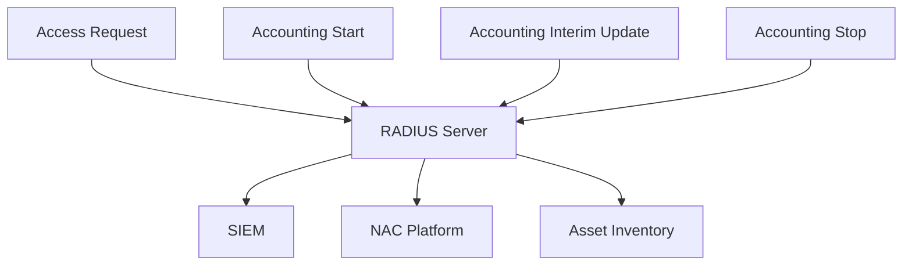

# RADIUS as a Source of Truth: Feeding NAC, SIEM, and Asset Inventories

## English

RADIUS is usually described as a gatekeeper, but it is also a sensor. Every Access-Request, Access-Accept, Access-Reject, and Accounting record is a timestamped observation about who tried to get on the network, from which port, with what result. That stream is valuable far beyond the moment of authentication, and mature environments treat the RADIUS tier as an identity and asset telemetry source that feeds other systems. The same packet that authorises a laptop also tells your SIEM (Security Information and Event Management platform) that a particular MAC address appeared on a particular switch port at 09:14 on a Tuesday.

Accounting records are the richest source. An Accounting-Request with Acct-Status-Type set to Start, Interim-Update, or Stop carries a session identifier, the NAS address, the port, the user name, and byte counters. Interim-Updates in particular turn RADIUS into a near-real-time feed of who is online and how much they are moving. Security teams mine this for impossible-travel patterns (the same user authenticating from two distant buildings within minutes), for devices that authenticate far more often than a human would, and for sessions that never send a Stop record — a sign of a device that vanished, was spoofed, or whose NAS lost contact.

NAC (Network Access Control) and asset inventory platforms consume RADIUS data as a discovery mechanism. If a device authenticates via MAC Authentication Bypass, the RADIUS server sees its MAC address and the switch port it lives on; that observation can be pushed into an inventory system, which then profiles the device and decides what it should be allowed to do next time. Over weeks, the RADIUS logs quietly build a map of the physical network: which ports have devices, which ports are empty, which MAC addresses move around. That map is difficult to obtain any other way at scale.

There is an important privacy and governance dimension. RADIUS records can reveal employee location and working hours at fine granularity, and the user name is often a real identity. Retention policies, access controls on the log store, and clear statements about what is collected and why are not optional extras — they are part of running the system responsibly. Some organisations hash or truncate identifiers in the SIEM feed while keeping full fidelity in the AAA system itself, so investigations remain possible without turning the log platform into a surveillance tool.

Practically, integrating RADIUS with downstream systems means deciding on a transport (syslog, a streaming pipeline, or direct database export), normalising the fields (different NAS vendors populate attributes differently), and handling volume — a large campus can produce millions of accounting records per day. The design question is not whether to export, but what each consumer actually needs: the SIEM wants anomalies, the inventory wants first-seen and last-seen, and the capacity team wants byte counters per port. Feeding each the right slice keeps the pipeline manageable and the privacy exposure minimal.

## 中文

RADIUS 常被形容為守門人，但它同時也是感測器。每一筆 Access-Request、Access-Accept、Access-Reject 與 Accounting 記錄，都是關於「誰在何時、從哪個連線埠、以什麼結果嘗試上網」的時間戳觀察。這股資料流的價值遠超認證那一刻，成熟的環境會把 RADIUS 層視為身分與資產遙測來源，餵養其他系統。授權一部筆記型電腦的那個封包，同時也告訴你的 SIEM（Security Information and Event Management，安全資訊與事件管理平臺）：某個 MAC 位址在星期二 09:14 出現在某臺交換機的某個連線埠上。

Accounting 記錄是最豐富的來源。Acct-Status-Type 設為 Start、Interim-Update 或 Stop 的 Accounting-Request，會攜帶工作階段識別碼、NAS 位址、連線埠、使用者名稱與位元組計數。Interim-Update 尤其把 RADIUS 變成近乎即時的「誰線上、流量多少」資料流。安全團隊從中挖掘不可能旅行模式（同一使用者在數分鐘內從兩棟相距遙遠的大樓認證）、認證頻率遠高於人類的裝置，以及從未送出 Stop 記錄的工作階段——那代表裝置消失、被偽冒，或 NAS 失去聯絡。

NAC（Network Access Control，網路存取控制）與資產盤點平臺把 RADIUS 資料當作發現機制。若裝置透過 MAC Authentication Bypass 認證，RADIUS 伺服器會看到它的 MAC 位址與所在交換機連線埠；這項觀察可推送至盤點系統，由系統為裝置建立側寫，並決定它下次應被允許做什麼。數週之後，RADIUS 日誌便悄悄建構出實體網路的地圖：哪些連線埠有裝置、哪些是空的、哪些 MAC 位址在移動。這種地圖在規模化之下幾乎沒有其他取得方式。

這裡有重要的隱私與治理面向。RADIUS 記錄能以極細的粒度揭露員工位置與工作時段，而使用者名稱往往就是真實身分。保留政策、日誌儲存的存取控制，以及清楚說明收集什麼、為何收集，都不是可有可無的附加項——它們是負責任地執行系統的一部分。有些組織在 SIEM 資料流中雜湊或截斷識別碼，同時在 AAA 系統本身保留完整資料，讓調查仍有可能，而不會把日誌平臺變成監控工具。

實務上，把 RADIUS 與下游系統整合，意味著要決定傳輸方式（syslog、串流管線或直接資料庫匯出）、正規化欄位（不同 NAS 廠商填寫屬性的方式各異），以及處理資料量——大型校園每天可產生數百萬筆 accounting 記錄。設計問題不是要不要匯出，而是每個消費者實際需要什麼：SIEM 要異常、盤點要首次與最後出現時間、容量團隊要每個連線埠的位元組計數。餵給各方正確的切片，可讓管線易於管理，也把隱私暴露降到最低。

## Key Takeaway

Treat RADIUS logs and accounting records as valuable telemetry for security, inventory, and capacity, with explicit privacy controls around who can see them.

## Related Concepts
- The Accounting Session: Start, Interim-Update, and Stop as a Lifecycle Record
- Logging, Auditing, and Privacy: What RADIUS Records and What It Must Not

## Diagram

