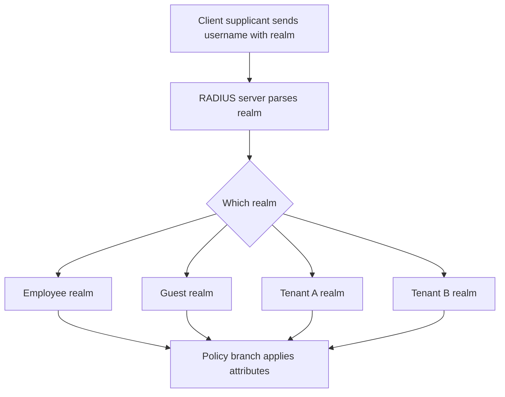

# RADIUS in a Multi-Tenant or Guest World: Realms, Tenants, and Delegated Administration

## English

A single RADIUS server often serves more than one population: employees, guests, contractors, IoT devices, and sometimes entirely separate organisations sharing a building or a managed service. The mechanism that lets one server handle many populations without turning into a mess is the realm — the part of the user name after the @ sign, or a prefix before a backslash, that names which policy domain a request belongs to. Realms are not just cosmetic; they are the primary routing key inside a multi-tenant RADIUS design.

Consider a managed office building where three companies share the wireless infrastructure. The building operator runs the RADIUS server and the access points, but each tenant has its own identity store. Users authenticate as alice@tenantA.example or bob@tenantB.example. The RADIUS server parses the realm, routes tenantA requests to tenantA's identity backend, tenantB requests to tenantB's, and applies a different set of authorisation attributes to each — different VLANs, different session timeouts, different bandwidth profiles. The realm is the seam that lets one physical infrastructure serve many logical networks.

Guest access is a special case of the same idea. Guests typically land in a dedicated realm (or a dedicated SSID that maps to one), authenticate against a captive portal or a sponsor-approval workflow, and receive tightly scoped authorisation: a quarantine VLAN, a bandwidth cap, and a session timeout measured in hours. The RADIUS server may also enforce simultaneous-use limits per guest account so a single voucher cannot be shared across a dozen devices. All of this is expressed through the same attributes as employee access, just with different values and a different policy branch.

Delegated administration is the harder half. If tenantA's IT team is allowed to add and remove its own users, you need a way to give them that control without giving them the keys to the whole AAA system. Common patterns include a self-service portal that writes to a scoped identity store, per-realm administrative accounts in the RADIUS server, and strict separation so that a tenant administrator cannot see or modify another tenant's users or policies. The realm boundary becomes a security boundary, and it must be enforced in the configuration, not just in the documentation.

Operationally, multi-tenant RADIUS demands careful naming, logging, and capacity planning. Logs must record the realm so that investigations can be scoped to the right tenant; shared secrets should be per-NAS and ideally per-tenant where the infrastructure allows it; and accounting data must be partitioned so one tenant cannot infer another's activity from byte counters. Done well, a single RADIUS tier can serve a whole building or a whole service provider portfolio. Done poorly, it becomes a single point of failure and a single point of data leakage at the same time.

## 中文

單一 RADIUS 伺服器往往要服務多個群體：員工、訪客、承辦商、IoT 裝置，有時甚至是共用一棟大樓或託管服務的完全獨立組織。讓一臺伺服器處理眾多群體而不致一團混亂的機制就是 realm——使用者名稱中 @ 之後的部分，或反斜線之前的字首，用來標明請求屬於哪個政策網域。Realm 不只是裝飾，它是多租戶 RADIUS 設計中的主要路由鍵。

設想一棟由三家公司共用無線基礎設施的託管辦公大樓。大樓營運商執行 RADIUS 伺服器與存取點，但每個租戶有自己的身分儲存。使用者以 alice@tenantA.example 或 bob@tenantB.example 認證。RADIUS 伺服器解析 realm，把 tenantA 的請求路由到 tenantA 的身分後端、tenantB 的請求路由到 tenantB 的，並對兩者套用不同的授權屬性組合——不同 VLAN、不同工作階段逾時、不同頻寬設定檔。Realm 就是讓一套實體基礎設施服務多個邏輯網路的接縫。

訪客存取是同一概念的特例。訪客通常落在專屬 realm（或對應到專屬 realm 的專屬 SSID），透過擷取入口網站或贊助者審批流程認證，並獲得嚴格限縮的授權：隔離 VLAN、頻寬上限、以小時計的工作階段逾時。RADIUS 伺服器亦可對每個訪客帳號強制 simultaneous-use 上限，使單一兌換券無法在十幾臺裝置上共用。這一切與員工存取使用相同的屬性表達，只是值不同、政策分支不同。

委派管理是較難的一半。若 tenantA 的 IT 團隊被允許自行新增與移除使用者，你需要一種方式給予他們這種控制權，而不把整個 AAA 系統的鑰匙交給他們。常見模式包括：寫入限定範圍身分儲存的自助入口網站、RADIUS 伺服器中按 realm 劃分的管理帳號，以及嚴格隔離，使某租戶管理員無法看到或修改另一租戶的使用者或政策。Realm 邊界成為安全邊界，而且必須在設定中強制執行，不能只寫在檔案裡。

在運維上，多租戶 RADIUS 要求謹慎的命名、日誌與容量規劃。日誌必須記錄 realm，讓調查能限定在正確租戶；共享金鑰應按 NAS 區分，基礎設施允許時最好按租戶區分；accounting 資料必須分割槽，使某租戶無法從位元組計數推斷另一租戶的活動。做得好，單一 RADIUS 層可服務整棟大樓或整個服務供應商的客戶群；做得差，它同時成為單一故障點與單一資料外洩點。

## Key Takeaway

Use realms as the routing and security boundary when one RADIUS tier must serve multiple populations, and enforce tenant separation in configuration and logging, not just in policy documents.

## Related Concepts
- Forwarding, Realms, and Failover: Building a RADIUS Proxy Tier
- RADIUS Proxy: Scaling Across Multiple Organizations

## Diagram

