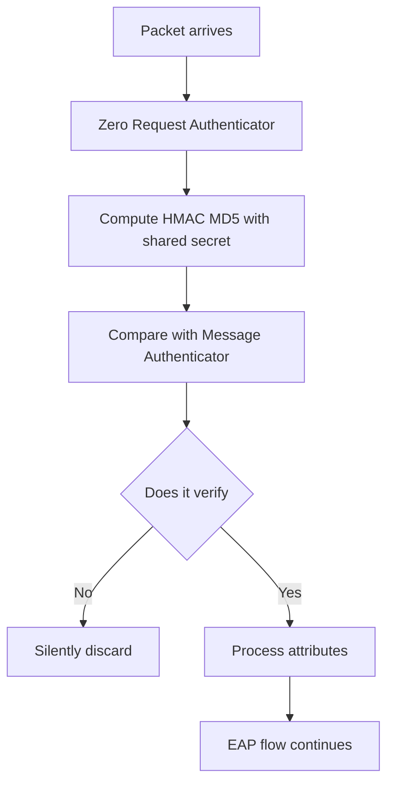

# Message-Authenticator: The Attribute That Stops Blinded Forgery

## English

Classic RADIUS protects a request with a 16-byte shared secret in a way that is easy to misunderstand: the Request Authenticator is a random nonce, and the server proves it knows the secret by recomputing an MD5 hash over the packet plus the secret and comparing the result. That works for integrity, but it leaves a hole. In a plain Access-Request, the only attribute whose integrity is tied to the secret is the User-Password attribute, which is XORed with an MD5 stream derived from the secret and the Request Authenticator. Every other attribute — User-Name, Calling-Station-Id, NAS-IP-Address, EAP-Message — travels in the clear and is not covered by any signature. An attacker who can observe traffic cannot read the password, but can flip bits in other attributes, and in some flows can mount a response forgery attack by exploiting how the Response Authenticator is computed.

The fix is an attribute called Message-Authenticator, defined in RFC 3579 for EAP over RADIUS and later made mandatory in more contexts by RFC 5080 and RFC 6158. It carries an HMAC-MD5 (in practice; the field is 16 bytes) computed over the entire packet with the shared secret as the key and the Request Authenticator zeroed out during computation. Because it covers the whole packet, changing any attribute — including ones the older scheme left unprotected — invalidates the HMAC. If a NAS or server receives a packet with a Message-Authenticator that does not verify, it must silently discard it, not reply with a rejection, so an attacker cannot use error responses as an oracle.

A subtlety worth knowing: the attribute is required on Access-Request packets that carry EAP-Message, and required on Access-Challenge, Access-Accept, and Access-Reject in EAP flows. In non-EAP flows it is optional in the standards but strongly recommended, and many deployments enforce it with a policy rule that drops any Access-Request lacking it. This is exactly the kind of thing a hardening checklist should contain: check that every RADIUS client is configured to send Message-Authenticator, and check that the server rejects packets without it. Otherwise a mixed fleet quietly keeps the old, weaker path alive.

Why does this matter beyond theory? Because RADIUS often runs over networks where an attacker has some visibility — a shared Wi-Fi segment, a management VLAN, a cloud VPC where a compromised instance can sniff. Without Message-Authenticator, an on-path attacker can potentially alter attributes like Tunnel-Type or Tunnel-Private-Group-Id in a reply, or replay a captured Access-Accept to a different session, depending on which fields are covered. With it, tampering is detected before policy is applied. The attribute is small, easy to overlook, and one of the highest-leverage hardening steps available.

One operational caveat: HMAC-MD5 is not broken as a MAC in the way MD5 is broken as a collision-resistant hash, but it is old, and some modern guidance prefers stronger primitives. RadSec (RADIUS over TLS) sidesteps the issue entirely by wrapping the whole conversation in TLS, where integrity and confidentiality are handled by modern ciphers. In practice, the sensible posture is: enable Message-Authenticator everywhere as a baseline, and migrate sensitive paths to RadSec where the transport itself is untrusted.

## 中文

傳統 RADIUS 用 16 bytes 的 shared secret 保護請求，但箇中機制很容易被誤解：Request Authenticator 是一個隨機 nonce，伺服器透過對整個封包加上 secret 重新計算 MD5 雜湊，再與收到的值比對，藉此證明自己知道 secret。這樣做對完整性有效，卻留下一個缺口。在普通的 Access-Request 裡，唯一與 secret 綁定完整性的屬性是 User-Password，它會與由 secret 及 Request Authenticator 衍生的 MD5 金鑰流做 XOR。其他所有屬性——User-Name、Calling-Station-Id、NAS-IP-Address、EAP-Message——都以明文傳送，不受任何簽章保護。能觀察流量的攻擊者雖然讀不到密碼，卻可以竄改其他屬性的位元；在某些流程中，更可透過利用 Response Authenticator 的計算方式，發動偽造回應的攻擊。

補救方法是一個叫 Message-Authenticator 的屬性，最早在 RFC 3579 為 EAP over RADIUS 定義，後來在 RFC 5080 與 RFC 6158 中被擴大為更多情境下的必要項。它攜帶一個以 shared secret 為金鑰、對整個封包（計算時將 Request Authenticator 歸零）計算出的 HMAC-MD5（實務上如此；欄位為 16 bytes）。由於它覆蓋整個封包，任何屬性的改動——包括舊機制未保護的那些——都會令 HMAC 驗證失敗。若 NAS 或伺服器收到 Message-Authenticator 驗證不通過的封包，必須靜默丟棄，而不是回一個拒絕，這樣攻擊者就無法把錯誤回應當成預言機（oracle）來利用。

有一個值得注意的細節：凡是攜帶 EAP-Message 的 Access-Request，以及 EAP 流程中的 Access-Challenge、Access-Accept、Access-Reject，都必須帶上這個屬性。在非 EAP 流程中，標準上它是選項，但強烈建議啟用，許多部署更以政策規則直接丟棄任何缺少它的 Access-Request。這正是 hardening checklist 應該包含的東西：確認每個 RADIUS client 都設定送出 Message-Authenticator，並確認伺服器會拒絕缺少它的封包。否則一個混合新舊設定的環境，會悄悄保留舊的、較弱的路徑。

為何這在理論以外也重要？因為 RADIUS 經常跑在攻擊者有一定可視度的網絡上——共享 Wi-Fi 網段、管理 VLAN、或某個被入侵的執行個體可以嗅探的雲端 VPC。沒有 Message-Authenticator 時，路徑上的攻擊者可能改動回應中的 Tunnel-Type 或 Tunnel-Private-Group-Id，或視乎哪些欄位受保護，把截獲的 Access-Accept 重播到另一個 session。有它，竄改會在政策套用之前被偵測到。這個屬性細小、容易被忽略，卻是最高槓桿的強化步驟之一。

一個營運上的注意事項：HMAC-MD5 並沒有像 MD5 作為抗碰撞雜湊那樣被攻破，但它已經老舊，部分現代指引傾向更強的基礎原件。RadSec（RADIUS over TLS）完全繞開這個問題，把整個對話包在 TLS 裡，由現代密碼套件負責完整性與機密性。實務上穩妥的姿態是：把 Message-Authenticator 在所有地方當作基線啟用，並在傳輸本身不可信的敏感路徑上遷移到 RadSec。

## Key Takeaway

Message-Authenticator is an HMAC over the whole RADIUS packet that closes the gap left by the older per-attribute scheme, and enforcing it everywhere is one of the cheapest real security wins in a RADIUS deployment.

## Related Concepts
- Shared secret
- RADIUS packet integrity

## Diagram

