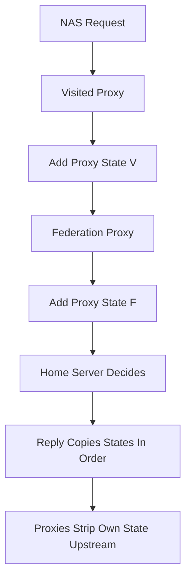

# The Proxy-State Attribute: How RADIUS Remembers Its Own Path

## English

When a RADIUS request passes through one or more proxies before reaching the server that actually decides, the reply has to find its way back along the same chain. RADIUS is stateless UDP, so there is no connection to follow; the protocol has to carry its own return address. The mechanism is a simple, clever attribute called Proxy-State. Each proxy that forwards a request appends a Proxy-State attribute containing whatever opaque data it needs to correlate the reply with the original request — a session token, an index, a pointer to in-memory state. The downstream server is required to copy every Proxy-State attribute it receives, unchanged and in the same order, into its reply. Each proxy strips the Proxy-State it added, reads it, and forwards the rest upstream.

The rules around ordering are strict for a reason. RFC 2865 says the server must copy Proxy-State attributes into the response in the same order they appeared in the request, and proxies must not reorder them. If a proxy appends a new Proxy-State on the way out, it appears after the ones already present, so unwinding works like a stack: the last one in is the first one stripped on the way back. This is why a proxy must never modify or reorder existing Proxy-State attributes — doing so breaks correlation for every hop upstream and produces the classic symptom of replies going to the wrong session or being silently dropped.

A concrete example: a university's eduroam-style roaming setup has a home RADIUS server, a national federation proxy, and a visited-site proxy. A student from another institution associates to a local access point; the local NAS sends the request to the visited proxy, which appends Proxy-State and forwards to the federation proxy, which appends its own and forwards to the home server. The home server authenticates, copies both Proxy-State attributes into the Access-Accept, and sends it back. The federation proxy strips its own, the visited proxy strips its own, and the NAS receives a clean reply. If any hop strips the wrong one or reorders them, the chain breaks.

There is an important operational consequence: Proxy-State is opaque to everyone except the proxy that created it, so it cannot be used for diagnostics by third parties, and it must not be logged as if it were meaningful. It also means that a proxy's in-memory state matters — if the proxy restarts between request and reply, the Proxy-State it receives back references state that no longer exists, and the reply is discarded. This is one reason proxy tiers are usually built to be stateless where possible, or to keep short-lived state with generous timeouts.

Finally, Proxy-State interacts with security. Because it is copied verbatim and is not covered by the shared secret in the same way as the Request Authenticator, a proxy must be trusted not to leak or forge it. It is also one of the reasons RadSec is attractive for proxy chains: wrapping each hop in TLS means the Proxy-State and everything around it is protected in transit, and each hop authenticates its peer with a certificate rather than a shared string. When you read a RADIUS debug log and see Proxy-State appearing and disappearing, you are watching the protocol's own breadcrumb trail unwind.

## 中文

當一個 RADIUS 請求在到達真正做決定的伺服器之前，要先穿過一個或多個 proxy，回應就必須沿著同一條鏈回到原處。RADIUS 是無狀態的 UDP，沒有連線可以跟隨，所以協定必須自帶回程地址。機制是一個簡單而巧妙的屬性，叫 Proxy-State。每個轉發請求的 proxy 都會附加一個 Proxy-State 屬性，裡面裝著它用來把回應與原請求對應起來的不透明資料——可能是 session token、索引，或指向記憶體狀態的指標。下游伺服器被要求把它收到的每一個 Proxy-State 屬性，原封不動、依相同次序複製到回應中。每個 proxy 再把自己加上的那個剝掉、讀取，然後把其餘的往上游轉發。

關於次序的規則之所以嚴格，是有原因的。RFC 2865 規定伺服器必須依請求中出現的次序，把 Proxy-State 屬性複製到回應，而 proxy 不得重新排序。如果一個 proxy 在往外送時附加新的 Proxy-State，它會排在已有的那些之後，所以解開的過程就像堆疊：最後放進去的，最先在回程被剝掉。這就是為何 proxy 絕不可修改或重排既有的 Proxy-State 屬性——這樣做會破壞每一個上游 hop 的對應關係，產生「回應送到錯誤 session」或「被靜默丟棄」這類典型症狀。

一個具體例子：某大學的 eduroam 式漫遊架構，有 home RADIUS 伺服器、全國聯盟 proxy，以及訪客站點 proxy。來自另一院校的學生連上本地 access point；本地 NAS 把請求送到訪客 proxy，它附加 Proxy-State 後轉發到聯盟 proxy，聯盟 proxy 再附加自己的並轉發到 home 伺服器。home 伺服器完成認證，把兩個 Proxy-State 屬性複製進 Access-Accept 並送回。聯盟 proxy 剝掉自己的，訪客 proxy 剝掉自己的，NAS 就收到乾淨的回應。若任何一個 hop 剝錯或重排，鏈就斷了。

有一個重要的營運後果：Proxy-State 對建立它以外的所有人都是不透明的，所以第三方不能用它來做診斷，也不應把它當成有意義的資料記錄下來。這也意味著 proxy 的記憶體狀態很重要——如果 proxy 在請求與回應之間重啟，它收回的 Proxy-State 就指向已不存在的狀態，回應會被丟棄。這是為何 proxy 層通常盡量設計成無狀態，或只保留短暫狀態並給予寬裕的逾時。

最後，Proxy-State 與安全性有互動。由於它被原樣複製，而且不像 Request Authenticator 那樣受 shared secret 保護，proxy 必須被信任不會洩漏或偽造它。這也是為何 RadSec 對 proxy 鏈特別有吸引力：把每個 hop 包在 TLS 裡，意味著 Proxy-State 及其周圍的一切在傳輸中都受保護，每個 hop 用憑證而非共享字串來認證對端。當你讀 RADIUS debug log，看到 Proxy-State 出現又消失，你看到的正是協定自己的麵包屑路徑在解開。

## Key Takeaway

Proxy-State is the opaque, order-sensitive breadcrumb each RADIUS proxy appends so replies can unwind back through the chain, and respecting its ordering rules is what keeps multi-hop authentication working.

## Related Concepts
- RADIUS proxy chains
- Attribute ordering rules

## Diagram

